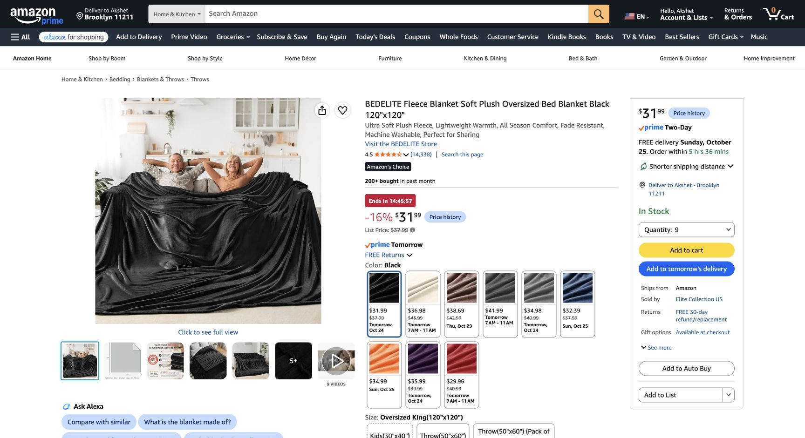

# Amazon black fleece replacement — October 23, 2026

**Recommended alternative, not purchased or physically tested.** Host asks for Amazon black fleece sufficient for all walls with pleating, delivery by October 27, whole decor around $1,600. This is **finished oversized fleece blankets used/cut as fabric**, not raw polar-fleece yardage or ready-made curtains. That construction/finish difference is explicit; host has not separately confirmed this exact SKU.

## Exact recommended offer

[BEDELITE Fleece Blanket Soft Plush Oversized Bed Blanket, **Black / Oversized King 120 × 120 inches**, ASIN **B0BJ238J66**](https://www.amazon.com/dp/B0BJ238J66).

- **Buy quantity nine**, each individually 120 × 120 in. **$31.99 each / $287.91 merchandise** at the displayed limited-time deal. List price shown $37.99; no coupon/subscription/used offer counted. No guarantee the displayed deal applies indefinitely or survives checkout.
- Signed-in Chrome, October 23, America/New_York (EDT, UTC−04:00), existing Brooklyn 11211 location: selected **quantity 9**, buy box displayed **In Stock, FREE delivery Sunday October 25**, Amazon ships / Elite Collection US sells. This meets the requested October 27 date **as a live estimate**, not a reservation, order or receipt guarantee. Quantity 8 had shown October 26; use the **quantity-nine buy box**, not stale variant thumbnails advertising single-unit October 24.
- Product title/size selector and details confirm Black, 120 × 120 in. Listing describes double-sided brushed polyester flannel fleece. **GSM/thickness are unspecified**; do not carry over FabricDirect's 280-GSM rating. Detail table lists **6.29 lb/item**, subject to received weight. Photos show plush nap with sheen; not a verified matte theatrical cloth, blackout fabric or rated acoustic treatment.
- No address entry, cart addition, checkout, purchase or seller message. Only product quantity selector changed. [Screenshot](../../research/amazon-fleece-nine-offer-2026-10-23.png) shows exact product, quantity nine, price and October 25 offer. Account header contains only the host name/ZIP, no exact address/payment/order information.

## Coverage and cost

[Current cut plan](02-shopping-and-sample.md): **seven blankets for walls**, about **1.5× fullness** on main runs, using conservative 118-in usable width / 117-in drop; **one for bed/desk** and **one for full-panel trial, header, Guardian/tub and reserve**. No horizontal joins across wall drops; vertical edges overlap. Nine blankets total 900 sq ft nominal, approximately 62 yd of 58-in-wide cloth by area; this is not a claim that they form a continuous bolt.

Retain four fabric-hook packs / 56 hooks and three binder-clip packs / 72 clips. New cut plan starts with **49 wall/header points**, including six across each widest panel. Full-size mounting/grip/sag/opacity/removal trial is still required. Material weight/finish differ from old fleece; no certified mounting system or acoustic performance claimed.

| Cash component | Current USD |
|---|---:|
| Nine fleece blankets at $31.99 | 287.91 |
| Other product rows, unchanged | 934.05 |
| **All merchandise** | **1,221.96** |
| Local/reuse allowances | 105.00 |
| 9% planning tax on aggregate | 119.43 |
| Shipping reserve retained | 60.00 |
| Existing contingency | 30.48 |
| **Whole-decor envelope** | **1,536.87** |
| Headroom below $1,600 beyond included contingency | 63.13 |

If all nine cost the displayed **$37.99 list price**, the same model is **$1,595.73** including reserves. That is a scenario, not a guaranteed future price. Actual checkout tax/required supports can change either total. No need to remove the rug, moss or either retained LED lighting product. $25 stage-light-support allowance remains unresolved and does not become adequate merely because fabric is sourced.

## Raw-yardage offers checked and not recommended

| Exact offer | Displayed evidence | Why excluded |
|---|---|---|
| [SY Fabrics 10-yd black anti-pill polar fleece B07CZMWRKF](https://www.amazon.com/dp/B07CZMWRKF) | $79.50 / 10 yd, In Stock, **November 2**, syfabrics ships/sells | Misses date. Six units / 60 yd would also be $477 before tax |
| [Pico Textiles 10-yd black solid fleece B0B1GFXH2T](https://www.amazon.com/dp/B0B1GFXH2T) | Search offer $99.95, **November 2** | Late and costly; not a full-quantity checkout check |
| [Yukon black fleece 12-yd bolt B07KCLN73N](https://www.amazon.com/dp/B07KCLN73N) | Live product $120, only 12 left, Oct 29–Nov 2 free or fastest **Oct 27**, AD FABRIC | Five units / 60 yd = $600 before any express charge; does not fit existing $1,600 plan |
| FabricDirect 54-yd old proposal / Big Z backup | [Earlier stock/shipping evidence](../../research/final-offer-check-2026-10-23.md) | Stock/deadline uncertainty and Big Z shipping; replaced in recommended basket, not added as extra cloth |

The inexpensive search results mixed in cotton muslin, tiny fleece craft squares and felt. None was relabeled as full-width black fleece. Main online recommendation is the exact nine-blanket variant above.
