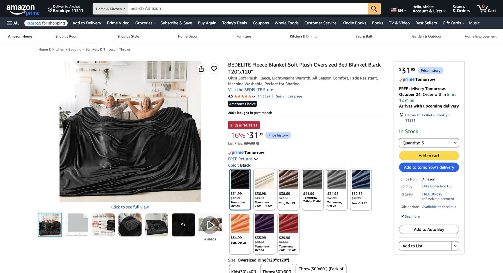

# Flat fleece walls and thin furniture cloth — October 23, 2026

**October 27 update:** quantities/cuts remain; [current prices, delivery and value options](../../research/price-refresh-and-value-plan-2026-10-27.md) and [current basket](../../shopping-ready.md) supersede the October 23 offers/totals below. No purchases.

**Confirmed host:** no pleating needed for fleece blankets; use cheaper thinner fabric for furniture covers. This supersedes the gathered nine-blanket proposal. All-wall/window black fleece coverage, larger rug and laser-free lighting retained. Exact products recommended, not purchased or physically tested.

## Live Amazon offers

Checked October 23 in signed-in Chrome, America/New_York (EDT / UTC−04:00), existing Brooklyn ZIP 11211. No exact address entered, cart addition, purchase or message.

| Exact product / selected variant | Buy quantity | Price USD | Live stock / displayed delivery |
|---|---:|---:|---|
| [BEDELITE **Black / Oversized King 120 × 120-in fleece**, B0BJ238J66](https://www.amazon.com/dp/B0BJ238J66) | **5 blankets** | **31.99 each / 159.95 total** | **Quantity five selected**, In Stock, free **October 24**, Amazon ships / Elite Collection US sells |
| [Utopia Kitchen **Black / 2 Pack 90 × 132-in polyester tablecloths**, B0854M59WT](https://www.amazon.com/dp/B0854M59WT) | **1 two-pack** | **21.84/pack** | New one-time offer, quantity one pack, In Stock, free **October 24**, Amazon ships / Utopia Brands sells |
| **All black fabric** | Five fleece + two thin cloths | **181.79** | Estimates meet October 27 target; no reserved shipment or guaranteed arrival |

Fleece remains brushed polyester with some sheen in photos, unspecified GSM/thickness and listed 6.29-lb whole-blanket weight. Thin covers are listed **100% polyester**, not plastic or fleece. Select the new $21.84 tablecloth offer, not used $14.94. Utopia displayed list $22.99; fleece list $37.99. No coupon/subscription/used offer counted.

## Quantities and price effect

[Flat cut plan](02-shopping-and-sample.md): five fleece sources make eleven full-height wall pieces and three small door-header pieces. Main panels hang flat with small vertical overlaps, not 1.5× gathering. No horizontal joins in full-height walls. Header comes from full-height side offcuts; **no extra reserve blanket** is ordered. Use one whole blanket for mounting trial first, then cut that same blanket.

Thin cloth 1 covers the stored bed; thin cloth 2 supplies the desk U-skirt, Guardian body and dry-tub base. [Furniture nesting](02-shopping-and-sample.md#thin-furniture-covers) protects these material allocations; dimensions/opacity/handling remain actual receipt checks.

Keep four fabric-hook packs / 56 hooks and three binder-clip packs / 72 clips until the real trial. Starting plan **43 wall/header points**, including six across the widest panels. Reduced cloth area does not establish hook/clip/substrate suitability. This retains 13 spare hooks and 23 spare clips after six desk clips. Fleece + proposed wall mounts = **$236.96**, or **$258.80** including thin covers, before tax/shipping.

| Cash component | USD |
|---|---:|
| Five fleece blankets | 159.95 |
| One thin-cover two-pack | 21.84 |
| Other products, unchanged | 934.05 |
| **All merchandise** | **1,115.84** |
| Local/reuse allowances | 105.00 |
| 9% aggregate planning tax, rounded | 109.88 |
| Shipping reserve | 60.00 |
| Existing contingency | 30.48 |
| **Whole-decor envelope** | **1,421.20** |
| Headroom below approximately $1,600, beyond included contingency | 178.80 |

Previous nine fleece were $287.91: new fabric $181.79 saves **$106.12 before tax**, **$115.67** on the aggregate whole-plan model ($1,536.87 → $1,421.20). At displayed list prices for both new fabrics, same model **$1,455.15**; future checkout prices are not guaranteed. Other product prices retain earlier dated checks. $25 stage-light support allowance is still unresolved, not a quoted adequate rig. No budget allocated twice or purchase authorized.

The earlier $95.97 three-blanket / $127.96 four-blanket comparisons were partial/flat wall-run estimates. **Five is the recommended complete wall/header quantity**, with thin furniture cloth separate. No claim that $100 now buys complete room coverage, mounting and furniture cloth.
