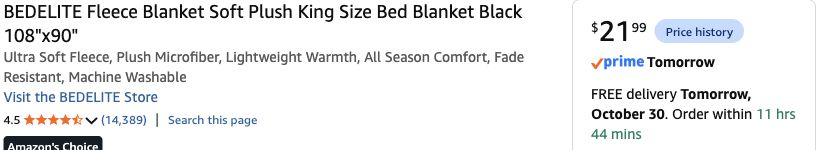

# Partial black fleece at approximately 100-in wall height — October 29, 2026

**Latest mounting correction October 29:** [King listing 3.66 lb /fewer hooks](09-hook-count-2026-10-29.md). Use 3 per blanket to start,4 if needed; two 14-hook packs / 28 hooks supply 18–24 points with 4–10 spare for six ordered blankets. Earlier 36-point/ 42-hook allocation is historical. Purchase status/cloth cuts unchanged.

**Purchase supersession, later October 29:** host confirms fleece and moss orders, recorded as **six King 108 × 90 fleece + four 39 × 39 moss** from session quantities. [Current purpose/allocation list](../../shopping-ready.md) replaces this four-fleece purchasing comparison. Six blankets remain wall material; initial 36 points within 42 hooks, 96 clips include six desk clips and 54 spares. No further fleece/moss order. Earlier quote math below is history; thin cloth still separately required. Actual charged totals/arrival/fit unverified.

**Later October 29 moss supersession:** host now wants full kitchen counters plus 22 × 44-in coffee top and 20 × 40-in other top. [New scan derivation and four-sheet cuts](../../living-room/moss-surfaces-and-cuts-2026-10-29.md) replaces three-sheet and optional two-sheet moss scenarios below. Four-fleece comparison is now$418.24 / about $455.88 including planning tax; six-fleece cart comparison $462.22 / about $503.82, no purchase inferred. Original four-fleece source/coverage math below remains useful; later six-blanket full-coverage question was arithmetic, not an explicit confirmed scope switch.

**Confirmed host:** wall is approximately **100 in tall** and **100% wall coverage is unnecessary**. This supersedes the full-enclosure requirement used in the earlier five-square-blanket cut plan. Flat fleece, cheap thin furniture cloth, larger rug and accepted corner furniture layout remain. Host has not selected exact panel positions or bought the proposed reduced quantity through this session.

## Recommended order revision

| Item | Earlier full enclosure | New recommendation, verified in Chrome October 29 |
|---|---|---|
| Wall fleece | Five Black 120 × 120-in BEDELITE, $164.95 | **Four [Black / King 108 × 90-in single BEDELITE blankets](https://www.amazon.com/dp/B08FYBWRQ1), $21.99 each / $87.96**, quantity 4 selected, In Stock, free **Friday Oct 30** |
| Large mounts | Four 14-hook Command packs /56 hooks, $58.44 | **Three [14-hook /16-strip Command packs](https://www.amazon.com/dp/B075Y2M1Q5), $14.61 each / $43.83**, quantity 3 selected, new one-time offer, In Stock, free **Oct 30** |
| Thin covers | One Utopia Black 90 × 132-in two-pack, $21.84 | Retain; bed/desk/Guardian/dry-tub allocations unchanged |

Four fleece sources save **$76.99**; one fewer hook pack saves **$14.61**. Current thirteen-line decor batch becomes **$401.25 merchandise + $36.11 aggregate 9% planning tax = about $437.36**, saving **$99.85 including planning tax** versus the preceding $537.21 batch. This is the same decor order revised, not additional spend. Dedicated lights/power/DMX and local pumpkin/craft allowances excluded. Remaining product quotes retain their earlier October 29 checks; recheck each Oct 30 checkout date.

The selected single-blanket title and radio option both show **King 108 × 90, Black**. Amazon’s size heading briefly displayed a hovered Kids option; the selected radio/title and proof establish the purchased-size recommendation. The King two-pack showed **no featured offer** and is not recommended or counted. No used/coupon/subscription offer included.

## Height, width and placement

The old scan suggested a **113.5-in ceiling**, so 120-in fabric was chosen to provide a full-height drop. Host’s approximately 100-in wall measurement is now the controlling input for these panels; the scan’s horizontal shell and furniture calculation are not rescaled.

Hang **108 in vertically and 90 in horizontally**. The approximately 8-in excess accommodates a top fold/adjustment; fit actual mount position and keep the hem off the floor. A 90 × 90 queen would leave approximately 10 in uncovered even before folds if mounted at the 100-in top, so the 108-in King is the simpler near-full-height panel. Smaller throws would need horizontal joining to reach this drop.

With an illustrative 88-in usable width per blanket and three 2-in overlaps, four yield **346 in /28.8 linear ft**, approximately **67% of the scan’s 514.9-in wall run excluding entry**. Three would be about 260 in /21.7 ft /50%, at **$65.97 cloth only**, using the freshly observed unit price; quantity 3 delivery not separately checked. These are planning spans, not a finished cut map or opacity/acoustic claim.

Start with **two panels wrapping the Guardian/bed corner**, then use the other two on the most visible/window sections. Leave hidden returns, door header and less visible side stretches uncovered. Placement depends on actual corners/windows; no claim that every window is fully screened. Keep panels whole initially, avoid spending time on eleven fitted strips, and use the existing thin bed cover behind the Guardian.

Use an initial **six independent top clips/hooks per 90-in panel =24 points**; three packs provide 42 hooks, leaving 18 trial/edge/spare hooks. Existing 96 binder clips cover 24 panel points plus six desk clips and spares. No full-wall 43-point/header requirement for this partial scheme. Trial one complete panel on the actual substrate, following hook preparation/wait/removal directions and checking sag/grip; do not add hook load ratings together or assume tested performance. More mounting needs can require repositioning/re-costing.

## Why 39 × 39-in moss sheets

That is the practical roughly 1 m-square material option, **cut to fit rather than displayed as a 39-in square**. Large sheets permit broad counter-depth sections; the long counter is still joined. One 39 × 39 sheet is **10.56 sqft**, three are **31.69 sqft**. The scan estimated **24.4 sqft of usable non-appliance counter**, plus approximately 2 sqft desk fascia and small accents; the remaining approximately 5.3 sqft provides cutting/seam waste. This is a coverage allowance, not a paper-template packing guarantee.

**Keep three at $50.97 if broad counter coverage is still wanted.** The host relaxed wall coverage, not explicitly countertop coverage. **Optional: two at the earlier $16.99 unit price / $33.98** provide 21.13 sqft nominal, less than the counters alone before waste. Use selected moss islands/runners around pumpkins and drinks, desk strips and small props, with clean bare serving areas. That option saves another $16.99 merchandise and puts the batch at **$384.26 / about $418.84 with planning tax**. It does not supply full counters. Quantity2 delivery was not freshly verified: Amazon showed another human prompt, no agent action taken. Do not present that optional scenario as a new confirmed delivery quote.

No moss change is silently applied: [current exact list](../../research/decor-order-tomorrow-2026-10-29.md) retains three sheets until host chooses selective counter coverage. The urgent fabric/mount revision is independent of that optional saving.

[Sanitized quantities and offers](../../research/decor-nextday-2026-10-29.json) · [Earlier full-wall cuts and unchanged furniture nesting](02-shopping-and-sample.md).
