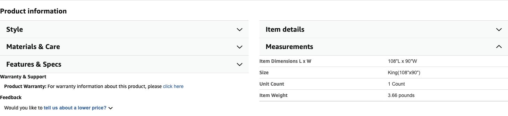

# Fleece mounting — weight checked, support location unresolved

**Latest host correction, October 29:** there is only approximately **1.5 in of vertical mounting surface at the top of the wall**; the proposed large hooks are approximately 3 in tall. **H24 is on hold: do not order it for this strip or mount it on the ceiling on the strength of its wall rating.** The earlier two-pack recommendation below is now a provisional inventory/cost scenario, not a fit-confirmed buying instruction.

## Practical next step

Find out what is immediately below the narrow band: window glass, flat frame/trim or more painted wall. The simplest proposed solution is to lower the hook row onto a suitable **vertical** surface, accepting a narrow exposed strip above the blankets. Partial coverage is already accepted. Keep the entire adhesive backing on one flat compatible surface, preserve removal access and fit the blanket fold to the lower hanging height. This is conditional on actual geometry and package instructions; no surface or installation test has passed.

[3M’s current FAQ](https://www.command.com/3M/en_US/command/contact-us/faqs/) lists smooth, clean painted wall, finished wood, glass and metal among compatible surfaces, subject to the specific pack’s instructions. A hook’s wall rating does not establish its ceiling capacity. Do not rotate the hook, cut its strip, bridge a wall/frame joint, substitute tiny decorating clips or assume several low-rated hooks create a new capacity. [3M ceiling-hook instructions](https://multimedia.3m.com/mws/media/1132646O/command-instructions-17008-es.pdf) describe a separate ceiling product; they do not authorize the selected H24 utility hook for this use. No suitable ceiling replacement, price or timely delivery is confirmed here.

If there is no compatible vertical mounting surface, choose a different support method after inspecting the room. No existing curtain rod, load-rated blind rail, ceiling anchor or freestanding support has been established. Do not treat tape alone as a verified fleece hanger. No drilling or new support purchase performed.

## Weight and spacing evidence retained

- The purchased [BEDELITE Black King 108 × 90 listing](https://www.amazon.com/dp/B08FYBWRQ1), Measurements panel, showed **Item Weight 3.66 pounds**, checked directly in Chrome October 29. This is a listing specification, not a received blanket weighed by host. The earlier 6.29-lb value belonged to the larger 120-in square.
- Three points across a 90-in panel, with a fourth for sag/edges, was a practical spacing proposal: **18–24 points for six blankets**. It does not solve the narrow mounting band. Final supports and point counts depend on the selected method and one-panel grip/adhesion trial.
- [3M’s multi-hook project guidance](https://www.command.com.my/3M/en_MY/command-my/projects/all-projects/his-office-efficient-organization/) keeps the total rating at one hook’s rating and calls for even distribution; do not add hook capacities.
- Follow the actual package’s surface preparation, pressure, wait time and removal directions. No physical mounting test passed.

## Buying and budget correction

The previous candidate was two [14-hook Command Large packs](https://www.amazon.com/dp/B075Y2M1Q5): 28 hooks at the prior $14.61 unit quote, **$29.22**. Keep this as a provisional mounting allowance only. Quantity 2 stock/delivery was not freshly checked, and fit is now unresolved. The 96 binder-clip pack remains a shared blanket/desk supply; its final wall allocation follows the support choice.

**Ten other remaining core decor lines total $218.49 before tax / $238.15 with 9% planning tax, plus mounting TBD.** Retaining the old $29.22 mounting allowance would give the previous $247.71 / $270.00 scenario. Removing an unsuitable product is not a completed cost saving. Six fleece/four moss remain host-reported ordered, last quoted merchandise value $199.90, actual paid unknown. Local $105 allowances and lighting remain separate.

[Current buying list](../../shopping-ready.md) · [Purchase/allocation ledger](../../purchases-and-allocations-2026-10-29.json) · [Latest handoff](../../handoff-2026-10-29-narrow-mounting-band.md).
