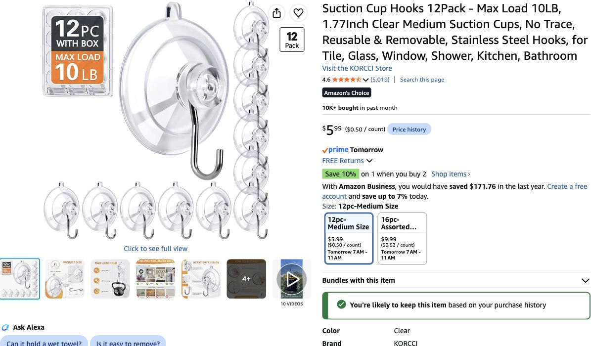

# Fleece mounting — suction hooks on window glass

**Later October 29 purchase confirmation:** host reports Command hooks, suction cups and binder clips ordered. Record the latest list quantities (one pack of each) as context-derived, pending receipt quantities. Actual paid totals, arrival, receipt and physical trials remain unverified. Do not reorder these goods. [Current buying list](../../shopping-ready.md).

**Host-confirmed method, October 29:** **suction hooks on glass; Command hooks on solid wall**. Glass is directly below the ~1.5-in top strip and gets direct sun; setup lasts only a few days. Keep both types upright on vertical surfaces. On solid wall, lower the row enough to fit the entire ~3-in Command hook/backing and preserve removal access; do not squeeze it into the narrow strip or move it onto the ceiling.

## Ordered inventory — quantities carried from latest list

| Surface | Product | Recorded order quantity | Last quoted merchandise |
|---|---|---:|---:|
| Window glass | [KORCCI /12pc-Medium Size suction hooks](https://www.amazon.com/dp/B0DFLZ5FX4) | **1 pack /12 cups** | **$5.99** |
| Suitable solid painted wall | [Command Large White /14 hooks,16 strips](https://www.amazon.com/dp/B075Y2M1Q5) | **1 pack /14 hooks** | **$14.61** |
| **Combined mounting inventory** | Mixed by surface, not two full-room systems | **26 hooks** | **$20.60** |

This is the latest discussed one-pack-of-each inventory, now recorded as host-reported ordered. Exact pack counts are not receipt-verified. Reconcile actual delivered counts before any additional purchase.

The [scan review](../../space-inputs/scan-review-2026-10-21.md#windows-and-purchasing-implications) gives W4 approximately 79.9 in and W6 approximately 104.6 in: **184.5 in /15.4 ft window span**. Against approximately 514.9 in /42.9 ft wall run excluding entry, the remaining solid run is about 330.4 in /27.5 ft. These are horizontal planning estimates, not a measured top-edge mounting map. Actual seams, trim and corners may alter point positions.

Keep **18–24 combined points** for six blankets (three per blanket, fourth where useful). A reasonable initial allowance is **eight suction points + ten Command points**, leaving four of each type spare. That is a fitting allowance, not a measured point map. Use available glass or wall at each location, and do not assume a spare suction hook solves a shortage on painted wall. Adjust after tape-mapping; one pack of each is not a fit guarantee.

**Offer status:** both unit prices are October 29 quotes. The prior suction check selected quantity 2 and showed In Stock /Oct 30,7–11a.m., with free delivery conditional on qualifying orders over $25; [record](../../research/suction-hook-check-2026-10-29.json). One-pack checkout price/shipping was not newly checked. Command $14.61 is the earlier quote; its quantity 1 stock/arrival was not freshly checked. No new arrival promise or agent cart/payment action. Host order report supersedes the earlier unpurchased status; discounts/actual paid totals remain unverified.

KORCCI claims up to10 lb on its glass/window listing; this is a seller claim, not independently tested performance. Selected Command Large hooks state 5 lb in normal specified wall use. The blanket listing states 3.66 lb, not an actual received weighing. Do not add hook ratings or transfer a wall rating to the ceiling.

## Fitting and trial

1. Tape-map the six blanket tops across actual glass and solid wall. Lower the row where needed for a full hook/backing, accessible release tab and a clear hem. Partial coverage/top gaps are accepted.
2. Put suction cups wholly on clean, smooth bare glass, clear of pane joints, seals and film. Put Command hooks wholly on suitable smooth solid wall, following the package’s cleaning, pressure and wait instructions. Both stay upright; no ceiling mounting, blind-rail loading, cut strips or bridging surfaces.
3. Start three points across each 90-in blanket; add a fourth for sag/edges where useful. Clip the folded top with binder clips and hang their wire handles from the selected surface-appropriate hooks. Do not pull cloth taut.
4. Trial one intact blanket on **each support type actually used** before repeating. Check suction through overnight/daylight conditions and follow Command adhesive wait time before loading. Check clip grip, sag and attachment again before guests arrive. No physical trial has passed.

## Cost and inventory

The hooks’ last quoted merchandise value remains **$20.60**. Host also reports binder clips, polyester cloths, gaffer tape, zip ties and shower curtain ordered; with earlier fleece/moss that gives **nine ordered lines / $281.07 at last quotes**. Five core decor lines remain **$157.92 before tax / $172.13 with planning tax**. Actual paid totals are unknown; local $105 and deferred lighting remain separate.

One 96-clip pack was the latest discussed quantity: 18–24 combined panel grips plus six desk clips, subject to actual received inventory and grip trial. No physical trial has passed.

## Source distinction and surface limits

- [KORCCI brand/seller listing](https://www.amazon.com/dp/B0DFLZ5FX4) supplies this specific pack’s size, material and 10-lb claim; [dated offer record](../../research/suction-hook-check-2026-10-29.json) records price/quantity/shipping and no order.
- [Adams’ Large Suction Cup](https://www.adamsmfg.com/products/christmas-hardware-accessories/suction-cups/holiday-large-suction-cup) is an independent manufacturer example rated up to 7 lb for windows. [Its FAQ](https://suctioncups.com/pages/general-faqs) bases ratings on cups/hooks attached to glass and advises testing. This is supporting comparison evidence, **not a rating or sunlight certification for KORCCI**. The Adams Amazon two-pack search offer showed Nov 1 free /Oct 31 fastest, so it is not the tomorrow recommendation.
- [3M’s window FAQ](https://www.command.com/3M/en_CA/command-ca/contact-us/faqs/) excludes ordinary indoor strips under direct sun, including inside a window. Ordinary H24 hooks are now selected for suitable solid wall only; suction serves sunlit glass. H24-to-outdoor-strip compatibility was not established. No ceiling capacity inherited from a wall rating; no extra UV-adhesive product added.

[Current buying list](../../shopping-ready.md) · [Ledger](../../purchases-and-allocations-2026-10-29.json) · [Latest handoff](../../handoff-2026-10-29-orders-recorded.md).
