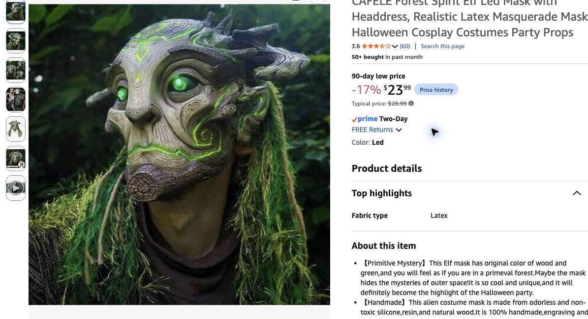

# The Rootkeeper — mostly bought automated desk Guardian

**Latest October 30 evening head override:** host wants to avoid Spirit's extreme queue. [Current head alternatives/photo assessment](skull-alternatives-2026-10-30.md) supersedes the ram errand and older mask mount below. Floral skull in host photo is a workable proposal with existing external lights/vines; exact material/price unknown, eyes appear closed. Checked foam/LED Michaels skulls show Chelsea out of stock. Nearby Home Depot 40 W23 is open until 9; $3.25 LED skull is a visit-store availability lead, not confirmed stock. No replacement selected/bought. Heavy ceramic needs a supported tabletop/platform rather than the old mask-on-pole mount. Retain separate DEC-05 wolf skull and all 15 IDs. Original mask/stand remain Sunday-delayed; GC support proposal remains conditional on chosen head and stability trial. No physical/camera test.

**October 29 host instruction:** minimize handmaking, maximize Amazon components. This supersedes the 3–5 hour sculpted-card bark face/branching crown. No human DJ, animatronics or new furniture footprint. [Exact urgent orders](../urgent-buy-list-2026-10-29.md) · [Placement](../final-room-plan.md#the-hollow-accepted-corner-arrangement).

## Heavy skull proposal: seated, hooded Guardian

**Latest host observations October 30:** the Día de los Muertos head is pretty heavy, with a small opening underneath that is not very deep. Exact mass, dimensions, base contact shape and material remain unmeasured. Purchase/receipt not explicitly confirmed. Treat the shallow opening as insufficient evidence for a pole socket; no drilling, wedging a pole into the opening or head suspended from the Swiffer handle proposed.

Make the Guardian a seated figure at the automated desk. **The desk carries the head from underneath; the Swiffer handle carries only light costume dressing.** This develops the already proposed tabletop option; host has not yet approved or physically tried this specific arrangement.

1. Place a **single low, broad, rigid wooden box/crate** on the desk behind the laptop, between the speakers, if a suitable household piece exists. Its top must fully support the skull's footprint, be level and resist the actual load. Start with only enough height for the face to clear the laptop, approximately 6–8in as an illustrative trial rather than a measured requirement. Exact box/desk capacity and equipment clearance remain to check. No purchase or tall stack of boxes specified.
2. Rest the skull on its base on the support. If it rocks, shape a shallow padded cradle with folded cloth/firm packing foam around its supported lower edge; keep all weight borne by the broad top, not a peg in the hole. The head must sit securely before dressing; no glue/tape-only support or untested clamp mount. Unknown base shape may require a different cradle.
3. Put the hanger/crosspiece behind the head near neck/shoulder level, secured to the desk-attached Swiffer handle if that attachment works. Drape the allocated black cloth as a deep hood and shoulders, with pale face visible. Cloth should hang loosely rather than pull on the head. Hide the rigid support with cloth, then attached moss/vines; keep laptop cooling, speakers and controls clear. No human DJ space or handmade hands required.
4. Use existing red/violet fills and intact allocated fairy lights around the hood/roots. Closed-looking eye relief does not promise internal eye light. Trial rocking/sliding/tipping and actual visibility from the doorway, then photograph/enroll the finished DEC-03 under real lighting.

This reads as an intentionally seated pretend DJ and can reuse household materials. It does **not** establish a safe raised head mount without checking the actual head/base/support/desk. If the face needs full standing height later, a suitable broad rigid pedestal needs separate fitting; the earlier microphone stand/mask mount is not automatically suitable for this heavy object. No new hardware buy, paid-cost change, physical test or game ID change.

## Proposed reuse support: owned Swiffer

**Host correction October 30:** the owned tool is a Swiffer handle with its flat mop base attached, not a bare broomstick. Exact model, joint/lock behavior and dimensions are unverified. Host asks whether it can replace the microphone stand. **Recommendation: pause the $39.99 GC stand purchase and try the desk-supported Swiffer handle first.** This is a proposal, not a host-confirmed final build or a tested mount. Original Sunday-delayed stand order stays ordered; no cancellation/refund.

For lightweight costume dressing:

1. Set the attached flat mop base on the floor under/behind the desk where it fits clear of routes. The base is a foot for the robe frame, not a verified freestanding head support. If the actual rear desk leg offers two sound attachment points, bind pole to leg at two separated heights using the already ordered ties. Check both twisting and sliding; tape can protect surfaces/hide joins but is not the main attachment. Desk stability and attachment geometry need an in-room trial. Keep pole/dressing in the existing Guardian band, without bracing the upright bed.
2. Tie an existing lightweight hanger/crosspiece to the pole for shoulders. Add allocated black cloth, vines and a few moss scraps, keeping equipment vents, speakers and controls accessible.
3. Check the actual handle/joint and desk attachment for rotation, slipping and tipping with the light dressing fitted. The current heavy skull remains fully supported underneath on the desk platform; no head load is assigned to the Swiffer. If the frame cannot be held securely, simplify the drape around the tabletop head.

**For the pictured skull if ceramic/heavy:** support its full base on a sturdy low box/platform resting directly on the desk, covered in the allocated cloth, positioned clear of equipment and edge. The actual surface, box strength, head height and equipment clearance must fit. The Swiffer handle can carry lightweight shoulders/vines behind it; do not balance the ceramic head on the pole or depend on glue/tape as the head's support. Use existing external lights if eye sockets are closed. No extra support purchase specified until the household trial.

Manufacturer context: [P&G describes a swivel and locking head on the Sweep + Mop Deluxe](https://pgn2020news.q4web.com/news-releases/news-details/2025/The-New-Swiffer-Sweep--Mop-Deluxe-Elevates-Your-Everyday-Clean-with-a-Stick-That-Collapses-in-Half-for-Easy-Storage-in-Small-Spaces/default.aspx). This does not identify the host's model or establish prop-load capacity. Do not assume every head pivots freely or that any lock makes it a rated pedestal; inspect the actual tool. The proposed desk ties and separately supported heavy skull avoid relying on that unknown joint for the head.

This could avoid the **$39.99 prior-quoted stand and GC detour**, with no new floor base footprint. It changes the earlier independent-stand proposal to desk attachment; neither arrangement is physically tested. Host reports a heavy head; exact mass/material and desk attachment remain unknown. No stage/light rig or bed restraint is being made. Final DEC-03 still needs reference photos and camera tests.

## Earlier ordered mask/stand parts — historical reference

| Part | Exact choice | Additional buy |
|---|---|---:|
| Face/headdress |[CAFELE forest-spirit /Led](https://www.amazon.com/dp/B09V19JMMW), one |23.99|
| Independent support |[InnoGear MS250, single Black, Twist Clutch 34–60 in](https://www.amazon.com/dp/B08QZD9B5P), one |29.99|
| Black body |30×48 in cut from ordered H14 cloth 2 |0|
| Dressing |Allocated two paired 7 ft ivy runs, small ordered moss scraps, ordered ties/gaffer |Already shared; no duplicate|
| Prop light/fallback |One of **three total** Twinkle Star 66 ft warm USB strings |9.99 allocated once in shared light row|
| Tiny backplate/shoulders |One reused stiff card rectangle~8×10 in, packing paper, one existing hanger/light crosspiece |Reuse, inventory check|

**Head +support $53.98; including allocated string $63.97**, before tax. Host confirms head/stand/string ordered October 29; actual receipt/charges unverified. All three product pages showOct 31 at check time, no early-delivery guarantee. [Offer evidence](../research/cart-and-lighting-check-2026-10-29.json).

The bought face is advertised **9×6.1×2.75 in**, an adult-size small bust rather than the huge 16–20 in face/antlers in the mood image. It has a mossy/woodland green headdress and short horn-like details; no separate carved crown needed. Listing fabric table says latex while prose names silicone/resin/wood; do not treat its composition or mounting weight as independently verified. Rating 3.6/5 across 60 reviews at check; appearance/quality untested. LED variant selected; battery type/included cells/runtime not stated in accessible copy. **Do not invent a battery order or promise the eyes will work without checking the package.** The already allocated warm string and selected AUTO fill lights supply a fallback; no new electrical modifications.

## Earlier mask/stand assembly — historical reference, not timed/tested

1. Place the weighted stand in the existing~39×12 in Guardian band, independently of bed/desk. Adjust pole near 55–60 in; face center around 60–64 in as fit permits.9.8 in base fits nominal band, actual stability/clearance remains to test.
2. Use mask's existing straps around a small stiff reused backplate; secure that plate to pole at **two separated points** with ordered ties. Add a little packing paper only if needed to retain shape; no carving, sculpting, drilling the bought face or gluing hardware. If the actual straps/shape do not support this arrangement, make a reversible cradle from the same card before placing guests nearby.
3. Tie an existing lightweight hanger/crosspiece below the head for shoulders, drape the 30×48 in thin black cloth. Hide support behind desk/bed backdrop; hem clear of floor. No paid mannequin/wig head or constructed arms.
4. Dress neck/desk edges with already allocated vines and a few attached moss scraps. Use mask's LED mode if verified; route intact warm USB string loosely as roots or diffused eye fallback without cutting/packing lights into the face. Keep control/power accessible; test temperature, glare and runtime.
5. Check it from the doorway under actual red/violet wash, then gentle-contact stability/route/desk access. Photograph/enroll final assembled object for image recognition after dressing; do not use retailer photos.

**No carving or painting required for Guardian.** PVA/raffia string and five small twig entities belong to shared crafts; host dropped paint kit, with existing markers/card accents if needed. No antler/headband, mask duplicate, resin skull, pendants, motor or second cloth/moss order. The support carries only lightweight scenery; it is not a manufacturer-rated prop rig, stage-light hanger or bed restraint. If actual mask/base arrangement is unstable, reduce dressing or obtain a suitable support rather than propping it against the bed.

DEC-03 remains one decor-integrated entity. No physical tag, moon marker or NFC order. Existing desk-front scenic edge stays clear of controls; recognition focuses on the visible head/body. [Camera workflow](../../interactive-game/app/guardian-camera-prototype.md). Fixture choice, DMX show and music synchronization are separate; no physical or software test claimed.
