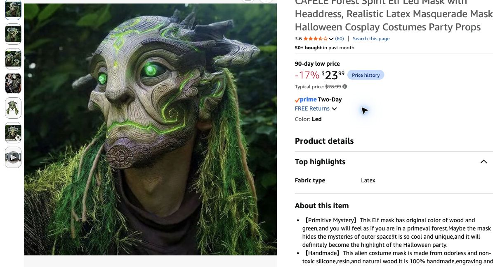

# The Rootkeeper — mostly bought automated desk Guardian

**October 29 host instruction:** minimize handmaking, maximize Amazon components. This supersedes the 3–5 hour sculpted-card bark face/branching crown. No human DJ, animatronics or new furniture footprint. [Exact urgent orders](../urgent-buy-list-2026-10-29.md) · [Placement](../final-room-plan.md#the-hollow-accepted-corner-arrangement).

## Buy versus reuse

| Part | Exact choice | Additional buy |
|---|---|---:|
| Face/headdress |[CAFELE forest-spirit /Led](https://www.amazon.com/dp/B09V19JMMW), one |23.99|
| Independent support |[InnoGear MS250, single Black, Twist Clutch 34–60 in](https://www.amazon.com/dp/B08QZD9B5P), one |29.99|
| Black body |30×48 in cut from ordered H14 cloth 2 |0|
| Dressing |Allocated two paired 7 ft ivy runs, small ordered moss scraps, ordered ties/gaffer |Already shared; no duplicate|
| Prop light/fallback |One of **three total** Twinkle Star 66 ft warm USB strings |9.99 allocated once in shared light row|
| Tiny backplate/shoulders |One reused stiff card rectangle~8×10 in, packing paper, one existing hanger/light crosspiece |Reuse, inventory check|

**Head +support $53.98; including allocated string $63.97**, before tax. Head/stand/string observed in unpaid cart. All three product pages showOct 31 at check time, no early-delivery guarantee. [Offer evidence](../research/cart-and-lighting-check-2026-10-29.json).

The bought face is advertised **9×6.1×2.75 in**, an adult-size small bust rather than the huge 16–20 in face/antlers in the mood image. It has a mossy/woodland green headdress and short horn-like details; no separate carved crown needed. Listing fabric table says latex while prose names silicone/resin/wood; do not treat its composition or mounting weight as independently verified. Rating 3.6/5 across 60 reviews at check; appearance/quality untested. LED variant selected; battery type/included cells/runtime not stated in accessible copy. **Do not invent a battery order or promise the eyes will work without checking the package.** The already allocated warm string and eventual stage wash supply a fallback; no new electrical modifications.

## Assembly proposal — about 30–45 minutes, not timed/tested

1. Place the weighted stand in the existing~39×12 in Guardian band, independently of bed/desk. Adjust pole near 55–60 in; face center around 60–64 in as fit permits.9.8 in base fits nominal band, actual stability/clearance remains to test.
2. Use mask's existing straps around a small stiff reused backplate; secure that plate to pole at **two separated points** with ordered ties. Add a little packing paper only if needed to retain shape; no carving, sculpting, drilling the bought face or gluing hardware. If the actual straps/shape do not support this arrangement, make a reversible cradle from the same card before placing guests nearby.
3. Tie an existing lightweight hanger/crosspiece below the head for shoulders, drape the 30×48 in thin black cloth. Hide support behind desk/bed backdrop; hem clear of floor. No paid mannequin/wig head or constructed arms.
4. Dress neck/desk edges with already allocated vines and a few attached moss scraps. Use mask's LED mode if verified; route intact warm USB string loosely as roots or diffused eye fallback without cutting/packing lights into the face. Keep control/power accessible; test temperature, glare and runtime.
5. Check it from the doorway under actual red/violet wash, then gentle-contact stability/route/desk access. Photograph/enroll final assembled object for image recognition after dressing; do not use retailer photos.

**No carving or painting required for Guardian.** PVA/raffia string and five small twig entities belong to shared crafts; host dropped paint kit, with existing markers/card accents if needed. No antler/headband, mask duplicate, resin skull, pendants, motor or second cloth/moss order. The support carries only lightweight scenery; it is not a manufacturer-rated prop rig, stage-light hanger or bed restraint. If actual mask/base arrangement is unstable, reduce dressing or obtain a suitable support rather than propping it against the bed.

DEC-03 remains one decor-integrated entity. No physical tag, moon marker or NFC order. Existing desk-front scenic edge stays clear of controls; recognition focuses on the visible head/body. [Camera workflow](../../interactive-game/app/guardian-camera-prototype.md). Fixture choice, DMX show and music synchronization are separate; no physical or software test claimed.
