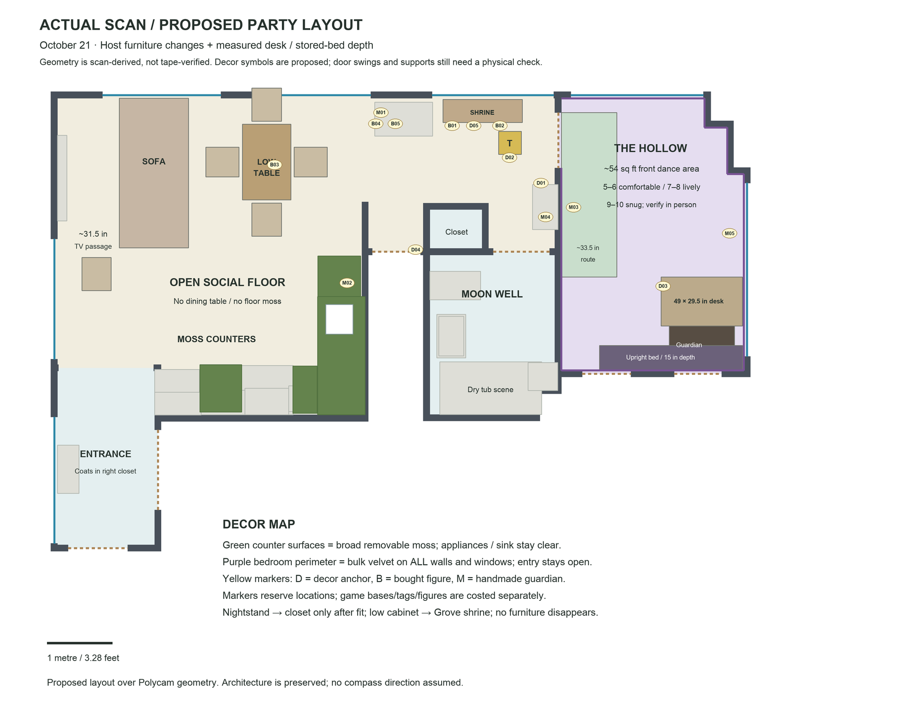
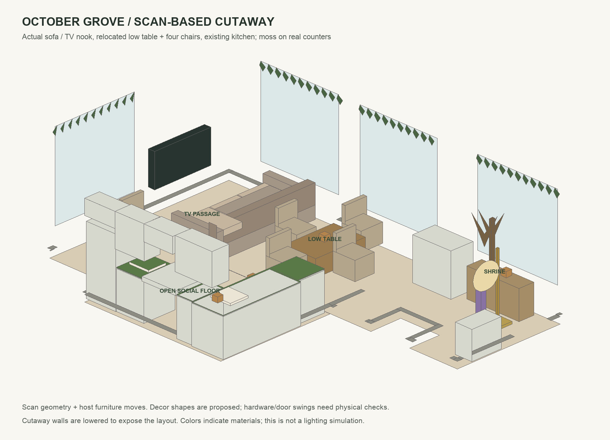
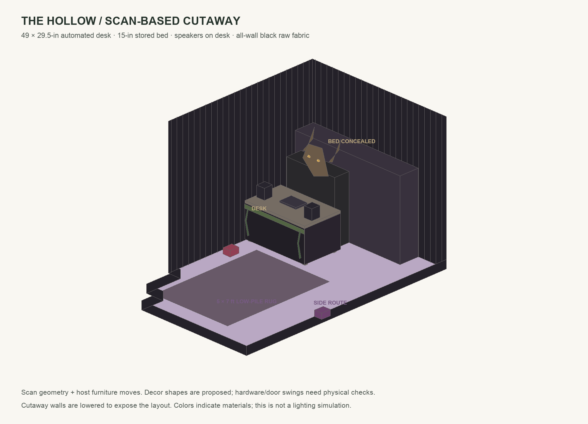

# Apartment decor execution plan — updated October 22, 2026

**Layout accepted by host; decor/product choices proposed.** Revised ceiling about $1,600 including permanent lights (Oct 22); only gold tree/full-color LIFX owned, nothing new ordered; 2–4 full days. Latest instruction: raw black fabric on **all Hollow walls**, no ready-made curtains. Dining table is gone; other relocated furniture stays inside. [Basket](shopping-ready.md) · [Schedule](setup-schedule.md) · [Materials and atmospheric references](inspiration/2026-10-21/README.md).

## Grounded visual plan

[Editable SVG](space-inputs/party-layout-2026-10-21.svg) · [Coordinates](space-inputs/party-layout-2026-10-21.json) · [Original scan baseline](space-inputs/apartment-base-plan-2026-10-21.png).

The scan preserves the real adjacency, stepped bedroom corner, window/door planes and kitchen. Furniture boxes are simplified. The top-down plan controls spatial decisions; generated mood images do not establish extra furniture/windows/counters. Raw model/screenshot remain local and ignored. One tape scale check, door swings, outlet positions and physical support checks are outstanding.

Cutaways use the same scan geometry and host dimensions. Walls are lowered selectively for visibility; no photorealistic lighting or actual fabric blackout simulation is claimed.

## October Grove: furniture first

1. Remove the dining-height table from this party arrangement, as host confirms it is gone.
2. Move coffee table (~29.3 × 45.7 in, 16-in scan height) to the former dining-table center. Put four existing dining chairs around it, approached from open south/east sides. The narrow gap between west chair backs and sofa is **not** a through-route.
3. Shift sofa ~22 in toward TV. Proposed TV-front-to-sofa gap **31.5 in / 0.8 m** is a starting walk-through clearance, not a code/comfort certification. Check seated knees and actual TV projection; move back slightly if needed.
4. Move scanned bedroom low cabinet (~47.9 × 13.8 in) under the Grove's upper/right window for the shrine. Nightstand goes into closet after actual opening/interior fit. Keep the fifth small chair beside the TV nook if it clears entry flow.
5. Keep broad central kitchen/social floor open. Main door is bottom-left vestibule with coat closet on right; the central recess is not the main entrance.

### Forest treatment, on actual surfaces

**Counters:** cover the usable non-appliance countertop broadly with green faux moss mats, not just a tiny tray. Scan estimates ~24.4 sq ft after excluding sink; order three 39 × 39-in sheets = ~31.7 sq ft nominal to allow cuts, seams and scenic offcuts. Trace paper templates first. Long sink-side run needs joined pieces; offcuts cover the short stove-side sections. Keep sink basin, taps, cooktop, switches/outlets and hot appliances clear.

Lay moss on removable wipeable underlayers. Set clean washable trays/risers into the moss for drinks, cups and food; no food/ice contacts moss. Place cups at the approach end, drinks on the long counter and water at its far accessible end. Test filling a cup while another person passes. No countertop scenery dangles into walking space.

**Vines:** one 12-strand / 84-ft pack shared between rooms. Grove receives ten: eight strands (~56 ft) on selected window heads/wall tops/cabinet edges, one (~7 ft) trailing accent and one (~7 ft) shrine. Two strands (~14 ft) dress the Hollow desk. This is a high perimeter treatment, not a dense ceiling canopy. Use separate compatible low-load clips; no real wood suspended overhead.

**Wood/stone/harvest:** card/kraft branch silhouettes on independent supports at the shrine cabinet; the purchased 63-in branch is removed to fund the bedroom rug. Five small pumpkins/gourds across shrine/counters/low-table centerpiece. Make three lightweight faux stones from crumpled packaging/card, charcoal paint and dry-brushed bone, rather than buying heavy rocks. Add a few attached rust paper leaves from craft offcuts. A very low central moss/stone ring leaves most coffee-table area usable.

**Moon and purple:** choose a **24-in handmade light-backed moon disk** on the existing right-side Grove cabinet/wall area, not the $89.99 six-pound sconce. Reused card + thin bone-colored paper/crater paint; one H12 warm USB string retained intact behind/in a shallow vented disk frame. Do not cut/shorten electrical strings or pack them tightly against heat-sensitive material. Test brightness/temperature and sturdy support; if backlighting fails, use an opaque painted disk lit from an existing practical. It remains DEC-01 with a separate reachable target.

Owned gold tree/LIFX near shrine; new permanent Govee Basic at opposite Grove edge supplies another violet bounce. Match color by eye; turn down TV glare. White lumen claims do not establish saturated-purple coverage. Do not count tree/LIFX in bedroom simultaneously.

## The Hollow: accepted corner arrangement

Store bed upright on its long edge against the rear closet wall, shifted right; host-supplied **15-in stored depth**, assuming legs removed or flipped/concealed. Reserve **12 in / 0.30 m** ahead for independent guardian support, then **49 × 29.5-in automated desk**. No human DJ bay. Two small powered speakers sit on desk. Leave side access to controls; drinks outside room.

The scan-based study estimates ~120.6 sq ft inside walls, ~98.3 sq ft unoccupied including circulation and **~54.5 sq ft front dance area** after a ~33.5-in side-route allowance. **5–6 comfortable; 7–8 lively; 9–10 snug** is a planning judgment, not an occupancy approval. Corner grouping consolidates side pockets; it does not make all remaining floor danceable.

Bed support, actual leg removal and closet access remain physical setup dependencies. The model uses the requested depth without claiming a restraint design. Guardian never supports or stabilizes the bed. If stable storage cannot be established, a covered flat bed is the fallback, with the earlier study's roughly 27 sq ft front area; do not advertise the upright-layout capacity for that fallback.

### Rug and fully dressed desk

Host approved the Hollow mood image as the material direction and requested a rug plus moss/vines/black cloth over the desk. [Exact rug offer, measured fit and desk cut/allocation plan](bedroom/rug-and-desk-finish-2026-10-21.md): one charcoal distressed **5 × 7-ft low-pile rug** on the front floor, clear of the reserved side route, with a $15 conditional grip reserve. Desk front and both sides get a full floor-clear black fabric U-skirt, ~2 sq ft attached moss on the fascia, and two existing ivy strands. Keep equipment top/vents/speaker fronts clear. The rug does not increase capacity; actual traction, edges and door swing need testing.

### Every wall is black raw fabric

[40-yard cut schedule and supports](bedroom/draping/02-shopping-and-sample.md): FWD black 170-GSM polyester poplin, $143.64 proposed after host rejects expensive stretch velvet, shallow folds, 15 full-height pieces plus entry-head valance. Cover windows within the same wall spans; keep the doorway open. Large offcuts conceal the bed and form guardian shoulders. Actual opacity/attachment/heat/airflow require a room trial.

Latest material clarification: **velvet is not required, some sound deadening is wanted**. [Black cloth + felted backing](bedroom/draping/03-black-cloth-and-echo-2026-10-22.md) proposes two 68 × 85-in pads hidden behind the exposed left-wall run as a modest echo-control trial. Poplin remains the full-height visual layer; pad band is partial-height. Check combined mounting load/door/route fit, keep speaker faces clear, and do not claim bass isolation. No actual sound test performed.

### Guardian and EDM lights

[Rootkeeper build](bedroom/woodland-guardian.md): a 3–5-hour lightweight bust, bark-card face, paper/faux twig antlers, black-fabric offcut body. Face about 16–20 in high, crown tops below ceiling; prototype from doorway. Its independently supported body fits the reserved ~39 × 12-in band, never bolted to audio gear or relied on as bed restraint. If no suitable base exists within allowance, mount a flat lightweight face/root board independently and preserve its visual presence.

Steady amber eyes: second H12 warm string intact, two diffused clusters and sparse root lights on independent guardian support; controller/USB accessible. Not DMX-addressable. Test temperature/glare and nine-hour runtime.

**October 22 combined lighting proposal:** [exact offers, control and automation](lighting/fabric-and-combined-rig-2026-10-22.md): one OPPSK segmented wash/strobe + one conditional Gruolin laser + U’King two-moving-head pack, buffered DMXking MAX and free QLC+. Replaces the two-PAR kit. OPPSK provides restrained wash/pixel chases, LED movers provide controlled gobo/color projection, laser would add confined surface patterns only if its actual class/output and projection/support arrangement are suitable. No fog/haze; no crowd scanning or unrestricted laser auto mode. Keep rapid strobe disabled for initial prototype.

**Placement is unresolved:** the measured dance-study polygons are unchanged, but that capacity assumes all new fixtures/supports fit outside them and the side route. No claim four fixtures fit on the equipped desk. OPPSK (listed 10.6 lb) and moving heads cannot hang from cloth hooks, guardian or bed. Physical support/outlet/beam-path plan required; re-cost if provisional support reserve is insufficient.

**Automation proposal, not built:** coordinated repeating looks and tested QLC+ audio-frequency triggers, or final rendered premix and lights on a shared Show Manager timeline after audio/TV rehearsal. Independent starts of two apps do not establish nine-hour sync. Save normal/static/blackout controls and test power/data-loss behavior. See lighting plan for firmware, profiles and audio routing dependencies.

## Moon Well

Keep the documented buy-first dry-tub scene: 72 × 72-in dark-green forest shower curtain partly open; folded/overlapped black poplin offcuts in dry tub on a soft protective underlayer, 5.9-in moon on its supplied stand and 10-ft moss root vine. Small offcuts on removable bases; no loose moss by drain or on floor.

Separate cordless warm lamp on a stable dry shelf lights sink/lock/route. Charge both bath lamps outside room and test at selected brightness for nine elapsed hours; advertised runtime is not a passed test. No charging/mains leads in tub. If runtime fails, retain normal usable light; orb can remain a reflective prop. Remove scenery before bathing.

Wrapped chocolates/fortunes in clean covered jar on reachable dry surface, no reaching into tub. Sweets belong to food budget ($25 proposed), bags/printing to supplies ($5), not decor twice. Game threshold remains **outside bathroom**.

## Place all 15 entities

Preserve [5 decor / 5 bought / 5 handmade identities](../interactive-game/physical/entity-plan.md). Proposal below uses **11 Grove / 3 Hollow / 1 bath threshold**, replacing the earlier illustrative 9/5/1 split to reduce queues/extra stands on the small dance floor. This is a placement recommendation, not a change to game IDs, puzzles or code.

| ID / plan marker | Proposed reachable location | Integration |
|---|---|---|
| DEC-01 / D01 moon | Right-side Grove cabinet/wall moon, below light | Separate dry nonmetal target plaque |
| DEC-02 / D02 gold tree | Shrine-side tree base, guest-facing | Target beside lamp, not on socket/metal |
| DEC-03 / D03 Rootkeeper | Front-left desk fascia | Target on separate scenic edge away from controls/speakers |
| DEC-04 / D04 Well threshold | Grove-facing trim outside bathroom | Own flat carrier; no bathroom queue inside |
| DEC-05 / D05 branch/skull shrine | Center of relocated cabinet | Lightweight raven-skull/bark display; expensive wolf skull optional |
| BUY-01 / B01 raven | Left side of shrine cabinet | Distinct stable base |
| BUY-02 / B02 barn owl | Right side of shrine cabinet | Distinct base, not hidden in vines |
| BUY-03 / B03 fox | Low table's attached scenic centerpiece | Reachable from chair; clear cup space |
| BUY-04 / B04 stag | Existing upper-window cabinet, left | Stable base and separate marker |
| BUY-05 / B05 hare | Same cabinet, right | Visually separate from stag target |
| MAKE-01 / M01 forked twig, ochre | Above upper-window cabinet | Flat light figure on independent attachment |
| MAKE-02 / M02 straw fan, rust | Dry counter back edge, above serving zone | Flat board carrier, clear of splashes |
| MAKE-03 / M03 crossed twig, indigo | Hollow left wall beyond entry swing | Independent flat wall attachment through removable cloth gap |
| MAKE-04 / M04 straw bundle, moss green | Grove right cabinet's lower scenic panel | Bound straw, no shedding into bar |
| MAKE-05 / M05 arched twig, ivory | Hollow right perimeter ahead of desk | Flat figure, own support, outside beam/traffic |

All fifteen get distinct reachable nonmetal touchpoints. No targets behind bed, in private closets, on drinks, near water or hidden among cables. Wall figures attach independently of black fabric; no extra floor stands. Game pays only incremental tags, premade moon stickers, small bought figures and handmade bases; full scenery charged once here. Exact small figures/NFC install and phone testing remain with physical-game work, not purchased or encoded by this task.

## Shared supplies, checks and completion

Two USB strings: one Grove moon, one guardian. Twelve tea lights: six Grove, four bath, two spare. Black-fabric offcuts: full desk front/sides and dry-tub scene base; no separate tablecloth pack. One 84-ft ivy pack: 70 ft Grove, 14 ft desk; separate 10-ft vine bath. Three moss sheets first cover actual counters, then reserve ~2 sq ft desk fascia, followed by other small guardian/shrine/bath offcuts; if template waste exhausts material, preserve counters and use painted texture on small props.

Propose three 15-ft H19 supplies: one Grove and two Hollow for four fixtures + guardian USB. Each must connect directly to a suitable wall outlet; actual circuit/nameplate loads and fixture ports require inspection. Owned tree and existing audio/TV retain their existing supplies. The third supply is now included; additional outlet/support needs require re-costing. Each supply goes directly to suitable wall outlet; no daisy chain or floor-crossing assumption. Read actual loads/ratings, secure leads at perimeter, preserve switch access.

Before setup: one tape wall scale check; actual fabric drop/substrate/24-hour trial; bed support; desk equipment templates; nightstand/closet fit; cabinet relocation; outlet/cable map; tub/shelf fit. After setup: after-dark cup-carrying route, chair access, three-person dance/door trial, music-reactive/reset trial, nine-hour light/battery test, NFC reach/scan rehearsal. Nothing on this physical checklist is claimed tested.

If cost/time grows, keep all-wall fabric, open floor and working lights. Simplify card-built guardian detail, the purchased branch is already replaced by card; omit optional pendants or reduce pumpkins before changing the host's full-wall request. No whole-floor moss, truss/drape rig or extra light package beyond the itemized combined-rig proposal is included.
