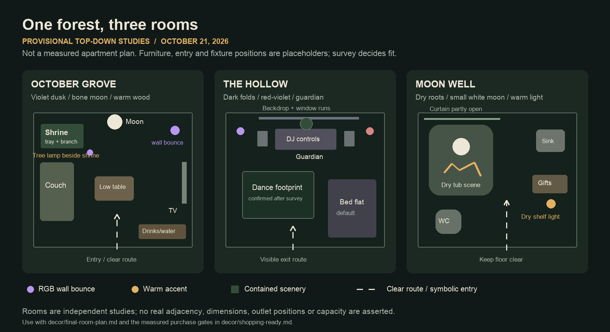

# Three-room execution plan — provisional October 21

**Planning result; room survey pending.** Host confirmed October 21: **$1,000 including permanent lights**, nothing newly ordered, one owned gold lamp/stand with full-color LIFX, furniture can move but must stay in the apartment, nightstands may move into closets, 2–4 full days available, **iPhone 16 Pro**. No dimensions, outlet map, wall finish or closet/storage fit yet. Placement is a design recipe, not a measured apartment floor plan. [Shopping basket](shopping-ready.md) · [Setup schedule](setup-schedule.md) · [Capture and layout-tool guide](space-inputs/README.md).

The three diagram boxes are independent room studies, not real apartment adjacency. Door/window positions, furniture footprints and fixture locations are illustrative. Rotate/mirror the recipe around actual entry, windows, outlets and routes after photos. Diagram source: [SVG](room-layout-provisional.svg).

## Shared design

Use deep green, charcoal, bone, muted autumn leaves and small amber accents. Living room is a dim violet forest clearing with a separate neutral moon; bedroom is a red/violet root chamber; bathroom is a quiet warm scene around a small white moon. Concentrate scenery against walls and on stable furniture. Existing floors, seating and functional surfaces supply negative space; floor coverage/canopy remain optional later studies.

Confirmed inventory: gold tree lamp with **full-color LIFX**, DDJ-FLX4/Mac, two powered bedroom speakers, two living-room Google Homes, TV/soundbar. Only the lamp is redeployed; no move/configuration happened. Host confirms no new decor ordered, so September cart items are not owned. Ordinary trays/tools/cords still need a quick household check. The basket includes new supplies conservatively. Helpers are not confirmed; use the solo 2–4-day schedule and keep the bed flat.

## October Grove / living room

Choose **one focal wall/dead corner visible on arrival**, outside the bar queue and through-route. Center the H02 19.7-in moon there if the wall supports its proper bracket; position one 63-in branch to one side rather than building an entire forest. Set the resin wolf skull on a stable low tray with one raven accent, a dark base, narrow moss edging and three small pumpkins. Keep an adjacent clear, reachable nonmetal game touchpoint area; the physical game task supplies the NFC components.

Move the owned gold tree lamp beside this group, with bulb/socket and shade unobstructed. Its full-color LIFX and **one new H26 Govee Basic permanent corner lamp** provide separated violet bounces; the warm string reveals wood/bone. Exact saturation/output comes from the test; the tree lamp's geometry may limit its wash, and black cloth/windows are poor bounce surfaces. Test before adding another fixture. A 66-ft warm string traces the focal cluster or selected edge; it is not a mandate to run all its length around the ceiling. Existing practical counter/seating lights remain available.

Keep the couch/TV nook and four intended coffee-table seats functional. A second shallow tray can suggest a fairy circle using attached leaf/mushroom shapes from reused card; no separate miniature purchase is necessary. Leave most table space for drinks. Four foliage strands are the entire living-room allocation, 22.4 ft; use only where visible under the lights. Six tea lights distribute between table and scenic edge. Google Homes stay clear of greenery and spills; approved silent TV visuals continue independently.

Place cups, drinks and water along existing counter/surfaces after the route survey. Keep water accessible without returning through a drinks line. Walk from apartment entry to both room entrances and bathroom carrying a cup. Mark actual furniture and door swing envelopes before placing props. No floor-size or 60-person capacity claim is made from this sketch.

**Moon mounting gate:** current large light is roughly 6 lb and needs a suitable bracket/fastener system. Hooks for light strings/fabric are not its mounting plan. If screw mounting is unsuitable or unwanted, select the lightweight 24-in bone-painted card moon with an existing indirect lamp instead; reduce basket cost accordingly. No hardwiring project is proposed.

## The Hollow / bedroom

Keep the bed **flat as the provisional default**. Put a tight dark cover on it and accept the smaller dance footprint. **All furniture must stay in the apartment**; nightstands move into closets only after opening/interior dimensions and later access are checked. Disassembly is relevant only if the frame/mattress can genuinely be stored flat inside the apartment, with instructions/clear route/two helpers confirmed. No external storage is assumed. No upright tied bed or mattress forms the guardian's support.

Locate the DJ table on a perimeter wall away from the entry path. Keep a side for operating controller/laptop, both speaker stands outside dancing, vents/controls open, and drinks on a separate surface. The scenic treatment starts with a roughly human-scale **card/kraft face and branch crown** on its own broad stable low support. Do not build a full articulated body. A black table front, two raven pendants, paper roots and four sheer cloth panels imply shoulders/scale. The second warm string can outline a small root/crown detail; red/amber sidelight can supply the eyes without extra electronics.

First cover one DJ backdrop plus measured window runs. Use matte duvetyne for the backdrop; its manufacturer reports about 50% light blocking, so the window alternative is fitted opaque curtains or existing effective coverings. Sample panel weight, wall compatibility, clip grip and removal for 24 hours. Hooks/clips and direct tape are host-accepted approaches; the recommended prototype remains hooks/clips. H16 gaffer is not automatically a paint-safe load-bearing fabric adhesive. No room-wide fabric order precedes the survey.

Two H01 fixtures start static: red/amber skims the guardian/branches, violet hits a pale surface or ceiling. Start low, strobe off; only keep a slow program if it stays within the intended palette and a test shows it works. A protected edge/factory bracket is preferred over stands in dancing. Record controls and restore settings; no Mac lighting software or music-sync dependency.

Leave a visible route to the door, actual ventilation/window access, and access to playback controls. The guardian's touchpoint belongs on a separate reachable guest-facing scenic edge away from gear/cables. Five bedroom perimeter checkpoints are a game-planning example, not permission to fill five separate floor footprints.

**Time limit:** guardian is a 3–5 person-hour bust proposal plus drying time. If that time/support is unavailable by Oct 26, use the same face/root silhouette on an appropriately mounted light board and spend the remaining time testing drapes/light. If no suitable support/mount exists, keep the backdrop/lighting and flag the guardian anchor substitution to the game task.

## Moon Well / bathroom

Measure existing curtain rail/drop and reveal the compact scene by leaving the H05 forest curtain partly open. Place one folded H14 dark cloth **inside the clean dry tub**, with a soft non-scratch layer under hard bases. At one visible end, the 5.9-in H03 moon stays on its supplied stand. Coil the single 10-ft H06 vine around the base as roots; attach allocated moss and two sheer cloth panels to the removable base. No loose moss near drains or cloth on bathroom floor.

Place the separate cordless H04 warm ambient on a stable **dry shelf outside splash**, aimed/positioned for usable light on sink, lock and floor. Use the moon white and the room warm. Four tea lights provide low accents; they do not establish that the room is bright enough by themselves. Retain ordinary lighting for practical use; no charging cord, mains light or extension enters the tub. No water/humidity rating has been established for these lamps; normal bathing requires removing the dry installation.

The chocolate/fortune station is a clean covered jar on an existing reachable dry shelf/caddy, separate from scenery. If a stable reachable station does not fit, move gifts to the living-room food table and leave a small note. Guests never lean into or step into the tub. Keep the game's threshold target outside the bathroom, with the bathroom entry clear; no new scored bathroom checkpoint.

Assembly estimate: 45–60 minutes scenery after fit, plus 45–60 minutes for 36–72 gifts/fortunes. The existing buy-first Moon Well scene remains the selected concept; no giant well/forest-god sculpture added.

## Shared allocation and electrical plan

| Shared item | Living room | Bedroom | Bathroom / reserve |
|---|---|---|---|
| Two PAR fixtures + permanent RGB lamp | One Govee Basic + owned color LIFX | Two PAR red/violet washes | None |
| Six foliage strands | Four | One | One bath |
| Two moss strips | One, edging across trays | 16 in of second | 31 in of second, bath |
| Two opaque tablecloths | None | One table front | One folded tub base |
| Six sheer cloths | None | Four | Two bath |
| Two USB strings | One | One | None |
| Twelve tea lights | Six | None required | Four bath / two spare |
| Gold tree/LIFX | One, moved from bedroom | Not counted here simultaneously | — |

Power proposal: three H19 15-ft supplies are a placeholder maximum for separated living-room light positions plus bedroom light position, each directly to an appropriate wall outlet. Two PARs + large moon + Govee Basic = four new mains loads; tree lamp remains at its own existing wall supply. Two USB strings use two of six integrated USB-A ports. Recharge the two cordless bath lamps outside the room before use. Existing TV/audio supplies remain part of the music inventory, not assumed spare outlets. Buy fewer cord units if the actual outlet map supports that.

Record actual fixture label watts and existing loads before connecting; advertised LED counts are not circuit-load measurements. Verify all selected supplies' ratings/instructions and wall reach. Route every lead at perimeter with accessible switches; no chained strips or leads hidden under rugs. If a route crosses dancing/exit access, move the fixture first. Cord covers/extra lengths are conditional additions with explicit costs in the basket. This is a planning topology, not an installed electrical test.

## Purchase-critical measurements and input register

All linear entries should be in **inches**, with a tape check of at least one wall against any scan. A model can simplify furniture and miss mirrors/windows/outlets. Keep originals under ignored `space-inputs/raw/`; do not publish the apartment model.

| Input | Current source / confidence | Needed for |
|---|---|---|
| Each room shell, door positions/swings, usable routes | Missing / unknown | Actual annotated apartment plan; guest-flow and scene footprints |
| Each bedroom window span + mounting-to-finish drop | Missing / unknown | H23 pairs/length, separate-run quantities |
| DJ-backdrop span + drop + top/bottom fold allowance | Missing / unknown | H22 raw yardage and panel count |
| Wall finish, paint condition, complete panel mass, clip fit | Missing / unknown | H24/25 trial and final supports; mounting cannot be inferred from LiDAR |
| Moon wall material, permitted fixings, outlet distance | Missing / unknown | H02 vs lightweight fallback, mounting kit/lead |
| Bed/table/speaker footprints, nightstand/closet openings/interiors | Furniture stays inside apartment / confirmed; dimensions missing | Keep-flat dance area, closet fit; disassembly only if internal flat storage is real |
| Tub interior, curtain rail width/drop, dry shelf footprint | Missing / unknown | H03–06/H14 fit and reachable gifts |
| Outlets, existing cord lengths, fixture label loads | Missing / unknown | H19 count/length and final perimeter routes |
| Existing carpet attachment/edge heights | Host says laminate + low/no-pile carpet / confirmed type, unknown edges | Preserve stable floor and transitions; no green covering order |
| Decor inventory / ceiling / available time | Host Oct 21 / confirmed: only gold stand/color LIFX, $1,000 including permanent lights, 2–4 full days; helpers unconfirmed | One permanent Govee + bedroom kit; $973.12 example envelope; solo build plan |
| Phone / photos or export | iPhone 16 Pro confirmed; captures pending | Polycam Floorplan supported; dimensioned views + photos + furniture list, optional GLTF ZIP |

Photos/scan can refine this plan whenever convenient; the shortlist and modest builds do not depend on a perfect model. Until supplied, every diagram position and large quantity stays **provisional**.

## Minimum scope if time or ceiling contracts

Preserve functional lighting/clear routes, purple Grove, one moon shape, dark DJ backdrop, flat bed and Moon Well curtain/reveal. Drop extra skulls/creepy cloth and paper-build the branch/moon before dropping practical mounting/power/testing. Use the three-panel fabric scale if it actually fits. Recalculate the single basket after those substitutions; do not buy a second complete design. Construction and nine-hour hardware tests remain future host execution, not completed planning checks.
