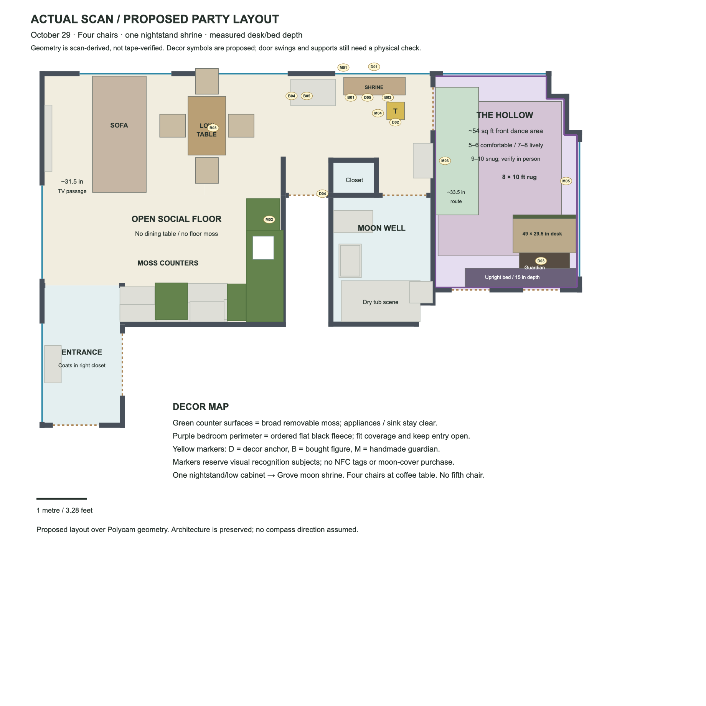

# Apartment decor execution plan — October 29, 2026

**Current host corrections:** four chairs total, all around coffee table. The scanned bedroom low cabinet **is the nightstand**; move that one piece to the Grove Harvest Offering Table, not another cabinet plus a separate hidden nightstand. Hollow wall/desk materials are selected and ordered. Add cross-room foliage, wall fairy lights and larger wall branches. Guardian should be mostly bought, minimal assembly. Image recognition replaces NFC; no tags/tag-cover stickers to order. Crown is lowest priority/deferred.

[Exact current buy list](urgent-buy-list-2026-10-29.md) · [Ordered inventory and shared cuts](shopping-ready.md) · [Latest offer record](research/cart-final-corrections-2026-10-29.json). Products and layout proposals are not purchases or physical tests. Current cart and missing-light quotes are in that list; fixtures/control remain unpurchased and untested. Do not use older moving-head/Pyle/rug/fabric passages as the current order.

## Grounded visual plan

[Updated scan-based layout /four chairs/nightstand shrine/8×10 rug](space-inputs/party-layout-2026-10-29.svg) · [Original scan](space-inputs/apartment-base-plan-2026-10-21.png) · [Rug fit detail](space-inputs/hollow-rug-fit-2026-10-22.png).

Geometry remains scan-derived, not tape-verified. Furniture boxes simplify real objects. Original October 21 PNG/cutaways are historical renders:their fifth chair, separate nightstand/cabinet wording and 5×7 rug are superseded. New overhead swags and branch positions are proposals awaiting attachment/clearance checks, not measured installations.

## October Grove: furniture first

1. Dining-height table is gone. Move **22×44 in coffee table** to former dining-table area; put **all four chairs** around it. No fifth chair or TV-side spare chair.
2. Push sofa toward TV, preserving proposed~31.5 in walking gap, adjusted after seated-knee and actual TV clearance trial. Narrow sofa/chair-back gap is not a route.
3. Move **one bedroom nightstand/low cabinet** into the previously proposed Grove window-side shrine position. Cabinet footprint/height and usable backing need in-room confirmation; no second cabinet or second nightstand relocation assumed.
4. Keep broad kitchen/social floor clear. Main entrance is bottom-left vestibule, coat closet on right; central recess is not main door.

### Forest surfaces and additional scenery

- **Moss surfaces:** four ordered 39×39 in sheets cover scan-derived 24.38 sqft usable counters +coffee table 6.72 sqft +20×40 in other top 5.56 sqft =36.66 sqft. Retain~2 sqft desk fascia via joined cuts/sink-cutout reuse. [Actual four-sheet cut plan](living-room/moss-surfaces-and-cuts-2026-10-29.md). Removable underlayer; food/drinks on clean trays, sink/cooktop/hot appliances clear. No moss floor.
- **Across-room vines:** propose **two light swags over the coffee-table/seating bay**, not the entire kitchen. Four 7 ft strands join into two nominal 14 ft single-strand runs; actual reach/sag must fit. Secure ends on appropriate vertical wall hooks with loose sag, not taut ceiling anchors. Keep lowest foliage at least 7.5 ft clear; if fit fails, move it to wall edges.
- **Wall vines:** fourteen strands form seven fuller paired 7 ft sections (49 ft nominal) around selected window/wall/cabinet edges. Two form one paired 7 ft shrine accent split between the two displays; remaining four form two paired 7 ft desk accents. **Host cart now has four 12-packs/48 strands total**. The 24-strand distribution above stays baseline; extra 24 add fullness/spares along the same routes after mount trials, not a new ceiling canopy or another four packs per room.
- **Fairy lights:** two warm-white 66 ft strings on separate Grove wall/foliage routes in steady or slow-fade mode. Third string is Guardian roots/eye fallback; **three total**, no Grove moon string. Small clips are for wall routes, large hooks for swag ends/branch. No integrated DMX/beat sync assumed.
- **Larger branches:** one bought 78.9 in/2.4 in-advertised faux trunk along the wood-and-bone shrine wall, with leaves winding along it. Host cart adds a separate 67-inch faux wall branch ($32.98) for a second wall, replacing optional handmade card extensions. Fixed autumn leaves from one $6.64 pack add small scenic accents. No heavy wood overhead. Earlier 63 in branch is late; Janinka thin roots are not a second trunk order.
- **Harvest and stone:** one bought pumpkin candy holder plus four local small gourds (two wood-and-bone shrine, one coffee table, one counter), optional three packaging-card faux stones, a few fixed rust-colored paper leaves. These are additional planned Grove decorations; skip stone detail before sacrificing setup time.
- **Light:** owned gold tree/LIFX **in the middle of the living room**, warm wall pinpoints and harvest table tea lights. No Grove moon; the single moon is in the Moon Well. One Govee RGBIC Floor Lamp Basic / Black ($64.99, October 31) is the missing recommended dim-purple wash, separate from DMX. No unbought fixture is installed.

## The two Grove shrines

[Detailed allocation](living-room/grove-shrines-2026-10-29.md). **Harvest Offering Table / DEC-04 The Last Seed:** one relocated nightstand, one ready-made [Blue Sky Clayworks pumpkin/spider candy bowl](https://www.amazon.com/dp/B0GQ51PZQF), seller 8×8×8.5 inches including top spider / $41.00, selected in host cart; small shared ivy/moss accent, two shared tea lights outside the food and wrapped chocolates in the pumpkin's mouth. Fill in batches and refill from reserve; capacity is unmeasured. Larger owl can sit at a separately frameable corner. No moon imagery or tree beside this table.

**Wood-and-bone shrine / DEC-05:** propose the existing **20×40-inch surface**, already included in moss cuts. One 7.9-inch wolf skull ($17.39 quoted, host reports in cart) is the centerpiece; the **same already-budgeted 78.9-inch Grove wall branch** frames it. Add shared ivy, two gourds and two shared tea lights. Larger raven can sit separately at its edge. Actual location/support/photo framing need fitting; no second branch/moss pack or cabinet.

**Central tree / DEC-02:** the host explicitly places the owned golden tree in the middle of the living room. Fit its actual base and cable route there without blocking circulation; no measured coordinate asserted. One 120-piece wrapped chocolate bag ($19.97) belongs to food, replacing the existing $25 sweets allowance. Stag/hare stay on distinct dry display spots outside serving reach. No Grove moon disk or threshold crescent.

## The Hollow: accepted corner arrangement

Bed upright on long edge against rear closet wall, shifted right, host 15 in stored depth. Guardian has independent~12 in band in front, then 49×29.5 in automated desk; two small speakers on top. No human DJ bay. Upright bed securement remains a separate physical dependency; Guardian never braces it.

Scan study:~120.6 sqft inside walls, ~98.3 sqft unoccupied including circulation, ~54.5 sqft front dance area after~33.5 in side route. Planning judgment:5–6 comfortable, 7–8 lively, 9–10 snug, conditional on actual bed/prop/fixture support fit. Flat covered bed fallback yields much less front area; do not carry upright capacity into it.

### Ordered walls and desk

Six ordered 108×90 in fleece:hang 108 vertically, 90 wide, flat/no pleats; adjust to~100 in wall. Suction on glass, Command on suitable vertical solid wall;18–24 combined panel points plus binder grips, fitting/trials outstanding. [Mounting map/quantities](bedroom/draping/09-hook-count-2026-10-29.md).

One ordered thin-cloth two-pack:cloth 1 bed concealment; cloth 2 supplies 117×~34 in desk U-skirt, 30×48 in Guardian drape and 62×32 in dry-tub base. [Nesting](bedroom/draping/02-shopping-and-sample.md#thin-furniture-covers).~2 sqft moss desk fascia plus allocated vines; top/vents/speaker fronts clear. Existing material orders closed; no extra fleece/moss/cloth purchase.

Host replaced the late OLANLY rug with **Xafir Black 8×10 shag / $49.99 / October 31**, observed in cart. This supersedes low-pile Rugflix recommendation. 80 sqft, partly under desk/Guardian band; actual shag suitability for dancing needs trial. Actual door sweep/grip/flat edges untested. New ready-made Guardian in [minimal-assembly build](bedroom/woodland-guardian.md):bought mask/headdress +weighted stand +existing cloth/vines, no carved-card face/crown or paid mannequin.

### Lighting and DJ coordination

[Missing lighting](lighting/cart-lighting-2026-10-29.md): original OPPSK panel, recommended Betopper LPC018 two-pack, SH-RS09C USB-C interface, two short links and terminator, plus separate Govee Grove wash. $341.94 conservative hardware quote sits within $450 inclusive reserve. QLC+ and combined music/TV/light rehearsal remain pending. No moving heads/lasers. Fixtures and laptop within 5 ft; short fixture-to-fixture links if fills chosen, no long extension pack. Guardian LEDs/string are independent, not DMX-addressable by assumption. [Concrete handoff for music session](lighting/dj-sync-handoff-2026-10-29.md) lists required final playback/timeline/start-pause-reset details; no synchronization built/tested or message sent.

## Moon Well

Already ordered forest 72×72 in curtain partly open, thin black cloth in dry tub on protective underlayer, smaller 4.7 in moon on its stand, moss/ivy/jute offcut accents. Omit late 10 ftDUSPRO vine; no extra moss order. **No separate ambient lamp to buy now:** try the self-lit moon first, with existing room light available. If writing/sink/lock visibility is inadequate, use the room light or an owned suitable lamp before buying another. Four dry tea lights remain bathroom accents, not a room-light substitute; cart has 100, optional 24-pack covers roughly 14 Grove/4 Hollow/4 bath/2 spare.

Add a separate reachable **galvanized water pail +dry paper/pen tray** for private memory/secret release. [Ritual plan](bathroom/moon-well-release-2026-10-29.md) proposes dissolve-only:linked paper is water-soluble, not flash paper. Host requested burning; no-flame substitution is a recommendation awaiting acceptance, not falsely logged as host-approved. No heat/flame kit ordered. Water vessel stays outside tub on catch tray; if no suitable surface, omit water activity. Sweets stay at the Grove harvest table. The **single moon here is DEC-01 / The Moon That Stayed and the listener**. Its normal puzzle is separate from the optional unscored ritual; no writing/secret required. Scan only while the bathroom is free, never guests/notes. Old threshold listener is superseded by DEC-04 Last Seed in the Grove.

## Place all 15 entities

**5 decor +5 bought +5 handmade**, not fifteen new orders. Discovery now uses image recognition. Photograph/enroll final real props in actual lighting, hold out test views, and check each distinct guardian/background. Owned LEGO red panda covers the fox and sticks for all five handmade figures are acquired. New animal props aim for about 6 in in one dimension. No NFC tags or tag-cover moon stickers. [Physical roster](../interactive-game/physical/entity-plan.md) and [camera acceptance](../interactive-game/app/guardian-camera-prototype.md) own game identity and software work.

| ID | Proposed position | Distinct object |
|---|---|---|
| DEC-01 |Moon Well, dry reachable position|Single self-lit moon / The Moon That Stayed and listener|
| DEC-02 |Middle of living room|Owned gold tree|
| DEC-03 |Behind Hollow desk|Bought-face Guardian|
| DEC-04 |Nightstand Harvest Offering Table|The Last Seed / pumpkin candy holder|
| DEC-05 |Proposed existing 20×40-inch surface|Wolf-skull and branch tableau|
| BUY-01 |Bone-shrine edge, separately framed|6-inch overall raven on stump|
| BUY-02 |Harvest-table corner|7⅞-inch barn owl on branch|
| BUY-03 |Coffee-table scenic corner|Owned LEGO red panda as fox|
| BUY-04 |Separate dry window-side display|Advertised 8-inch stag, in cart|
| BUY-05 |Separate dry counter/display spot|6.1-inch standing rabbit, in cart|
| MAKE-01 |Above shrine wall|Forked twig, ochre|
| MAKE-02 |Counter dry back edge|Raffia fan, rust|
| MAKE-03 |Hollow left wall beyond swing|Crossed twig, indigo|
| MAKE-04 |Nightstand lower scenic edge|Short raffia bundle, green|
| MAKE-05 |Hollow right perimeter|Arched twig, ivory|

[All 15 coverage/status checklist](../interactive-game/physical/guardian-coverage-2026-10-29.md) is authoritative for latest objects. The layout image remains a furniture study; its earlier entity marker positions are superseded by this roster. This preserves 11 Grove / 3 Hollow / 1 Moon Well. Positions are proposals, not installed/camera-tested. Avoid cramped clusters:each subject needs a clean framing area, not a hidden object behind vines. Legacy NFC routes may remain in software; procurement choice does not claim public camera rollout is finished.

## Before guests arrive

Fit bed/supports, blanket mounts, table/chair flow, rug/door, Guardian base, water surface, outlets/cords. Run cup-carrying/door/dance rehearsal, actual light modes/reset and camera enrollment/tests under party light. Charge bath lamps away from water and test useful runtime; nine-hour operation is not guaranteed by seller claims. Main fixture load/rehearsal separate. Simplify optional card stones/branch detail if deliveries land late.
