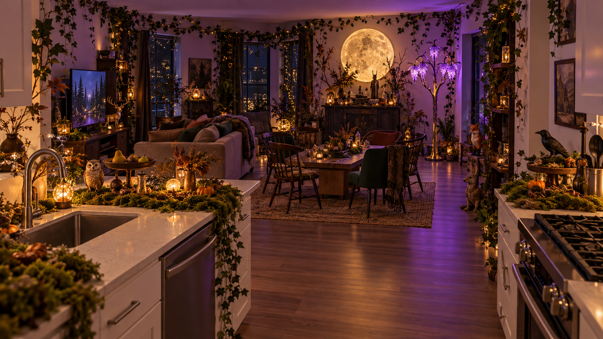
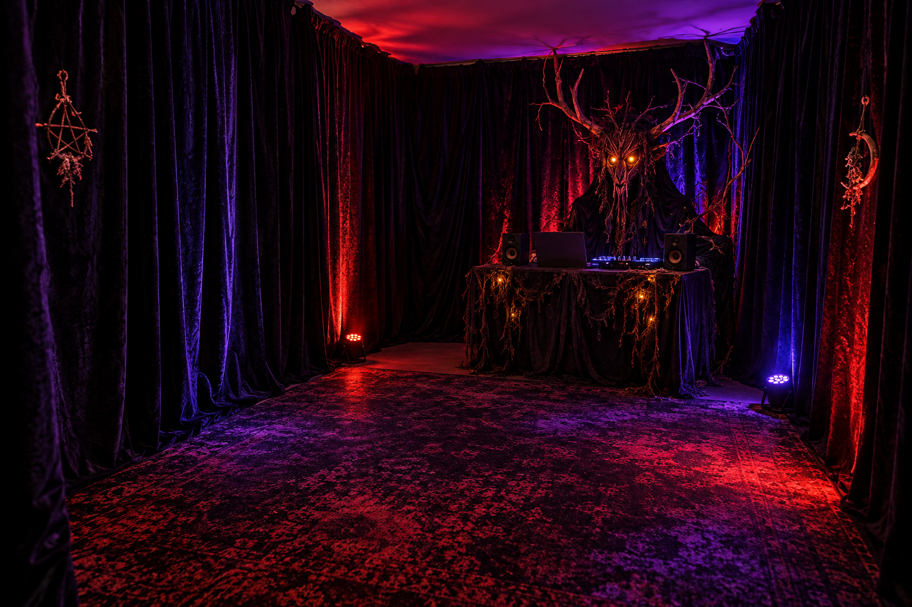
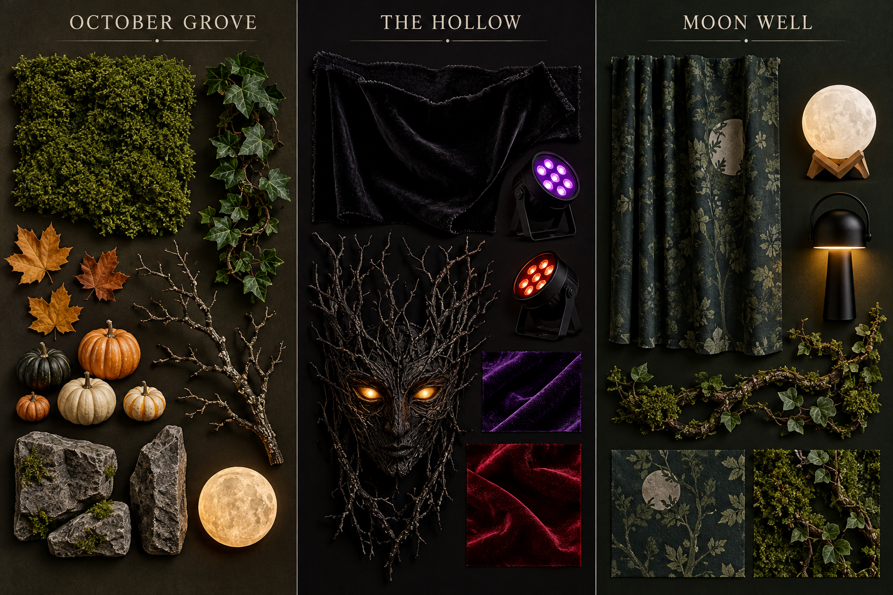

# October 21 decor concepts

Generated with the built-in image-generation tool on October 21, 2026. [Initial prompt set](prompts.json) · [Selected material-board prompt](prompts-materials.json). These are illustrative styling studies, not photographs or measured renders of the apartment. Use the [party layout](../../space-inputs/party-layout-2026-10-21.png) for geometry and the [basket](../../shopping-ready.md) for purchased quantities.

## Use the real layout first

[Scaled actual apartment plan](../../space-inputs/party-layout-2026-10-21.png) · [Direct Grove cutaway](../../space-inputs/grove-cutaway-2026-10-21.png) · [Direct Hollow cutaway](../../space-inputs/hollow-cutaway-2026-10-21.png). The host explicitly requested October 21 that visuals stay grounded in the real apartment. Later AI cutaway drafts still changed sofa orientation/added furniture and are excluded.

## October Grove

Use: moss-covered counters, low seating circle, hanging ivy, pumpkins, stone texture, warm pinpoints and violet wash. Actual moon is a handmade light-backed disk; actual furniture follows the scan. The image adds lanterns, furniture details and foliage density that are not separate shopping commitments. Keep serving surfaces washable and the sink/cooktop clear.

## The Hollow

Use: plush black fabric covering all walls, glowing guardian eyes, automated desk and compact speakers in the rear-right corner. Buy two PAR fixtures; the image depicts extra light sources and a different rug. Keep fabric hems above the floor rather than reproducing the illustrated pooling. **Later host approval:** rug and moss/vine/velvet desk finish now explicitly requested. [Measured fit, product and build allocation](../../bedroom/rug-and-desk-finish-2026-10-21.md) govern the actual 5 × 7-ft rug; the illustrated pattern is a style reference, not the sourced item. Bed storage is concealed behind the guardian; support must be resolved before physical setup.

## Material board

The board shows texture and palette; the linked room plan owns fixture positions, quantities and the Moon Well dry-tub installation. No game figure depicted here establishes a purchased product or final entity artwork.
