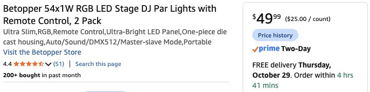
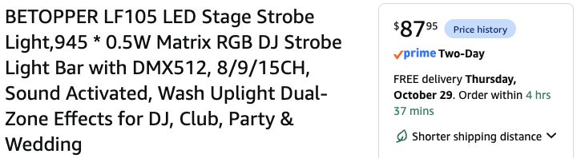

# DMX fill lights and cheaper effect panels — October 27, 2026

**Confirmed host:** no moving heads; all fixtures and laptop will be within five feet of one another. Find the best value wired-DMX fill lights, starting with linked Betopper, and alternatives to the original OPPSK at its coupon price. **Recommendation:** two Betopper LPC018 PARs plus one Betopper LF105 for inexpensive preset-oriented effects. **Step-up:** OPPSK 384-LED panel instead of LF105 if direct zone mapping matters. These are proposals, not newly selected purchases. Original OPPSK remains the selected baseline until host chooses a replacement.

Checked live in signed-in Chrome Play, existing Brooklyn ZIP 11211, October 27, America/New_York (EDT / UTC−04:00). All below except U’King showed **In Stock / free Thursday October 29 delivery**; U’King showed Friday October 30. Target receive by October 30. Coupons were visible but **not clipped/applied**; exact checkout eligibility/price/date remain conditional. No cart additions, orders, software installation or hardware tests.

## Fill: choose the linked LPC018 two-pack

| Model / exact Amazon option | Buy quantity | Price USD | Arrival estimate | Judgment for this room |
|---|---:|---:|---|---|
| **[Betopper LPC018 54×1W RGB, 2 Pack / B0GCCPC16R](https://www.amazon.com/dp/B0GCCPC16R)** | **1 two-pack** | **49.99** | **Oct 29** | **Best fit/value:** slim, fanless design, RGB 3-in-1, 7CH wired DMX, supplied floor brackets/remote. Two different fill positions |
| [U’King 36 LED RGB, 2 Packs / B0B9H16RH5](https://www.amazon.com/dp/B0B9H16RH5) | 1 two-pack | 39.99 | Oct 30 | Lowest cost; only $10 saved and one less setup day. No verified brightness/quality comparison |
| [Betopper LPC120 RGBW 60×2W, 2 Packs / B0D25B3NLG](https://www.amazon.com/dp/B0D25B3NLG) | 1 two-pack | 85.99 | Oct 29 | White channel and more quoted output; $36 premium unnecessary for dim saturated red/violet fill |

The host's exact linked LPC018 is already the DMX version; no separate DMX upgrade/receiver purchase. Four-pack was $95.99, but buying twice the fixtures saves only about $1 per light and adds positions/cabling we do not need. Recommend **two fills total**, one red/amber mix toward Guardian/branches and one violet onto a different cloth/wall surface, with both fixtures clustered within the host’s five-foot equipment area on their own brackets. Keep the side route clear. Start dim, with no strobe; actual angles, base footprints and fabric clearance need a trial. No fixture on Guardian stand or stored bed.

[Manufacturer LPC018 page](https://jp.betopperdj.com/products/betopper-lpc018-54x1w-rgb-3-in-1-stage-led-par-light) documents fanless cooling and 3/7CH; exact Amazon listing says 7CH. The [official linked two-page manual](https://cdn.shopify.com/s/files/1/0084/5230/9047/files/Betopper_LPC018_User_Manual.pdf?v=1780468568), page 2, was downloaded, rendered and visually inspected: 7CH map is master, R, G, B, strobe, macro, speed; strobe **0** is no strobe and macro **0** is inactive. **Version discrepancy:** current listing says 30W / 54×1W; linked LPC018 manual says 50W / 54×1.5W. Use **50W each provisionally** for outlet planning and inspect received labels/map. No claim of tested smoothness near blackout, flicker-free video or measured output. LED count/wattage marketing alone does not rank light quality.



## Main effect panel: alternatives to the $165.59 OPPSK

| Exact product / one fixture | List / visible coupon USD | Relevant control | Tradeoff |
|---|---:|---|---|
| **[Betopper LF105 / B0FX2N14PZ](https://www.amazon.com/dp/B0FX2N14PZ)** | **87.95, no coupon needed** | **8/9/15CH**, RGB matrix, built-in/dual-zone patterns, static RGB/dimmer | **Best preset-oriented value:** saves **$77.64** vs original coupon. No dedicated white/amber channels established; less fine DMX mapping |
| [OPPSK 384 LEDs / B0BBM95KFN](https://www.amazon.com/dp/B0BBM95KFN) | 109.99 / **104.49** | **6/9/64/112CH**, **32 RGB + 16 white zones** | Best step-up for direct zone control, $16.54 above LF105; fewer RGB zones and no amber versus original |
| [OPPSK 960 LEDs / B0D2HDSGSQ](https://www.amazon.com/dp/B0D2HDSGSQ) | 141.99 / **134.89** | **4/11/32/39CH**, **8 RGB + 8 white zones** | Poor middle option for us: saves only $30.70 vs original while giving up much of its zoning |
| [Original OPPSK 1080 LEDs / B0H6HJJ5DP](https://www.amazon.com/dp/B0H6HJJ5DP) | 179.99 / **165.59** | **18/268CH**, **72 RGB + 32 white + 8 CW/amber zones** | Most detailed control and amber; keep if those effects matter enough for the premium |

The user-reported approximately $165 original OPPSK price is confirmed more precisely as **$165.59 displayed coupon price**, unchecked. It is not $165.00 and not a paid total.

LF105 recommendation is an **inference from its documented features, cost and the intended show**, not a claim of equal measured brightness/build quality. [Manufacturer LF105 page](https://jp.betopperdj.com/products/betopper-lf105-150w-matrix-strobe-effect-lights) documents RGB matrix animations, static color, dimming, DMX and built-in dual-zone effects. Amazon advertises 105 visual cells, but its **maximum 15 DMX channels do not establish independent RGB control of 105 pixels**. Treat it as a bank of preset animations with color/speed/dim controls. Original OPPSK's high-channel mode offers materially more detailed mapping. Its dedicated white/amber array is also different. For slow color movement and automated club patterns in this small room, the extra capabilities are not necessary to the proposed first show.

Manufacturer/Amazon LF105 LED power figures differ (0.2W vs 0.5W per LED); use the received input nameplate, not multiplication of advertised LED wattages. The manufacturer describes 150W consumption. Exact received manual/profile, low-end dimming, no-strobe controls and loss-of-DMX behavior still need checking. Do not claim an untested effect panel is identical to the original OPPSK.



## Connection and simple automation

The accepted SH-RS09C USB-C interface and free QLC+ remain. All fixtures use one line, with each fixture set to **DMX receive**, not one device's standalone/master program driving another brand.

```text
Mac USB-C → SH-RS09C included lead → chosen effect panel
  → DMX cable 1 → LPC018 fill A
  → DMX cable 2 → LPC018 fill B → existing 120Ω terminator
```

**Two short fixture links are necessary if adding the pair.** Recommend [Cable Matters 6-ft 3-pin DMX two-pack, B08SQMHPF3](https://www.amazon.com/dp/B08SQMHPF3), **one pack / $16.99 / In Stock / free Oct 29**, Amazon ships / Cable Matters sells, refreshed this session. Both cables are used; no extra pack. With host-confirmed five-foot spacing, the included 5.9-ft USB-DMX lead and six-foot links give modest slack; no long extension pack. These are links **between fixtures**, not an extra USB/Mac extension. Check connector orientation and actual routed reach during setup. Keep the terminator at the last fill, not the first panel. No second interface/splitter/controller required for this linear three-fixture proposal. Separate grounded AC feeds still required.

Provisional simple-mode patch: panel **001** using LF105 15CH, OPPSK384 9CH or original OPPSK18CH; fill A **033 / 7CH**, fill B **049 / 7CH**. These do not overlap in the named modes. Full pixel modes require a different address plan. Verify received manuals before patching; no ready-to-run fixture profile/show was fabricated.

Start with low static red/violet fills and use the panel for slow preset patterns. Add controlled QLC+ intensity/color changes after first-output tests; microphone response can be introduced separately. Do not let three independent sound programs fight one another. [Existing Mac/automation setup and same-Mac rehearsal](oppsk-usb-dmx-2026-10-27.md) still applies; [official QLC+ DMX USB support](https://docs.qlcplus.org/v4/plugins/dmx-usb). Guardian eyes remain a separate steady warm string. Existing Grove/bath lighting and all scenery unchanged.

## Whole-decor comparison

Same scenery, $105 local/support allowance, aggregate 9% planning tax, $60 shipping reserve and $30.48 buffer. Only the effect panel, two-fill pack and two links differ. Actual tax/shipping/support still unquoted.

| Scenario | Products | Tax allowance | Whole decor |
|---|---:|---:|---:|
| Existing selected OPPSK only, conservative no coupon | 951.48 | 95.08 | **1,242.04** |
| Same selected OPPSK only, if $165.59 coupon applies | 937.08 | 93.79 | **1,226.35** |
| **Recommended LF105 + LPC018 pair + two links** | **926.42** | **92.83** | **1,214.73** |
| OPPSK384 coupon + LPC018 pair + two links | 942.96 | 94.32 | **1,232.76** |
| Original OPPSK coupon + LPC018 pair + two links | 1,004.06 | 99.82 | **1,299.36** |

Recommended light bundle is **$154.93 before tax** (LF105 $87.95 + fill pair $49.99 + links $16.99), plus existing interface/terminators already counted. That includes the full scenery and three controlled fixtures for $27.31 less than the conservative current one-fixture plan. **$385.27 below $1,600**, including protected buffer. The direct-zone step-up without its coupon is $1,238.75; original-panel upgrade without its coupon is $1,315.05. No duplicated fixtures or additional spare-control allowance.

Selected baseline has not been silently replaced. Choose one main effect panel; do not buy every comparison. No purchase requested/performed. Earlier OPPSK-only/no-extension decisions are preserved pending the new panel/fill choice; moving-head removal is now explicitly confirmed by host.

[Exact offers, UI excerpts and Decimal calculations](../research/dmx-fill-and-panel-comparison-2026-10-27.json) · [RGBW comparison proof](../research/betopper-rgbw-two-offer-2026-10-27.png). One stale/no-longer-live LPC120 ASIN (B0D2VYXSFH) was rejected; the live two-pack is B0D25B3NLG. No availability assertion relies on the failed page or generic manufacturer 3–7-day shipping.
