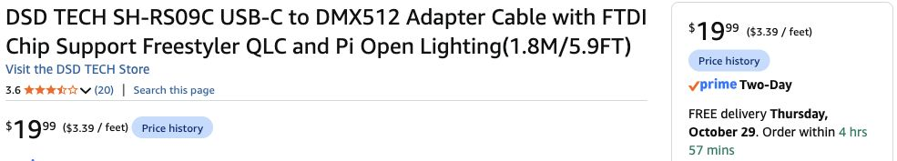

# OPPSK over USB-C — October 27, 2026

**Confirmed host:** accept the OPPSK / direct USB-C DMX route and omit extension cables (latest October 27 reply). The current basket uses one OPPSK, with no PAR kit, moving heads or lasers. **Recommended control:** DSD TECH SH-RS09C directly into the Mac's USB-C port, free QLC+, one terminated DMX line. The interface, terminators and OPPSK showed **free Thursday October 29 delivery / In Stock** in signed-in Chrome Play earlier on October 27; no fresh offer check in the extension-removal update. Target receipt Friday October 30; offers can change before checkout. Nothing bought, installed or physically tested.

## Exact parts and costs

| ID | Product / exact variant | Buy quantity | USD | Observed fulfillment |
|---|---|---:|---:|---|
| H29 | [OPPSK 1080LEDs Stage Light / B0H6HJJ5DP](https://www.amazon.com/dp/B0H6HJJ5DP) | 1 | 179.99 | Oct 29; Amazon ships / OPPSK Pro-Lighting sells |
| H39 | [DSD TECH SH-RS09C USB-C to DMX512 / 1.8m, 5.9ft / B0FX49ZQ8T](https://www.amazon.com/dp/B0FX49ZQ8T) | 1 | 19.99 | Oct 29; Amazon / DSD TECH Direct |
| H36 | [Cable Matters 120Ω 3-pin male DMX terminator / 2-pack / B0CSSJP1H4](https://www.amazon.com/dp/B0CSSJP1H4) | 1 pack | 8.99 | Oct 29; Amazon / Cable Matters |

Use one terminator; the second is a pack spare. **Selected control hardware $28.98**, OPPSK plus control **$208.97**, before tax. The [whole-decor basket](../shopping-ready.md) is **$1,242.04**, including aggregate planning tax, local/support allowances, shipping and buffer. Host has accepted this route; no purchase has been performed.

**Extension pack omitted by host.** Use the SH-RS09C’s included 5.9-ft lead directly. Confirm the route during setup; adjust equipment position if practical. The [H35 Cable Matters 25-ft two-pack](https://www.amazon.com/dp/B08SQG6GBF), earlier quoted $26.99 / Oct 29, is only a contingency if reach fails, not an item to buy now. Earlier $1,271.46 extension-included total is superseded by the selected direct-cable budget, saving $29.42 with tax allowance.

The SH-RS09C listing identifies **FTDI FT232RL**, macOS and QLC+ support; its product image shows USB-C male and 3-pin female DMX. [Manufacturer page](https://deshide.com/product-details_SH-RS09C.html). This is an active data interface, powered over USB. The fixture still requires its own AC supply. Its seller's other software claims have not been validated.



[Sanitized UI excerpts and cost calculations](../research/oppsk-usb-dmx-2026-10-27.json). These are new one-time offers, without used/subscription/coupon discounts; they are not reserved delivery slots.

## Physical connection

```text
Mac USB-C
  → SH-RS09C (USB → actual DMX signal; included 5.9-ft lead)
  → OPPSK DMX IN (male)

OPPSK DMX OUT (female) → H36: 120Ω male terminator
OPPSK power input → separate suitable grounded AC supply
```

The terminator is the end of the single-fixture line, not a USB adapter. Use DMX-rated cable, not a USB microphone interface. Guardian eyes remain on their separate warm-light power/remote system; they are not DMX fixtures. The Guardian's microphone stand does not support the OPPSK. Keep the independent fixture-positioning reserve; no overhead support has been sourced or approved.

## Other lighting / second-system clarification

The original second Hollow effect was the **U’King moving-head pair (H31)**. It was excluded from the current timely basket because the earlier October 27 quote showed **October 31 arrival / $129.99**. It has not been re-added or newly quote-checked in this update. One OPPSK is currently the bedroom’s DMX rig. Guardian eyes remain a separate steady warm accent.

The Grove still has a separate lighting arrangement: **Govee RGBIC floor lamp + owned LIFX tree lamp**, plus the handmade moon and warm string accents. They are not connected to this DMX line. Bathroom lighting also remains in the [shopping list](../shopping-ready.md#lighting-still-in-the-plan).

## First Mac setup

Read-only host check: this Mac reports **arm64 / macOS 26.6.2**. No QLC-named application was found in the two normal Applications folders. No software was installed or system settings changed.

1. Use **QLC+ 4.14.4, Apple Silicon** from [official downloads](https://www.qlcplus.org/download), offered for macOS 12+. V5 is also available; stick to the v4 workflow for this short setup. The download minimum is not a test on this exact Mac/adapter.
2. Connect the adapter directly. In QLC+ **Inputs/Outputs**, enable its **DMX USB output** for **Universe 1**. If detection does not identify the adapter correctly, configure it as **Open TX**. Only one lighting application should own the interface. [QLC+ DMX USB configuration](https://docs.qlcplus.org/v4/plugins/dmx-usb) · [ENTTEC first-output guide](https://support.enttec.com/dmx/usbdmx-open-dmx-usb-70303/open-dmx-usb-with-qlc).
3. QLC+ documents native macOS USB support without extra drivers and specifically warns against **VCP** drivers. Do not install random serial drivers or make kernel/security changes to troubleshoot. Diagnose detection/port ownership first using the linked official guidance.
4. On OPPSK choose **CHnd → 18CH**, **address A001**. Use QLC+ Simple Desk for initial single-channel checks, followed by a matching 18-channel fixture definition. Start with low static output and verify master, RGB and blackout before enabling any built-in effect. Address is DMX channel 1, not a network address. One fixture is all we need to patch.
5. Save a workspace with low red, violet, slow crossfade and blackout controls after verifying each on the light. Reopen it and test again. Do not reuse the old three-fixture addresses/definitions.

**Protocol confidence:** the FTDI hardware and QLC+ Open-TX support give a documented, reasonable compatibility path. The exact SH-RS09C/OPPSK/host combination is **untested**. Do not describe this $19.99 interface as buffered or electrically isolated: those features are not established. Treat it as Open-style host-timed output when planning the load test. [ENTTEC's Open versus Pro comparison](https://support.enttec.com/dmx/usbdmx/usbdmx-compare-enttecs-dmx-usb-devices) explains why more expensive buffered interfaces can be more resilient; no Pro purchase is required by this plan.

## OPPSK map and automation

The exact Amazon listing states **18/268 channels and 112 zones**. An [OPPSK-authored manual mirrored by device.report](https://device.report/m/90fa5b393e3b556c627dc3b75acabca580ec081a5bb8c0672335a966088f9ff4.pdf) matches those modes and the LED counts: 648 RGB, 288 white, 144 cool-white/amber. Its menu text identifies CHnd and A001. This is stronger evidence than a generic OPPSK profile, but the received model/manual must still match.

The table's extracted text identifies master/RGB controls and built-in effects in 18CH; 268CH provides individual-zone controls. **The table was not visually verified:** the mirror's browser check blocked PDF viewing, and screenshot retrieval did not expose a usable table image. No guessed `.qxf` or ready-to-run show was produced. Verify the printed 18CH table and effect/strobe-off ranges before assigning faders or automation. Similar OPPSK models use different maps. 18CH is sufficient for a first color/effect show; individual-pixel programming is optional later work.

QLC+ scenes and repeating chasers can run unattended once started. [Audio triggers](https://docs.qlcplus.org/v4/virtual-console/audio-triggers) can map microphone volume/frequency bands to functions or channels. Start with the Mac microphone hearing the speakers, subject to the normal microphone permission; this avoids purchasing audio capture hardware. Room conversation can also trigger it. A clean internal audio feed is a separate routing task, not automatically provided by USB DMX. No new loopback driver is required for the baseline plan.

Recommended first automation: a slow red/violet chase, then an optional low-frequency trigger for color or modest intensity changes after the exact controls are verified. Keep strobe channels out of automatic audio mappings. This is reactive lighting, not automatic rekordbox beat-grid/phrase/drop synchronization. Keep a static fallback and visible blackout control. No human DJ is needed.

## Receipt and rehearsal

October dates below use America/New_York, **EDT / UTC−04:00**.

- **Oct 27–28:** recheck checkout delivery; preserve the desk's USB-C data port and map a perimeter cable route. Prepare scenery/card work without waiting for lights.
- **Oct 29:** receive/inspect parts, check the printed manual/model, build the first patch and static scenes. Separately begin the full fleece-panel mount trial. If detection fails, inspect QLC+ output selection and cable polarity/IN port before considering different hardware.
- **Oct 30:** run QLC+ with the **actual final music and TV workload together**, not just a quiet desktop. Check sustained fades, audio input, flicker/dropouts, music interruptions, app restart, USB reconnection, fixture power cycle and loss-of-DMX behavior. Restore to a dim predictable state after each. Physical controls must remain accessible. The bedroom fixture's actual nameplate load and independent position/clearance still need inspection.
- If the cheap interface is unreliable or late, retain the same OPPSK on a tested onboard static/auto setting. Its sound mode is an option only after inspecting its brightness/strobe behavior. Do not make another mail-order controller a last-day dependency.

Earlier full rig and two-PAR proposals remain dated comparisons, not additional shopping. No orders, cart edits, messages, software installation or live light tests were performed in this research session.
