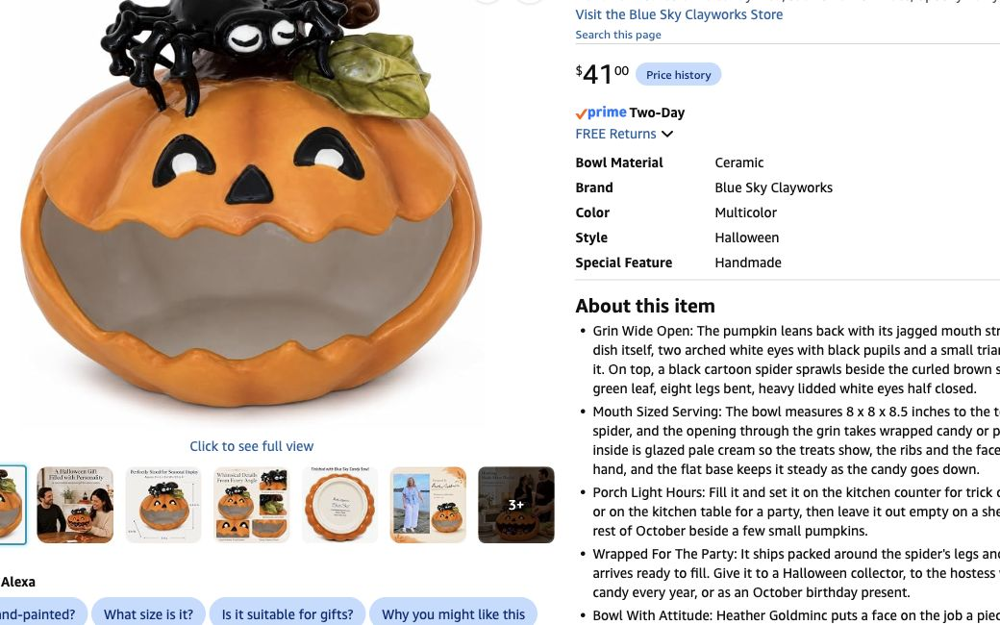

# Grove displays — harvest offering table and wood-and-bone shrine

**Confirmed October 29:** there is one moon only, in the Moon Well. The owned golden tree goes **in the middle of the living room**. The relocated bedroom nightstand becomes a **Harvest Offering Table**, with **The Last Seed** as its guardian and sweets holder. No moon disk, moon plaque, second tree lamp or extra cabinet.

| | Harvest Offering Table | Wood-and-bone shrine |
|---|---|---|
| Guardian | DEC-04, The Last Seed: pumpkin-face candy holder | DEC-05, The Unfinished Guest: ivory wolf skull |
| Furniture | One relocated bedroom nightstand | Proposed existing 20×40-inch surface; actual location still to fit |
| Main object | [Blue Sky Clayworks Pumpkin Spider bowl](https://www.amazon.com/dp/B0GQ51PZQF), one, $41.00, **ordered — host confirmed October 29** | [Veemoon White 20×14×8 cm skull](https://www.amazon.com/dp/B0BCGRT7ZQ), one, $17.39 quoted; **ordered — host confirmed October 29** |
| Surround | Small shared ivy/moss accent; food-contact mouth stays clean | Ordered moss top, shared ivy and the one already-budgeted 78.9-inch faux wall trunk |
| Harvest/light | Pumpkin holder itself plus two shared tea lights outside dish | Available acquired mini pumpkins and two shared tea lights |
| Interaction | Help yourself to individually wrapped chocolates; keep refill bag underneath | Separately frameable skull guardian; no food bowl or handling required |
| Nearby animal | Owl at a separately frameable corner if room allows | Raven to one side, separately frameable from skull |

## The Last Seed — ordered; wash, place, fill on receipt

The host-selected factory-painted pumpkin is seller-described **8×8×8.5 inches including the top spider**, a larger replacement for the earlier $23.99 Bico proposal. It needs no sculpting, carving, painting or separate face. Capacity is unmeasured; fill in batches and replenish from reserve. Keep moss out of the mouth and leave the face visible. Do not place a candle inside with candy.

Lore: **It once carried an entire forest through winter inside a single seed. It has been certain things will grow again ever since.** It guards what will survive the winter; sweets are the harvest offering. This keeps it distinct from the bustling hospitality of The Little Host. Proposed small sign: **“THE LAST SEED — Take something sweet for the road.”** No offering, secret or puzzle completion is required to take candy.

One [Mars 120-piece mixed chocolate bag / 46.19 oz](https://www.amazon.com/dp/B0D45S87QM), **$19.97**, gives about two small pieces per guest at 60 guests. Individually wrapped M&M’s, Snickers, Twix and Milky Way; not full-size bars. Seasonal listing says Christmas. Keep ingredient/allergen packaging available; mix includes peanut products. Candy replaces the existing $25 food sweets allocation, not another decor expense or bathroom order.

Pumpkin and candy detail pages showed In Stock/free **October 31** at about 10:33 p.m. EDT October 29; no before-party arrival window guaranteed. [Evidence and alternatives](../research/cart-and-lighting-check-2026-10-29.json). Host confirms pumpkin, chocolates and all selected shrine materials ordered; actual charges/order-specific delivery/receipt unverified. Agent placed no order.

## Shared material allocation

One [Fosolasi 78.9-inch faux trunk](https://www.amazon.com/dp/B0FPQ8DDDP), carried quote $49.99, is both Grove wall scenery and bone-shrine backdrop; do not order a second. Fit suitable wall supports to actual weight and wall. Skull sits on the surface; branch never carries it. No heavy overhead wood.

The 20×40 top is already in the four-sheet moss cut plan. Divide the single paired shrine ivy run between these two displays. Host confirms the selected 100-pack of amber tea lights ordered; **24 are enough for proposed accent clusters**, roughly 14 Grove/four Hollow/four dry bath/two spare, fitted to actual surfaces. Do not buy the earlier optional 24-pack alongside the ordered 100-pack. Host has acquired mini pumpkins; use available count at the two displays first, then coffee table/counter if any remain. **No additional pumpkin/gourd sourcing.** Existing $35 is a placeholder for acquired minis until actual cost known. Three USB strings total: two Grove wall/foliage routes and one Hollow Guardian; no shrine moon string. Four ivy packs are host-confirmed ordered; original route allocation plus extras for fullness/spares, no additional pack per display. A separate selected 67-inch wall branch supplies the second Grove wall; original 78.9-inch branch stays the bone tableau backdrop.

The central Gilded Root stays independent of both displays. Fit its base and cord route in the middle of the living room without blocking flow; exact spot not measured. Keep pumpkin, owl, skull and raven separately frameable. Enroll the pumpkin's fixed exterior, with a reference that tolerates changing candy levels; test rather than assuming recognition. [All 15 slots](../../interactive-game/physical/guardian-coverage-2026-10-29.md).

