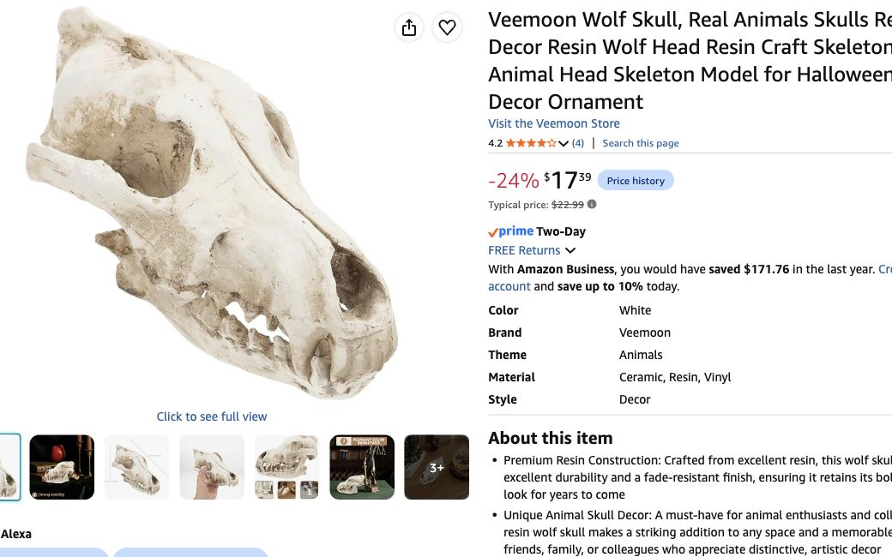

# The two Grove shrines

The last review combined two focal points too loosely. **Propose two distinct displays using existing furniture**, not two new cabinets. Moon shrine stays on the relocated bedroom nightstand. The other 20×40-inch surface is the proposed wood-and-bone shrine location; confirm where that actual surface stands before mounting branches. If it cannot be dedicated, use a dry existing counter-back section instead. No invented table or measured placement claim.

| | Moon and sweets shrine | Wood-and-bone shrine |
|---|---|---|
| Main object | 24-inch Grove moon above/behind nightstand | About 7.9-inch ivory wolf skull, $17.39 |
| Furniture | One relocated nightstand/low cabinet | Existing 20×40-inch surface, proposed |
| Surround | Ivy/moss accent, owned gold tree beside it | Already-budgeted 78.9-inch faux wall branch behind/along display, moss-covered top and ivy |
| Harvest/light | One pumpkin, two shared tea lights | Two pumpkins, two shared tea lights |
| Guest interaction | Clean bowl/jar of wrapped chocolates at the front | Distinct skull tableau as DEC-05; no handling or separate food bowl |
| Nearby animal | Larger owl at an uncluttered corner | Larger raven to one side, separated from skull for camera framing |

**New additional shrine purchase:** one [Veemoon wolf skull / White / 20×14×8 cm](https://www.amazon.com/dp/B0BCGRT7ZQ), **$17.39**, quantity **1**, showed In Stock/free October 31. Overall about 7.9×5.5×3.1 inches. Seller title/material table conflict with resin prose; treat material/finish as listing claims, actual quality untested. The old MagiDeal skull link now shows November 10–11 and is excluded.

**Already in the current plan; do not add again:** one [Fosolasi 78.9-inch branch](https://www.amazon.com/dp/B0FPQ8DDDP), earlier quote $49.99, supplies this shrine's substantial wall backdrop. It is the same branch from the Grove wall plan, not another branch order. Use existing H42 allocation, suitable Grove wall hooks and ties after checking its real weight/support. Skull sits on the table, never hanging from the faux branch. Do not put heavy real wood overhead.

Moss for the full 20×40 top is already in the four-sheet cut plan. Ivy comes from the same two Freyalife packs; split the single paired shrine run between the two displays as needed. Twelve tea lights remain six Grove/four bathroom/two spare: two moon shrine, two bone shrine, one coffee table, one counter. Five pumpkins remain one moon shrine, two bone shrine, one coffee table, one counter. No extra moss/vine/light/fruit pack just for the second shrine.

Candy remains **one existing $25 food allowance**, at the moon shrine. Use a clean washable bowl/jar or tray, keeping food separate from moss/paint. No duplicate bathroom candy purchase. The owl, raven, skull, moon and tree are separate recognition subjects; do not crowd them into an inseparable pile. [All fifteen physical slots](../../interactive-game/physical/guardian-coverage-2026-10-29.md) gives source/status for each.

