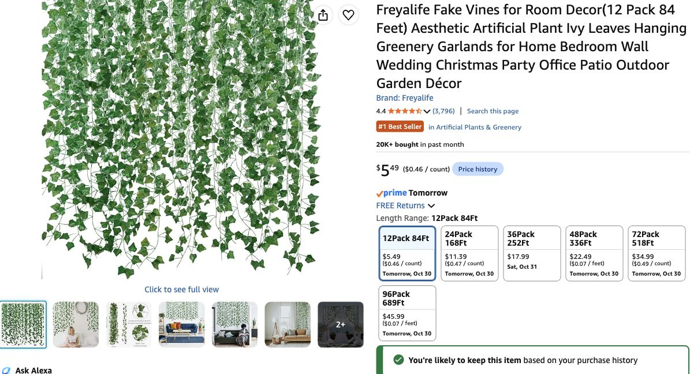

# Ivy comparison — Freyalife is the value recommendation

**Latest October 29:** host asks why the proposed Mizii is preferable to [Freyalife /12Pack 84Ft](https://www.amazon.com/dp/B0D6KDW17P). After inspecting that exact listing, **recommend two Freyalife 12-packs for $10.98**, loosely paired into twelve fuller runs. This supersedes Mizii as the default recommendation. The host has not selected or reported ordering either replacement.

## What the higher price buys — and what remains unverified

| Item | Last checked price | Pack length | Listed construction |
|---|---:|---:|---|
| [Mizii /Ivy](https://www.amazon.com/dp/B0CXHNJVR6) | $32.99 per five-vine pack | 5 ×79 in /32.92 ft | Seller explicitly claims 190 fabric leaves per vine, side branching and wire inside plastic stems |
| [Freyalife /12Pack 84Ft](https://www.amazon.com/dp/B0D6KDW17P) | $5.49 per twelve-vine pack | 12 ×7 ft /84 ft | Seller describes fabric (“silk”) leaves and plastic stems; no leaf count or internal-wire claim found |

Mizii was suggested for its branch structure and the look of the product photos. **No physical sample, independent durability test or side-by-side installed comparison establishes that it looks enough better to justify the premium.** Both sellers’ “silk” wording is not verified natural-silk composition. Do not turn marketing photos into a proven quality ranking or infer Freyalife has no wire merely because none is specified.

For this few-day party, dim purple/amber lighting and foliage mostly at room edges, Freyalife is the better cost judgment. Pairing adds material, although it does not reproduce Mizii’s branching or guarantee equal realism. The previous recommendation placed too much weight on photo styling compared with the host’s value preference.

## Proposed order and arrangement

- Select **12Pack 84Ft**, quantity **2**, rather than automatically switching to the single 24Pack option (which showed $11.39 versus $10.98 for two 12-packs).
- Two packs contain **24 individual strands /168 ft raw length**. Pair strands loosely, staggering leaves, to create **12 nominal7-ft runs /84 ft of paired coverage**. Actual bends/overlap can reduce useful span; this is a plan, not an installed measurement.
- Restore the earlier **ten paired runs Grove /70 ft** (eight high edge sections, one trailing accent, one shrine/tree) and **two paired runs Hollow desk /14 ft**. This avoids the prior Mizii proposal’s reduction to ten total runs/~66 ft.
- Use the ordered ties to join pairs loosely and planned suitable clips for attachment; no extra tie pack or separate foliage lights added. Individual leaf density is not verified, so do not promise a dense ceiling canopy.
- The Freyalife listing warns of packaging odor; unpack and air it out promptly on arrival. Attachment, appearance and odor still need a received-material check.

## Live offer verification

Checked signed-in Chrome October 29: exact ASIN **B0D6KDW17P**, selected **12Pack 84Ft**, **quantity 2**, **$5.49 each / $10.98 calculated**, In Stock, **free Friday October 30 delivery**. Shipped by Amazon, sold by Freyalife. No smaller time window was shown. Checkout must confirm; no cart, instant-buy or payment action.

Mizii’s $32.99 quote and quantity 2 Friday estimate come from the preceding check in this session, not a new second check on this follow-up. [Earlier Mizii evidence](../research/ivy-upgrade-check-2026-10-29.json) remains historical comparison; [new Freyalife record](../research/ivy-freyalife-check-2026-10-29.json) records the current recommended option.

## Budget — replacement pending host choice

Two Freyalife packs **$10.98** replace the old H27 allowance **$9.99**, a **$0.99** merchandise increase. Current remaining baseline stays $157.92 until selection; if accepted: **$158.91 +$14.30 aggregate 9% planning tax = $173.21 remaining**. This is **$55 less merchandise / $59.95 less with planning tax** than the superseded two-pack Mizii scenario ($213.91/ $233.16). Ordered quote value remains $281.07; proposed whole-core **$439.98 / $479.58 with tax**, excluding local $105/deferred lights and with actual paid totals unknown.

Original KASZOO held; Mizii is a premium alternative rather than the default. No replacement selected or ordered by inference from the host’s comparison question.

[Buying list](../shopping-ready.md) · [Purchase ledger](../purchases-and-allocations-2026-10-29.json) · [Handoff](../handoff-2026-10-29-ivy-value.md).
