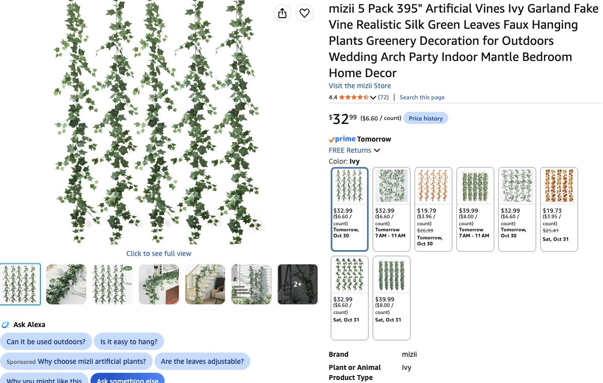

# Better-looking ivy — October 29, 2026

**Host feedback:** the current KASZOO ivy does not look good enough; find a better option. **Recommendation for review:** [Mizii / Ivy / five 79-in vines per pack](https://www.amazon.com/dp/B0CXHNJVR6), **two packs / ten vines / $65.98 before tax**. Exact product and reduced-coverage allocation are **not host selected or ordered**. Hold the old KASZOO purchase while choosing.

## Why this one

In the product photos, Mizii has smaller leaves, irregular side branches and mixed green tones; its leaf veins are less conspicuous than the RECUTMS alternative inspected. The seller describes **190 fabric leaves per vine** and plastic stems with internal iron wire, so the branches can be shaped outward. These are listing specifications and visual judgments from retailer photos, **not a physical sample or verified realism in this apartment**. The listing says “silk,” which does not establish natural-silk fiber content.

The inspected [RECUTMS Green-dgy6pcs / six 6.3-ft vines](https://www.amazon.com/dp/B0DHKN4TRD) is $30.99 per pack and showed Oct 30,7–11am at quantity 1. It provides more length per pack, but its broad flat leaves/prominent printed veins looked less convincing in the close-up. Its hypothetical two-pack $61.98 is only $4 below the recommended Mizii pair; quantity 2 RECUTMS stock/delivery was not checked. It is an alternative, not an extra buy.

## Delivery actually checked in Chrome

- **Mizii / Ivy**, ASIN **B0CXHNJVR6**, selected option explicitly “Ivy”; not Eucalyptus, Fall Ivy, Ficus, Scindapsus or Willows.
- **Quantity 2 selected**: $32.99 per five-vine pack, **$65.98** total calculation, In Stock, **free Friday October 30 delivery**. No narrower delivery window was shown for this green Ivy option. Sold by Mizii, shipped by Amazon.
- Product estimate only; no checkout/cart change/order/payment. Confirm final arrival and total at checkout. No coupon or bundle discount counted.
- [Structured offer record](../research/ivy-upgrade-check-2026-10-29.json) · screenshot below. Earlier Larksilk six-foot options in the search showed November 3 delivery and were not pursued for this deadline.

## Allocation and coverage tradeoff

Each vine is **79 in /6.58 ft**. Ten give **790 in /65.83 ft**, compared with the former12×7ft /84ft proposal: approximately **18.17 ft /22% less linear coverage**, with more branching per photographed strand. More leaves do not create extra length.

Proposed use: **eight Grove vines /52.67 ft** (six selected high window/cabinet/wall sections, one trailing accent, one shrine/tree) and **two Hollow desk/Guardian vines /13.17 ft**. Prior Grove allocation was ten7-ft vines; this proposal concentrates on six high sections rather than eight. Keep the room layout and clear central floor unchanged. Shape the side branches and hide joins behind the already ordered moss/cloth; do not count this as an overhead canopy.

If retaining at least84ft is essential, **three packs /15vines /98.75ft / $98.97** is the arithmetic alternative, with three extra vines beyond the former12-strand count. **Quantity3 delivery/availability not checked**, and this larger order is not the recommendation or approved scope.

## Cost comparison — pending selection

The current five-unconfirmed-line baseline is **$157.92 before tax / $172.13 with planning tax**, including the old **$9.99** ivy allowance. Replace that allowance with the two-pack **$65.98** proposal, rather than adding both: **$213.91 remaining merchandise +$19.25 aggregate 9% planning tax = $233.16**. Increase **$55.99 before tax / $61.03 with tax**. Ordered quote value remains$281.07; combined core would be **$494.98 / $539.53 with planning tax**. Actual paid totals remain unknown; local $105/deferred lighting separate.

The baseline ledger is retained for comparison until the host selects the replacement. It now flags H27 as held with a replacement proposal; this is not a final new order or an approved reduction in coverage. Mizii includes no light string; the old KASZOO incidental LED inclusion is not carried forward. Deferred moon/Guardian light strings remain their own allocations, not duplicate foliage purchases.

[Current buying list](../shopping-ready.md) · [Current purchase ledger](../purchases-and-allocations-2026-10-29.json) · [Handoff](../handoff-2026-10-29-ivy-upgrade.md).
