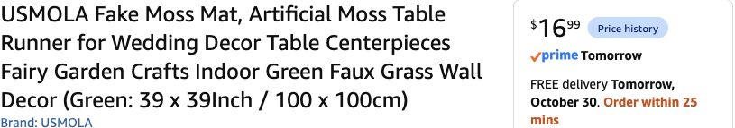

# Moss for countertops and both tables — October 29, 2026

**Confirmed host:** cover kitchen countertops using the scan, the **22 × 44-in coffee tabletop** and another **20 × 40-in surface**. Top surfaces only; no edge drop or vertical fascia added. These tabletop measurements supersede the scan for moss cuts; the coffee table’s larger modeled furniture bounding box remains a conservative layout reference, not its top measurement.

**Recommend four [USMOLA Green 39 × 39-in sheets](https://www.amazon.com/dp/B0FZD67YDD), $16.99 each / $67.96.** Selected Green39 × 39 and quantity 4 were checked in signed-in Chrome on October 29: **In Stock, FREE Tomorrow Friday, October 30**, Amazon ships /Usmola sells. At the check only **25 minutes remained**; host informed immediately. Reconfirm date at checkout. No cart addition or order by agent.

| Surface | Dimensions / basis | Moss area |
|---|---|---:|
| Usable kitchen worktops | Recomputed from original Polycam GLB; sink opening deducted, stove/oven/fridge excluded | **24.38 sq ft** |
| Coffee tabletop | Host22 × 44 in | **6.72 sq ft** |
| Other surface | Host20 × 40 in | **5.56 sq ft** |
| **Requested top coverage** | | **36.66 sq ft** |
| Retained Hollow desk accent | Earlier approximate2-sq-ft allocation, separate from new20 × 40 top | **~2 sq ft** |
| **Four sheets supplied** | 4 ×39 ×39 /144 | **42.25 sq ft** |

Three supply only 31.69 sq ft, less than the requested tops before cuts. Four leave about **5.59 sq ft for cuts before desk**, or **3.59 sq ft after the existing desk allowance**. The prior optional two-sheet runner scheme and three-sheet basket no longer satisfy the new full-surface scope. No extra purchased loose moss required for the Guardian; use small remaining scraps or paint.

## What the scan actually measures

The GLB has no node transforms; X/Z mesh accessor bounds give these approximate rectangular worktop footprints. Worktops are inferred from base cabinet/dishwasher shapes, not directly tape-measured edges. Actual overhangs, taps, irregular sink edge and usable clearances can differ.

| Scan component | Approximate top dimensions, inches | Area sq ft |
|---|---|---:|
| Left of stove, storage_cabinet_mid1_0 | 25.13 ×28.53 | 4.98 |
| Right of stove, storage_cabinet_mid1_3 | 14.55 ×28.53 | 2.88 |
| Long sink run, storage_cabinet_mid3_0 | 28.64 ×71.29 | 14.18 |
| Top over dishwasher, inferred from dishwasher_0 | 25.73 ×24.49 | 4.38 |
| Subtract modeled kitchen sink_1 opening | 16.31 ×18.00 | −2.04 |
| **Net estimate** | | **24.38** |

[Exact derived dimensions and method](moss-surfaces-2026-10-29.json). Raw scan stays local/ignored. Bath sink, upper cabinets and freestanding furniture are excluded from kitchen area.

## Four-sheet cut feasibility

[Illustrative cut diagram](moss-four-sheet-cuts-2026-10-29.svg) packs slightly rounded-up worktop sections, both tables and a49 × 6-in desk fascia into four 39-in squares. Geometry checked for sheet boundaries, overlaps and assembly areas. This is a proposed packing example, not a physical template or passed material test.

- **A+B:** two29-in-deep sections give a72-in sink run. Save an intact **at least16 ×18-in sink cutout** for the dishwasher section; cut around the actual paper sink template first.
- **C:**22 ×39-in coffee-table main piece; add **22 ×5 in** from B to reach 44 in. The remaining side strip supplies the small right-of-stove counter.
- **D:**20 ×39-in other-top main piece; add **20 ×1 in** from B to reach 40 in. Its19 ×29-in side piece joins a6.5 ×29-in A strip for the left-of-stove counter.
- **Dishwasher:** recovered16 ×18 plus10 ×18 from B give 26 ×18;19 ×7 from D plus7 ×7 from C extend it to 26 ×25. These seams can sit under a clean serving tray.
- **Desk:** small A/B/C/D strips join to 49 ×6 in. Use minor remaining scraps for Guardian/shrine; avoid allocating more than the actual surplus.

Packing uses **butt joints, with backing secured underneath**, rather than overlapping and consuming coverage. Four are the economical minimum; both tables and some counter sections need joined pieces. The rounded example uses 39.49 sq ft including desk and has2.76 sq ft unused. If paper templates or received usable edges invalidate it, simplify small accents or re-cost a fifth sheet; do not call four guaranteed seam-free coverage. No fifth included in order total.

Template all three surfaces and sink before cutting. Match pile direction where convenient; use a removable protective underlayer and clean trays for cups/food. Keep stove, hot appliances, sink, taps and controls clear; no food directly on moss. No adhesive/traction/shedding test claimed.

## Cost/status reconciliation

Moss line increases **$16.99** from three to four. The earlier **four-fleece partial-wall comparison** becomes **$418.24 merchandise / about $455.88 with 9% planning tax**. Six King fleece were visible in the host’s unpaid Amazon cart at $131.94 during this check; that is not an order or a new quantity 6 delivery check. With six instead of four fleece, the same decor comparison is **$462.22 / about $503.82 with planning tax**. These are alternatives, not additive budgets. No blanket choice is inferred as an explicit new host confirmation from the cart alone. Lighting/power/DMX and local pumpkin/craft allowances excluded.

[Current exact order list](../research/decor-order-tomorrow-2026-10-29.md) · [Offer data](../research/decor-nextday-2026-10-29.json). Prices/delivery estimates are dated, not reserved.

