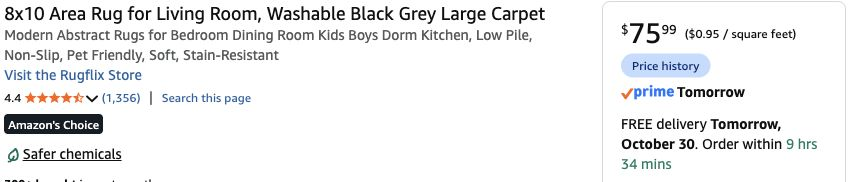
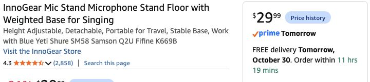

# Order-now decor for Friday October 30 — checked October 29, 2026

**Thirteen product lines show Friday, October 30 delivery** in signed-in Chrome Play to the existing Brooklyn ZIP 11211. Dedicated lighting, DMX and power hardware are deferred, as requested. These are live product-page estimates at the quantities below, not reserved stock or checkout promises. Choose **new / one-time purchase**; no subscription, used or business price is included. Some small-item early-morning shipping requires a qualifying $25 order.

**Order moss first:** at the check it displayed only about **1 hour 35 minutes remaining** for tomorrow delivery. The moss vine showed about 3 hours 34 minutes; other cutoffs vary. Reconfirm **October 30** for each line in checkout. Planned quantities below are totals; omit anything already ordered. Recent host orders have not been audited. No cart additions or purchases performed here.

| Priority / item — exact linked option | Buy quantity | Unit USD | Line USD | Tomorrow delivery observed |
|---|---:|---:|---:|---|
| [USMOLA Green moss / 39 × 39 in](https://www.amazon.com/dp/B0FZD67YDD) | 3 | 16.99 | 50.97 | Oct 30 |
| [Black wall fleece, BEDELITE Oversized King 120 × 120 in](https://www.amazon.com/dp/B0BJ238J66) | 5 | 32.99 | 164.95 | Oct 30 |
| [Command Large White Hooks / 14 hooks, 16 strips](https://www.amazon.com/dp/B075Y2M1Q5) | 4 packs / 56 hooks | 14.61 | 58.44 | Oct 30 |
| [Amazon Basics Medium 1.25-in binder clips / 96 Count](https://www.amazon.com/dp/B074XTRX7K) | 1 pack / 96 clips | 10.76 | 10.76 | Oct 30, 4–8 a.m. |
| [Utopia Kitchen Black / two 90 × 132-in cloths](https://www.amazon.com/dp/B0854M59WT) | 1 two-pack | 21.84 | 21.84 | Oct 30 |
| [KASZOO Green ivy / 12 Pack with 80 LED / 84 ft](https://www.amazon.com/dp/B07H1GQB36) | 1 pack / 12 vines | 9.99 | 9.99 | Oct 30, 4–8 a.m. |
| [Rugflix 8 × 10 rug / 03-black Grey](https://www.amazon.com/dp/B0FKN3M32V) | 1 | 75.99 | 75.99 | Oct 30 |
| [Black gaffer tape / 2 in × 30 yd / 1 Pack](https://www.amazon.com/dp/B0GH865ZQG) | 1 | 8.99 | 8.99 | Oct 30, 4–8 a.m. |
| [Skalon black 8-in ties / 100 Pack](https://www.amazon.com/dp/B09PJ8L58G) | 1 | 3.99 | 3.99 | Oct 30, 4–8 a.m. |
| [Command clear decorating clips / 40 clips, 48 strips](https://www.amazon.com/dp/B000M3YGHS) | 3 packs / 120 clips | 9.05 | 27.15 | Oct 30, 4–8 a.m. |
| [ORTIGIA Dark Green forest shower curtain / 72 × 72 in](https://www.amazon.com/dp/B07YD2X9NB) | 1 | 14.99 | 14.99 | Oct 30 |
| [DUSPRO bendable moss vine / 10 ft](https://www.amazon.com/dp/B0B3XC33R5) | 1 | 14.80 | 14.80 | Oct 30 |
| [InnoGear weighted round-base stand / 1 / Twist Clutch 34–60 in / Black](https://www.amazon.com/dp/B08QZD9B5P) | 1 | 29.99 | 29.99 | Oct 30 |

**Merchandise $492.85.** Aggregate **9% planning tax $44.36 → approximately $537.21**, before any checkout shipping/price change. This is the urgent **decor-only batch**, not a replacement estimate for the entire party or the unrefreshed lighting plan. No lamps, stage lights, DMX parts, power supplies, pumpkins or craft-material allowance is hidden in this subtotal. Every row above was In Stock when checked.

## Original items that miss tomorrow

- **Old WITSHOCK Bitter Black 8×10 rug / B0CYL5S6LW:** $83.99, **Sunday November 1**. Do not order it for Halloween. Proposed timely replacement is the linked **Rugflix 8×10 / 03-black Grey / B0FKN3M32V, $75.99**. It is a black/grey abstract pattern rather than the original distressed pattern, but preserves the intended low-pile 8×10 size. Actual grip, door clearance and edge flatness still require receipt checks.
- **Old Pyle PMKS5 single stand / B002PAW6AU:** $34.99, **Saturday October 31**. Not part of the tomorrow order. Use the [InnoGear weighted round-base stand / B08QZD9B5P](https://www.amazon.com/dp/B08QZD9B5P): **$29.99 / October 30 / In Stock**, now checked on its detail page after host completed Amazon’s human prompt. Choose **Number of Items: 1; Twist Clutch 34–60 in; Black**. Included in the table and total. No agent CAPTCHA click, cart edit or purchase.

The [InnoGear manufacturer's MS250 page](https://www.innogear.com/products/innogear-ms250-microphone-stand) documents a 34–60-in height range and weighted round base, matching the general support concept. Amazon’s selected single-stand page also confirms the 34–60-in range and 9.8-in diameter / 4.5-lb base. Manufacturer information here is specification evidence; the delivery quote comes from the Amazon detail offer. Any mic stand remains an untested adaptation for a lightweight card Guardian, not a rated scenic support.

## What the batch supplies

- **Hollow:** five flat fleece sources, no pleating, same [cut plan](../bedroom/draping/02-shopping-and-sample.md); four large-hook packs and medium binder clips; two thin cloths for the bed/desk/Guardian/dry-tub allocation. Trial an intact full panel immediately on receipt before cutting the same source; follow actual surface preparation/wait instructions. No second fabric/sample order.
- **Grove:** three 39×39-in moss sheets, shared 84-ft ivy and small decorating clips. Keep the two desk ivy strands and small moss fascia allocation within those shared packs. The ivy happens to include an LED string; this order is for the greenery and does not select the deferred lighting rig.
- **Guardian:** cloth, ties, tape and moss scraps are included in shared stock, with no bought mask/mannequin. Reuse clean corrugated delivery packaging and kraft for bark face/crown/spine. The verified single InnoGear stand supplies independent support; no floor-space/stability test has passed.
- **Moon Well:** 72×72-in dark-green forest shower curtain with hooks plus one 10-ft bendable moss vine. Its lights can be selected in the later lighting pass.

**Local/reuse list:** five pumpkins/gourds, PVA glue, black/charcoal + dark brown + ivory acrylic, brush and reusable cardboard/kraft. Prior planning allowances remain $35 pumpkins and $15 shared crafts, not stock-confirmed local quotes and not included in $492.85. Existing trays/underlayer and appropriate cutting tools are reuse assumptions. No elaborate new craft dependencies added; prioritize fabric, forest surfaces and the Guardian silhouette over fine finishing.

## Actions after ordering

Save actual order totals/dates when supplied by host; an unpaid cart/link is not purchased inventory. October 30: receive and inspect dimensions/quantities, start full-panel grip/sag/removal trial, unfold rug and mock up Guardian materials/support. October 31: finish only after actual mount/bed/rug/route checks and simplify optional card details to preserve setup time. Dedicated lights remain a separate next decision, not silently omitted from the overall intended scene.

[Machine-readable exact quantities, offers and late originals](decor-nextday-2026-10-29.json) · [Current shopping index](../shopping-ready.md). No previous October 27 delivery estimate should be treated as current October 29 evidence.
