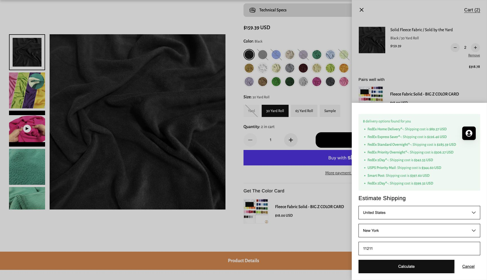

# Earlier decor offer checks — October 23, 2026

**Later same-day Amazon fleece recommendation supersedes the FabricDirect/Big Z buying routes and their cost scenarios here.** [Current nine-piece offer/cuts](../bedroom/draping/05-amazon-fleece-2026-10-23.md) · [Current basket](../shopping-ready.md). Other dated core-offer evidence remains useful.

Checked in the host's signed-in Chrome, America/New_York (EDT, UTC−04:00), for Brooklyn ZIP 11211. No exact address entered or persisted. These are displayed offers and conditional delivery estimates, not reservations, purchases or guaranteed receipt. [Current basket](../shopping-ready.md) owns the buying quantities and total; this file owns today's evidence.

## Fleece: stock and timely arrival cannot be confirmed

[FabricDirect black polar fleece 31707, 20-yd bolt](https://www.fabricdirect.com/shop/fleece-fabric-and-minky-fabric/fleece-fabric/fleece-fabric-solid-black-20-yard-bolt/) remains blocked by automatic site security verification in live Chrome. No challenge was solved or bypassed. Indexed $110/20-yd bolt, $5.99/cut yd, 280 GSM and 58/60-in width remain research evidence. The search result's “3546 in stock” was crawled about five months ago and is **not a current stock confirmation**. The separate cut-yard URL/continuous 14-yd availability could not be verified; do not invent a purchase link.

**HOLD the fabric order.** Needed: two 20-yd bolts plus one continuous 14-yd cut, 54 yd total, matching black appearance. Ask the vendor to confirm usable width, all units physically available, dispatch date and delivered date to 11211, preferably by **Tuesday October 27**, before committing. Indexed official processing of 1–4 days plus transit of 1–7 days does not establish receipt even by Halloween. Published contact: **856-705-0275**; no seller contacted. Three bolts / 60 yd / $330 is a simpler exact-SKU alternative, also unconfirmed.

### Live backup check — not selected

[Big Z Solid Black fleece, 30 Yard Roll](https://bigzfabric.com/products/fleece-fabric-solid-black-sold-by-the-yard?variant=53799506346291), variant SKU **ET3#5-29-30Roll**, live **$159.39 each**, 60 in / **385 GSM**, double-brushed polyester. Two rolls were accepted into an initially empty cart: **60 yd / $318.78**. This establishes an orderable offer, not reserved warehouse stock.

NY / ZIP 11211 shipping estimator showed **FedEx Home Delivery $89.57**, **Express Saver $226.46**, Standard Overnight $285.59, Priority Overnight $306.27; no calendar arrival date. [Official shipping help](https://help.bigzfabric.com/portal/en/kb/articles/shipping-delivery-10-8-2021) describes ground/home transit 1–5 days, Express Saver three days and a noon-Pacific express dispatch cutoff, with exclusions and processing caveats. These are not a confirmed ship date or arrival promise. The $15 [expedited fulfillment add-on](https://bigzfabric.com/products/expedited) accelerates processing, not transit; not included.

Replacing FabricDirect with this backup and replacing the $60 shipping reserve with $89.57 gives **$1,600.08** under the same planning tax assumptions; Express Saver gives **$1,736.97**. Other non-Amazon shipping could add more. Neither is a confirmed delivered quote. Its heavier fabric also needs a fresh mounting trial; do not substitute it without rechecking support load.

Both temporary rolls were removed afterward; **My Cart (0) / YOUR CART IS EMPTY** was visibly verified. No checkout or purchase. [Empty-cart evidence](fleece-quote-cart-cleared-2026-10-23.png). Amazon carts were not changed.

## Amazon offers refreshed today

New one-time offers, selected variants; no subscription, used item or optional clipped coupon counted. October 24 was shown as a free delivery choice for each row below, conditional on the displayed order cutoff/account/qualifying-order rules. Some also offered October 23. All displayed In Stock. Single-unit buy boxes checked except explicitly stated quantity checks.

| Basket ID / exact offer | Price USD | Quantity check / seller |
|---|---:|---|
| [H29 OPPSK 1080LEDs B0H6HJJ5DP](https://www.amazon.com/dp/B0H6HJJ5DP) | 179.99 | One; optional coupon excluded |
| [H31 U’King 2PCS B0836CXMW6](https://www.amazon.com/dp/B0836CXMW6) | 129.99/pair | One pair; selected Brown / black pictured, SpectraVibe |
| [H32 DSD TECH SH-RS09B 5.9FT B07WV6P5W6](https://www.amazon.com/dp/B07WV6P5W6) | 15.99 | One; Amazon / DSD TECH Direct |
| [H26 Govee Floor Lamp Basic Black B099WTN2TR](https://www.amazon.com/dp/B099WTN2TR) | **99.99** | One; Govee US. Up $30 from previous quote |
| [H03 Mydethun 5.9-in White & Yellow, Non-engraved B075JHP7TK](https://www.amazon.com/dp/B075JHP7TK) | 24.99 | One; Mydethun, only 12 left displayed |
| [H04 O’Bright Seraph mini Black B0D92YB4RH](https://www.amazon.com/dp/B0D92YB4RH) | **31.44** | One; live deal, down $5.55 |
| [H05 ORTIGIA Dark Green 72 × 72 B07YD2X9NB](https://www.amazon.com/dp/B07YD2X9NB) | **12.29** | One; Prime price, down $2.70 |
| [H06 DUSPRO 10ft B0B3XC33R5](https://www.amazon.com/dp/B0B3XC33R5) | 13.32 | One; Amazon / DUSPRO |
| [H08 HTZNHXT 3Pcs B0D73D5W3Y](https://www.amazon.com/dp/B0D73D5W3Y) | 8.95/pack | One pack; Amazon / HTZNHXT |
| [H11 USMOLA Green 39 × 39 B0FZD67YDD](https://www.amazon.com/dp/B0FZD67YDD) | 16.99/sheet | **Quantity 3 selected**, stock/free Oct 24 remained; Amazon / Usmola |
| [H27 KASZOO 12 Pack with 80 LED B07H1GQB36](https://www.amazon.com/dp/B07H1GQB36) | 9.99/pack | One; Amazon / KASZOO.shop |
| [H12 Twinkle Star Warm White USB 66ft / 200 LED B07GMQ42GG](https://www.amazon.com/dp/B07GMQ42GG) | 9.99/string | **Quantity 2 selected**, stock/Oct 24 remained; Amazon / Twinkle Star LLC |
| [H13 Homemory warm-white glow / white body 12-pack B01EDKGFGU](https://www.amazon.com/dp/B01EDKGFGU) | 7.99/pack | One; Amazon / Deng.Lit |
| [H16 DIY Doctor black gaffer 2in × 30yd, 1 Pack B0GH865ZQG](https://www.amazon.com/dp/B0GH865ZQG) | 8.99 | One-time purchase; Amazon / Great Ideas |
| [H17 Skalon black 8in, 100 Pack B09PJ8L58G](https://www.amazon.com/dp/B09PJ8L58G) | 3.99 | One; Amazon / BeataTap-SKALON |
| [H28 WITSHOCK Bitter Black / 8 × 10 B0CYL5S6LW](https://www.amazon.com/dp/B0CYL5S6LW) | 83.99 | One; Amazon / SshiY |
| [H35 Cable Matters DMX 25ft, 2-pack B08SQG6GBF](https://www.amazon.com/dp/B08SQG6GBF) | 26.99 | One pack; 22AWG 3-pin DMX, SKU 500053-25x2; Amazon / Cable Matters |
| [H36 Cable Matters 120-ohm 3-pin male DMX terminators, 2-pack B0CSSJP1H4](https://www.amazon.com/dp/B0CSSJP1H4) | 8.99 | One pack; one used, one spare; Amazon / Cable Matters |
| [H37 Anker A8731 USB-C to USB-A data adapter, Gray 2-pack B08HZ6PS61](https://www.amazon.com/dp/B08HZ6PS61) | 8.98 | One pack; Oct 24 upcoming delivery or Oct 26 standard; Amazon / AnkerDirect |

**Guardian support:** [H34 Pyle PMKS5, 1 Pack / Black B002PAW6AU](https://www.amazon.com/dp/B002PAW6AU), **$34.99**, In Stock, Amazon.com ships/sells, **free Tuesday October 27** displayed. Not the used offer or two-pack. [Manufacturer](https://www.pyleaudio.com/sku/pmks5/compact-base-black-microphone-stand) lists roughly 33.5–60-in adjustment and a **9.8-in round base**. Adapting this microphone stand to a lightweight card bust is our proposal, not a manufacturer-rated scenery installation; actual stability/fit must pass before use. It is not a stage-light stand or bed restraint.

Home Depot hooks/clips/power, Walmart binder clips and Target battery quotes remain older research, **not refreshed local stock or delivery checks**. Household-reuse/local-craft allowances are not exact quoted retail products. The list still has a real stage-light mounting dependency; the $25 reserve is not proof of a purchasable adequate rig.
