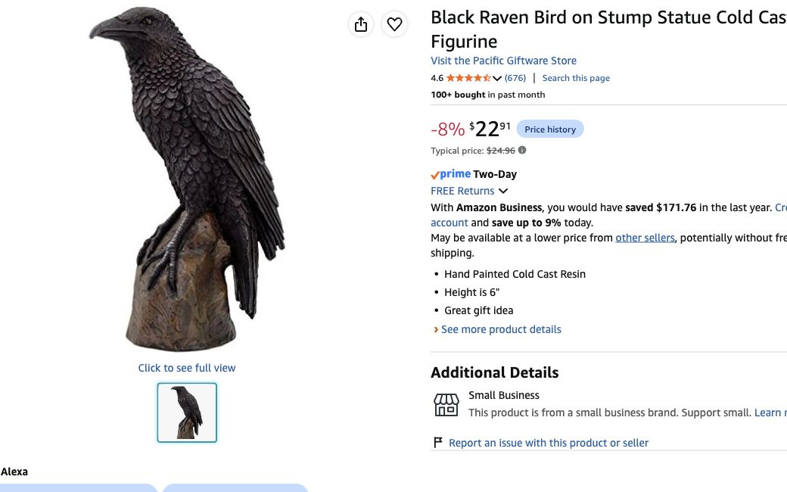
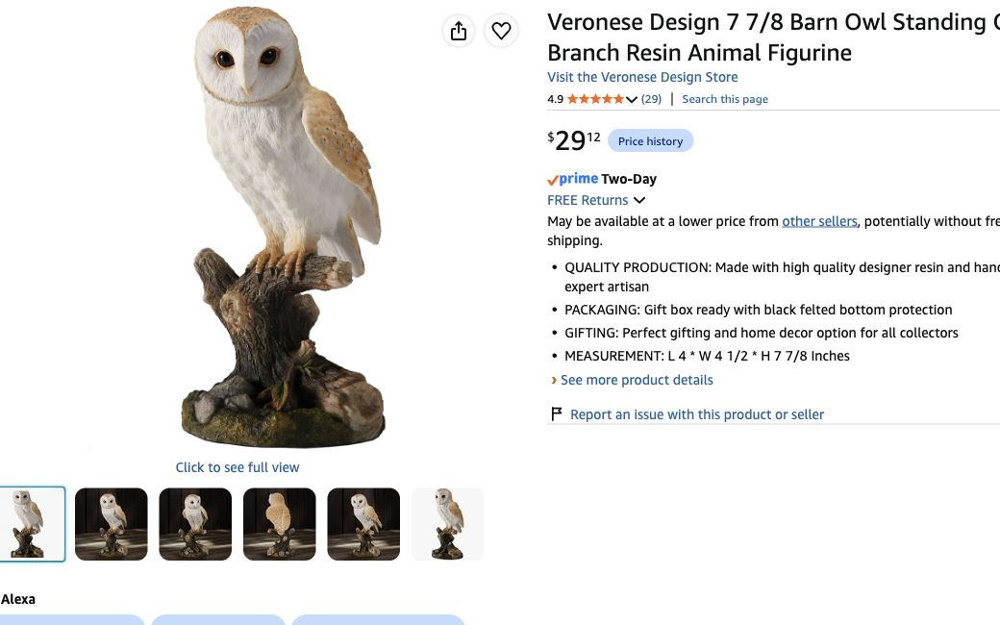
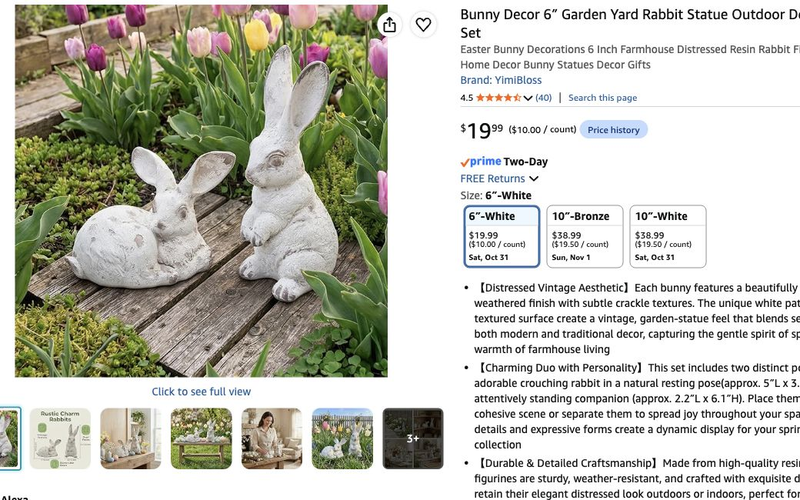

# Larger guardian options — October 29, 2026

Host target: roughly 6 inches in width or height. Existing LEGO red panda is the fox guardian; sticks for all five handmade figures acquired. Retailer measurements below include bases where specified; no physical sample or camera accuracy claim.

| Active slot | Recommended exact product | Selected size / quantity | Current price | Displayed delivery |
|---|---|---|---:|---|
| Raven |[Pacific Giftware](https://www.amazon.com/dp/B006JOVKFA)|One, 6 inches **overall including stump**|22.91|Oct 31|
| Owl |[Veronese barn owl](https://www.amazon.com/dp/B0CL6Q1L2X)|One, 4×4½×7⅞ inches **including branch/base**|29.12|Oct 31|
| Fox |Owned LEGO red panda|One, host-owned|0 new|Owned|
| Stag |[Brown deer](https://www.amazon.com/dp/B09J16Z7MX)|One, **Medium/Brown**, advertised 20 cm /8 inches; axis unclear|13.28|Oct 31|
| Hare |[YimiBloss rabbit pair](https://www.amazon.com/dp/B0GDWWQRRG)|One **6″-White set**; standing one 6.1 inches high, crouching one smaller|19.99|Oct 31|
| Separate bone shrine |[Veemoon wolf skull](https://www.amazon.com/dp/B0BCGRT7ZQ)|One, White /20×14×8 cm|17.39|Oct 31|
| Well threshold |[UFN HENRIK crescent](https://www.amazon.com/dp/B0D6YNB8S9)|One, **7 inch /1⁄4 inch thick**|8.00|Oct 31|

All six new offers checked in signed-in Chrome, quantity one, Amazon shipped. No before-party time window guaranteed. Exact offer/seller record in [structured evidence](large-guardians-and-shrines-2026-10-29.json). No cart/order/payment. Other buy-list prices retain earlier October 29 checks.

Birds match established Raven/Owl identities with larger supplied stump/branch silhouettes. These are visual judgments from retailer photos, not received-quality tests. Stag is the budget option: 3.6/5 across 12 reviews and seller's size axis is unclear; do not promise an independently measured 8-inch height. Use the grouped-herd route if that uncertainty is undesirable. The 7⅞-inch owl has a much clearer size statement. A brown rabbit considered at $14.99 was only about 4–4.7 in and rejected for size.

The [ten-pack grouping option](../../interactive-game/physical/guardian-coverage-2026-10-29.md#the-ten-pack-option--choose-instead-of-standalone-stag-and-hare) replaces only stag/hare orders: two larger birds +pack +owned red panda preserve five animal slots and save 12.28 before tax. Do not buy both routes.

