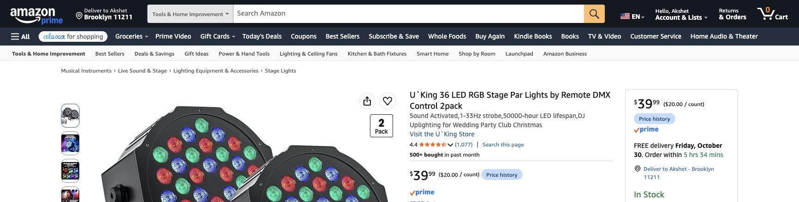
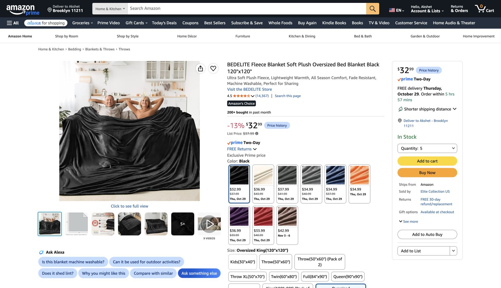
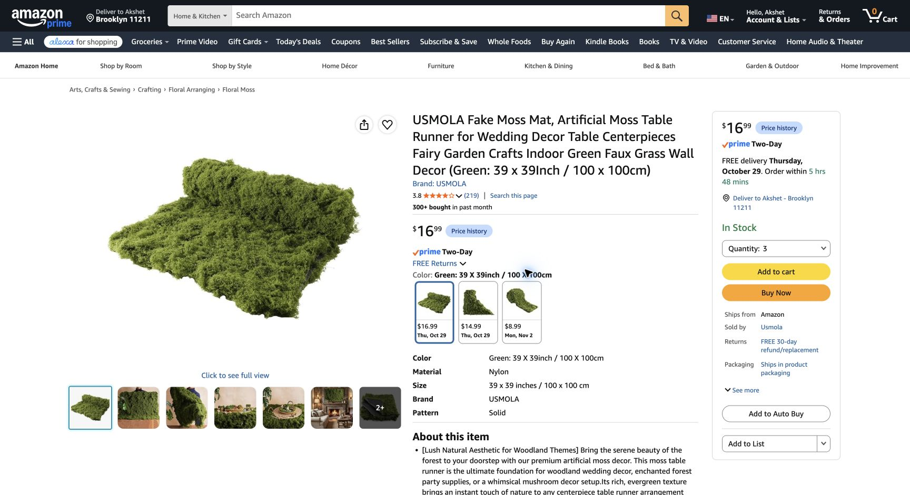

# Decor prices, delivery and value options — October 27, 2026

**Later October 27 selection supersedes the two-PAR recommendation:** host retains OPPSK. [USB-C control/quotes](../lighting/oppsk-usb-dmx-2026-10-27.md) and [current basket](../shopping-ready.md) own the $1,271.46 plan. Below is the earlier same-day comparison and scenery evidence, not an additional order.

Checked October 27, America/New_York / EDT (UTC−04:00). **Host confirms no decor bought.** Research and a concrete cheaper proposal, not a purchase or host selection of the new lighting scope. Target **receive by Friday October 30**, before Saturday Halloween. No guarantee of inventory/cutoff or final checkout delivery.

## Recommendation and tradeoff

Recommend **two U’King RGB PAR washes for $39.99**, replacing the OPPSK/moving-head/laptop-control rig. Keep five flat fleece sources, thin bed/desk/Guardian/tub covers, 8×10 rug, all three counter-moss sheets, 84-ft ivy, glowing Guardian, Grove moon and Govee purple wash, and the complete Moon Well. Two PARs preserve colored cave lighting; they give up moving gobos, the pixel-bar effect and laptop choreography. The current listing confirms static/auto/voice (sound)/gradient modes, sensitivity adjustment and supplied brackets/screws; actual microphone response, dimming, restrained strobe-free behavior and power-cycle memory still require the received-light trial. Use low static red/violet if sound mode is unsuitable.

The **OPPSK-only alternative** retains the effect panel, with its own controls/built-in modes and no moving heads or laptop DMX hardware. It costs more and retains the unresolved heavy-fixture support dependency. Do not buy both lighting options.

| Cash component | Value: two PARs | OPPSK only | Previous rig repriced |
|---|---:|---:|---:|
| Products | 782.50 | 922.50 | 1,132.79 |
| Local/reuse/support allowances | 105.00 | 105.00 | 105.00 |
| 9% planning tax, rounded | 79.88 | 92.48 | 111.40 |
| Shipping reserve | 60.00 | 60.00 | 60.00 |
| Price/missing-item buffer | 30.48 | 30.48 | 30.48 |
| **Whole-decor estimate** | 1,057.86 | 1,210.46 | 1,439.67 |

The previous $1,421.20 frozen estimate is replaced for price comparison by **$1,439.67**, which includes a provisional Target battery and two items that miss the setup deadline. It is **not** an arrival-ready order. The value proposal is **$1,057.86**, **$381.81 less than the refreshed comparison / $363.34 less than the old frozen estimate**. OPPSK-only **$1,210.46**. Tax is a planning assumption; no checkout tax/shipping quote. Food/drinks, costume, game figures/tags/crown/domain/music remain separate. Nothing bought, carted or installed.

## Fulfillment evidence and exact refreshed comparison

Amazon checked in signed-in **Chrome Play**, existing Brooklyn ZIP 11211. New one-time offers; subscriptions, used deals, business discounts and optional coupons excluded. Confirmed quantity selectors: **five fleece, four 14-hook packs, three moss sheets, two USB strings, three decorating-clip packs, two GE power strips**. Other recommended Amazon products use one product/pack. The binder offer is one Amazon Basics Medium / 96 Count pack, one-time $10.76, showing Oct 29 delivery; listed width 1.26 in / paper capacity 0.61 in, actual fleece grip still a trial. Staples 3 × 24-pack pickup at 500 Eighth Avenue Front 3, New York NY was also checked for Oct 29 / $18.57, but is not needed or ordered. Estimates were observed in this session, not reserved deliveries.

| ID | Exact product / selected variant | Buy quantity | Unit USD | Line USD | Arrival / fulfillment |
|---|---|---:|---:|---:|---|
| H22 | [BEDELITE Black / Oversized King 120 × 120-in fleece, B0BJ238J66](https://www.amazon.com/dp/B0BJ238J66) | 5 | 32.99 | 164.95 | Oct 29 |
| H14 | [Utopia Kitchen Black / 2 Pack 90 × 132-in polyester cloths, B0854M59WT](https://www.amazon.com/dp/B0854M59WT) | 1 | 21.84 | 21.84 | Oct 29 |
| H24 | [Command 17003-MPES, 14 large white hooks / 16 strips](https://www.amazon.com/dp/B075Y2M1Q5) | 4 | 14.61 | 58.44 | Oct 29 |
| H25 | [Amazon Basics Sturdy Binder Clips, Black / Medium 1.25 in / 96 Count (8 Pack of 12)](https://www.amazon.com/dp/B074XTRX7K) | 1 | 10.76 | 10.76 | Oct 29 |
| H29 | [OPPSK 1080LEDs Stage Light, B0H6HJJ5DP](https://www.amazon.com/dp/B0H6HJJ5DP) | 1 | 179.99 | 179.99 | Oct 29 |
| H31 | [U’King 25W moving heads 2PCS, Brown selected / black pictured, B0836CXMW6](https://www.amazon.com/dp/B0836CXMW6) | 1 | 129.99 | 129.99 | Oct 31 — misses setup deadline |
| H32 | [DSD TECH SH-RS09B 5.9FT, USB-A to 3-pin female DMX, B07WV6P5W6](https://www.amazon.com/dp/B07WV6P5W6) | 1 | 15.99 | 15.99 | Oct 29 |
| H35 | [Cable Matters 22AWG 3-pin DMX, 25ft, 2-pack, B08SQG6GBF](https://www.amazon.com/dp/B08SQG6GBF) | 1 | 26.99 | 26.99 | Oct 29 |
| H36 | [Cable Matters 120-ohm 3-pin male DMX terminators, 2-pack, B0CSSJP1H4](https://www.amazon.com/dp/B0CSSJP1H4) | 1 | 8.99 | 8.99 | Oct 29 |
| H37 | [Anker USB-C to USB-A data adapter, two-pack, B08HZ6PS61; current page model B8731](https://www.amazon.com/dp/B08HZ6PS61) | 1 | 12.99 | 12.99 | Oct 29 |
| H34 | [Pyle PMKS5 straight microphone stand, 1 Pack / Black, B002PAW6AU](https://www.amazon.com/dp/B002PAW6AU) | 1 | 34.99 | 34.99 | Oct 30 |
| H26 | [Govee RGBIC Floor Lamp Basic / Black, B099WTN2TR](https://www.amazon.com/dp/B099WTN2TR) | 1 | 99.99 | 99.99 | Oct 29 |
| H03 | [Mydethun moon 5.9-in White & Yellow / Non-engraved, wood stand, B075JHP7TK](https://www.amazon.com/dp/B075JHP7TK) | 1 | 24.99 | 24.99 | Oct 30 |
| H04 | [O’Bright Seraph mini / Black cordless lamp, B0D92YB4RH](https://www.amazon.com/dp/B0D92YB4RH) | 1 | 31.44 | 31.44 | Oct 29 |
| H05 | [ORTIGIA Dark Green 72 × 72-in forest shower curtain + hooks, B07YD2X9NB](https://www.amazon.com/dp/B07YD2X9NB) | 1 | 14.99 | 14.99 | Oct 29 |
| H06 | [DUSPRO bendable moss vine 10ft, B0B3XC33R5](https://www.amazon.com/dp/B0B3XC33R5) | 1 | 14.80 | 14.80 | Oct 30 |
| H08 | [HTZNHXT raven pendants 3Pcs, B0D73D5W3Y](https://www.amazon.com/dp/B0D73D5W3Y) | 1 | 8.95 | 8.95 | Nov 7–9 — late |
| H11 | [USMOLA Green 39 × 39-in / 100 × 100-cm moss sheet, B0FZD67YDD](https://www.amazon.com/dp/B0FZD67YDD) | 3 | 16.99 | 50.97 | Oct 29 |
| H27 | [KASZOO 12 Pack with 80 LED / Green, 84-ft ivy, B07H1GQB36](https://www.amazon.com/dp/B07H1GQB36) | 1 | 9.99 | 9.99 | Oct 29 |
| H12 | [Twinkle Star Warm White USB 66ft / 200 LED, remote, B07GMQ42GG](https://www.amazon.com/dp/B07GMQ42GG) | 2 | 9.99 | 19.98 | Oct 29 |
| H13 | [Homemory warm-white glow / white body, 12-pack tea lights, B01EDKGFGU](https://www.amazon.com/dp/B01EDKGFGU) | 1 | 8.99 | 8.99 | Oct 29 |
| H16 | [DIY Doctor black gaffer 2in × 30yd / 1 Pack, B0GH865ZQG](https://www.amazon.com/dp/B0GH865ZQG) | 1 | 8.99 | 8.99 | Oct 29 |
| H17 | [Skalon black 8-in ties / 100 Pack, B09PJ8L58G](https://www.amazon.com/dp/B09PJ8L58G) | 1 | 3.99 | 3.99 | Oct 29 |
| H18 | [Command clear decorating clips, 40 clips / 48 strips, 1 Pack](https://www.amazon.com/dp/B000M3YGHS) | 3 | 9.05 | 27.15 | Oct 29 |
| H19 | [GE 50768 White / 15 Ft / 1 Pack, six grounded AC outlets, 14-gauge SJT](https://www.amazon.com/dp/B087N9HCHV) | 2 | 18.70 | 37.40 | Oct 29 |
| H20 | [Energizer CR2032 2-pack, Target A-13738815](https://www.target.com/p/-/A-13738815) | 1 | 6.39 | 6.39 | Local/ship date unverified — conditional |
| H28 | [WITSHOCK Bitter Black / 8 × 10ft, B0CYL5S6LW](https://www.amazon.com/dp/B0CYL5S6LW) | 1 | 83.99 | 83.99 | Oct 29 |
| H38 | [Amazon Basics 12W One-Port USB-A Wall Charger, White / One Port (2-Pack), B0773JCTR5](https://www.amazon.com/dp/B0773JCTR5) | 1 | 13.87 | 13.87 | Oct 29 |

- H22 fleece **$32.99 each**, up $1; quantity-five **Oct 29**. Header still from side offcuts, no pleating/furnishing fleece. [Unchanged cut plan](../bedroom/draping/02-shopping-and-sample.md).
- H31 moving-head pair **Oct 31**: misses our before-Halloween receipt/setup target. H08 raven pendants **Nov 7–9**: definitely late. Do not retain either in the timely proposal. Reuse painted card/kraft relics for Guardian/shrine accents, within shared craft materials; game entity count and identities are not altered here.
- H37 same ASIN now **$12.99**, current page describes B8731; old A8731/$8.98 wording is superseded. It is not in either cheaper proposal.
- H24/18 now Amazon, same nominal 14-hook and 40-decorating-clip products; H18 **$9.05/pack**, down from $9.93. No substitute light-duty hooks for fleece.
- H19 replaces the unverified-local-stock HDX route with **two GE 50768 White/15ft**, six grounded AC outlets, **14-gauge SJT**, **$18.70 each**, quantity-two Oct 29. **No integrated USB:** H38 two-pack is included, one 5V/2.4A USB-A supply per room for the two H12 strings. Actual light input labels still must match. No USB-C data adapter is counted as USB power; actual music/Mac/outlet routes still require rehearsal.
- H20 **$6.39** is from the [Target public page](https://www.target.com/p/-/A-13738815), retrieved Oct 27 but cached three days; no current local/ship date verified. **Excluded from both proposed orders**, not an essential mail-order dependency. Inspect included tea-light/remote cells and buy the correct type locally only if needed, using existing buffer; do not assume every remote uses CR2032.
- Home Depot pages exposed product specs but their live price/fulfillment panels did not load in Chrome. Public indexed prices remain $14.61 hooks/$9.93 clips/$19.98 HDX; these are not pickup confirmations. Amazon/recorded binder alternative remove the need to rely on those unverified store claims.

## Recommended timely order

| ID | Exact product / selected variant | Buy quantity | Unit USD | Line USD | Arrival / fulfillment |
|---|---|---:|---:|---:|---|
| H22 | [BEDELITE Black / Oversized King 120 × 120-in fleece, B0BJ238J66](https://www.amazon.com/dp/B0BJ238J66) | 5 | 32.99 | 164.95 | Oct 29 |
| H14 | [Utopia Kitchen Black / 2 Pack 90 × 132-in polyester cloths, B0854M59WT](https://www.amazon.com/dp/B0854M59WT) | 1 | 21.84 | 21.84 | Oct 29 |
| H24 | [Command 17003-MPES, 14 large white hooks / 16 strips](https://www.amazon.com/dp/B075Y2M1Q5) | 4 | 14.61 | 58.44 | Oct 29 |
| H25 | [Amazon Basics Sturdy Binder Clips, Black / Medium 1.25 in / 96 Count (8 Pack of 12)](https://www.amazon.com/dp/B074XTRX7K) | 1 | 10.76 | 10.76 | Oct 29 |
| H01 | [U’King 36 LED RGB PAR / 2 Packs, B0B9H16RH5](https://www.amazon.com/dp/B0B9H16RH5) | 1 | 39.99 | 39.99 | Oct 30 |
| H34 | [Pyle PMKS5 straight microphone stand, 1 Pack / Black, B002PAW6AU](https://www.amazon.com/dp/B002PAW6AU) | 1 | 34.99 | 34.99 | Oct 30 |
| H26 | [Govee RGBIC Floor Lamp Basic / Black, B099WTN2TR](https://www.amazon.com/dp/B099WTN2TR) | 1 | 99.99 | 99.99 | Oct 29 |
| H03 | [Mydethun moon 5.9-in White & Yellow / Non-engraved, wood stand, B075JHP7TK](https://www.amazon.com/dp/B075JHP7TK) | 1 | 24.99 | 24.99 | Oct 30 |
| H04 | [O’Bright Seraph mini / Black cordless lamp, B0D92YB4RH](https://www.amazon.com/dp/B0D92YB4RH) | 1 | 31.44 | 31.44 | Oct 29 |
| H05 | [ORTIGIA Dark Green 72 × 72-in forest shower curtain + hooks, B07YD2X9NB](https://www.amazon.com/dp/B07YD2X9NB) | 1 | 14.99 | 14.99 | Oct 29 |
| H06 | [DUSPRO bendable moss vine 10ft, B0B3XC33R5](https://www.amazon.com/dp/B0B3XC33R5) | 1 | 14.80 | 14.80 | Oct 30 |
| H11 | [USMOLA Green 39 × 39-in / 100 × 100-cm moss sheet, B0FZD67YDD](https://www.amazon.com/dp/B0FZD67YDD) | 3 | 16.99 | 50.97 | Oct 29 |
| H27 | [KASZOO 12 Pack with 80 LED / Green, 84-ft ivy, B07H1GQB36](https://www.amazon.com/dp/B07H1GQB36) | 1 | 9.99 | 9.99 | Oct 29 |
| H12 | [Twinkle Star Warm White USB 66ft / 200 LED, remote, B07GMQ42GG](https://www.amazon.com/dp/B07GMQ42GG) | 2 | 9.99 | 19.98 | Oct 29 |
| H13 | [Homemory warm-white glow / white body, 12-pack tea lights, B01EDKGFGU](https://www.amazon.com/dp/B01EDKGFGU) | 1 | 8.99 | 8.99 | Oct 29 |
| H16 | [DIY Doctor black gaffer 2in × 30yd / 1 Pack, B0GH865ZQG](https://www.amazon.com/dp/B0GH865ZQG) | 1 | 8.99 | 8.99 | Oct 29 |
| H17 | [Skalon black 8-in ties / 100 Pack, B09PJ8L58G](https://www.amazon.com/dp/B09PJ8L58G) | 1 | 3.99 | 3.99 | Oct 29 |
| H18 | [Command clear decorating clips, 40 clips / 48 strips, 1 Pack](https://www.amazon.com/dp/B000M3YGHS) | 3 | 9.05 | 27.15 | Oct 29 |
| H19 | [GE 50768 White / 15 Ft / 1 Pack, six grounded AC outlets, 14-gauge SJT](https://www.amazon.com/dp/B087N9HCHV) | 2 | 18.70 | 37.40 | Oct 29 |
| H28 | [WITSHOCK Bitter Black / 8 × 10ft, B0CYL5S6LW](https://www.amazon.com/dp/B0CYL5S6LW) | 1 | 83.99 | 83.99 | Oct 29 |
| H38 | [Amazon Basics 12W One-Port USB-A Wall Charger, White / One Port (2-Pack), B0773JCTR5](https://www.amazon.com/dp/B0773JCTR5) | 1 | 13.87 | 13.87 | Oct 29 |

This table is **21 product lines**, not 21 individual pieces. The two-PAR kit has two lights; H38 has two separate chargers. Fleece and moss quantities are not reduced. Binder grip/aperture and all supports are physical receipt checks, not tested success.

Keep **$105 local/reuse allowances**: five pumpkins $35; shared paints/glue/card/kraft $15; moon disk/diffuser $5; trays/underlayer/jar/mounts $10; conditional rug grip $15; protected fixture-positioning/support reserve $25. These are **estimates with household reuse**, not priced local carts. No blanket count, rug or counter-moss cut is hidden in the savings. The $25 does not buy a certified overhead rig. For PARs, start at protected floor/perimeter locations on the supplied brackets after contents/footprint/clearance tests. Guardian stand and upright-bed restraint are separate; no stage light on either.

## Order and setup sequence

1. Recheck current exact variants/quantities and delivery **at checkout today**. Choose new one-time offers. Cutoffs shown were within hours, not guaranteed through tomorrow. Nothing is ordered by this session.
2. Oct 27–28: map outlets and stable bed storage; template wall/header/desk/counters; prepare simple card bark face/crown, moon disk and branch silhouettes. Use existing furniture/layout; no new large floor props.
3. Oct 29: receive wide fleece/hooks/moss/rug and power/strings. Inspect actual dimensions, weigh/load-check and begin full-panel **24-hour grip/sag/removal trial** before cutting that same blanket. Unfold rug; test door and support feet.
4. Oct 30: receive PARs, Guardian stand, bath moon/vine. Assemble/aim the two light brackets and independent Guardian; preserve routes. Install after mount trial passes, simplify finish details to protect rehearsal time. Charge bathroom devices outside bathroom and conduct the nine-hour elapsed light/runtime check at the actual dim setting before guests. No unattended tool-driven run is scheduled.
5. Reject late mail-order substitutions; get a confirmed local equivalent or omit optional accents. If bed securement or mounting cannot be established, re-plan physical setup; an arrival date is not an installation test. Oct 31 inspect/reset before arrivals.

## Evidence / actions

[Machine-readable comparison and proposals](price-refresh-2026-10-27.json) · [UI offer excerpts](offer-evidence-2026-10-27.json).

Chrome reads and quantity/fulfillment selectors only. Host completed both Amazon human checkpoints; the agent did not click either CAPTCHA or apply blanket future permission. No checkout, cart additions, seller contact, account settings, software installation or physical test. Public ZIP/first name may appear in screenshots; no precise address, payment credentials, order numbers or checkpoint tokens belong in committed evidence.
