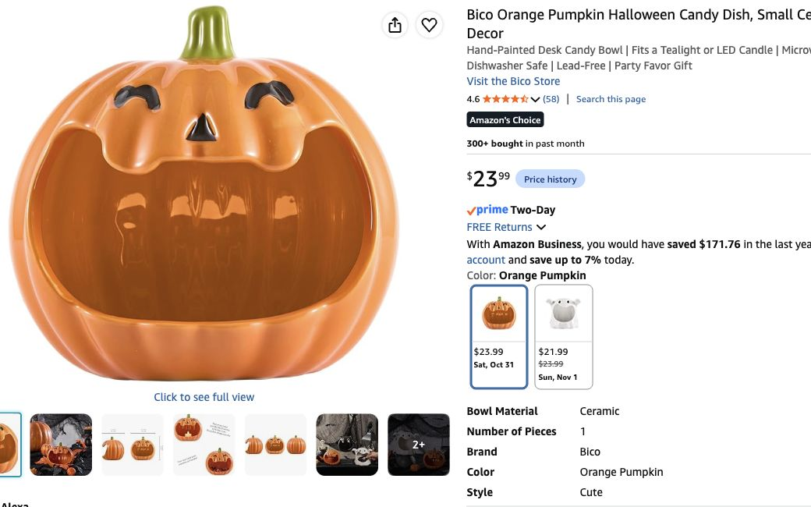

# Urgent decor and guardian orders — October 29, 2026

**Current host decisions:** one moon object only, at the Moon Well: **The Moon That Stayed is also the listener (DEC-01)**. The nightstand becomes a **Harvest Offering Table**, guarded by **The Last Seed (DEC-04)**, a ready-made pumpkin candy holder. The owned golden tree goes **in the middle of the living room**, independently of either table. No Grove moon disk or threshold crescent.

**Host reports rabbit, deer, owl, raven and wolf skull added to cart, not purchased.** Their latest quoted lines total $102.69; this is an estimate using the recommended variants/quantities, not a cart audit or paid total. They remain in the to-buy total below. Nine previously reported ordered lines remain closed: fleece, moss, Hollow large hooks, suction cups, binder clips, thin black cloth, gaffer tape, zip ties and forest shower curtain. [Ordered inventory](shopping-ready.md) · [All 15 guardians](../interactive-game/physical/guardian-coverage-2026-10-29.md).

**Freshly checked October 29, about 10:14 p.m. EDT:** pumpkin holder and chocolates show In Stock/free **Saturday October 31**. No before-party arrival window is guaranteed. All other rows retain earlier October 29 quotes, also showing October 31 then; confirm each checkout date. [Current evidence and cost calculation](research/single-moon-harvest-2026-10-29.json). No agent cart changes or purchases.

## Guardian behind the automated desk

| Exact product / option | Buy quantity | Line USD | Purpose / status |
|---|---:|---:|---|
| [CAFELE forest-spirit mask + headdress / Led](https://www.amazon.com/dp/B0BVFPTCZC) | 1 | 23.99 | Bought face/headdress for the automated desk Guardian. About9x6.1x2.75in; LED power/batteries unspecified. |
| [InnoGear MS250 / Black / single / Twist Clutch34–60in](https://www.amazon.com/dp/B08QZD9B5P) | 1 | 29.99 | Independent weighted support behind desk;9.8in base. Untested scenic adaptation, separate from bed restraint. |

Head/support **$53.98**; ordered cloth/ties/moss and one of **two total** USB strings dress it. [Minimal assembly](bedroom/woodland-guardian.md). Mask LED power/batteries remain unspecified; support and stability are untested.

## Animal guardians — in cart, not ordered

| Exact product / option | Buy quantity | Line USD | Purpose / status |
|---|---:|---:|---|
| [Pacific Giftware raven on stump](https://www.amazon.com/dp/B006JOVKFA) | 1 | 22.91 | Raven guardian. Bigger replacement for rejected 3-inch Safari bird. **In cart per host; unpaid, exact cart quantity/variant not verified.** |
| [Veronese Design barn owl on branch](https://www.amazon.com/dp/B0CL6Q1L2X) | 1 | 29.12 | Owl guardian. Bigger replacement for rejected 2.75-inch Safari owl. **In cart per host; unpaid, exact cart quantity/variant not verified.** |
| [Brown deer / advertised 20 cm](https://www.amazon.com/dp/B09J16Z7MX) | 1 | 13.28 | Budget standalone stag; seller sizing/quality less certain. Grouped animal-pack alternative remains available. **In cart per host; unpaid, exact cart quantity/variant not verified.** |
| [YimiBloss rabbit pair](https://www.amazon.com/dp/B0GDWWQRRG) | 1 | 19.99 | Use standing rabbit as Hare guardian; keep smaller one as spare outside hunt. Pair is one set, not two new guardians. **In cart per host; unpaid, exact cart quantity/variant not verified.** |

**Owned LEGO red panda = fox, $0 to buy. Four animal product lines = $85.30.** Rabbit set is one set: use the 6.1-inch standing one as Hare and keep the smaller one spare/off-hunt. The ten-pack remains a historical alternative; do not add it on top of the host's standalone stag/rabbit cart selections.

## Grove, offering table, wood-and-bone shrine and shared supports

| Exact product / option | Buy quantity | Line USD | Purpose / status |
|---|---:|---:|---|
| [Bico Orange Pumpkin Halloween Candy Dish / Orange Pumpkin / one](https://www.amazon.com/dp/B0F24RKBMY) | 1 | 23.99 | The Last Seed guardian and wrapped-candy holder on relocated Grove nightstand. About 6.2 x 5.6 x 5.9 inches; personal-size mouth holds a handful, refill from reserve. No painting or extra figure required. |
| [Freyalife /12Pack84Ft](https://www.amazon.com/dp/B0D6KDW17P) | 2 | 10.98 | 24raw7ft strands:4single strands make two nominal14ft overhead swags;14make seven paired7ft wall runs;2make one paired shrine run;4make two paired desk runs. |
| [Fosolasi large brown faux trunk /78.9in](https://www.amazon.com/dp/B0FPQ8DDDP) | 1 | 49.99 | One already-budgeted 78.9-inch wall branch frames the wood-and-bone shrine. No duplicate second-shrine branch; mounting location proposed, not measured. |
| [Veemoon resin wolf skull](https://www.amazon.com/dp/B0BCGRT7ZQ) | 1 | 17.39 | Wood-and-bone shrine centerpiece on proposed 20×40-inch moss-covered surface. Large branch/ivy/lights already shared; no second branch order. **In cart per host; unpaid, exact cart quantity/variant not verified.** |
| [Command decorating clips /40clips48strips](https://www.amazon.com/dp/B000M3YGHS) | 3 | 27.15 | 120small clips for wall fairy lights, ivy, desk and spares; not fleece or overhead-span anchors. |
| [Command Large White /14hooks16strips](https://www.amazon.com/dp/B075Y2M1Q5) | 1 | 14.61 | ONE ADDITIONAL pack for Grove:four swag ends,about4branch points,spares. Existing ordered H24 pack stays with Hollow. Wall-only placement, load/adhesion trial. |
| [Twinkle Star /Warm White /66ft200LED /USB](https://www.amazon.com/dp/B07GMQ42GG) | 2 | 19.98 | Two total USB strings: one Grove wall/foliage run and one Hollow Guardian roots/eye fallback. No Grove moon string. |
| [Homemory /Warm White Glow White Body /12tea lights](https://www.amazon.com/dp/B01EDKGFGU) | 1 | 8.99 | Twelve total: two harvest offering table, two wood-and-bone shrine, one coffee table, one counter, four dry bathroom accents, two spare. Keep lights outside candy holder. |

[Two Grove displays](living-room/grove-shrines-2026-10-29.md): pumpkin offering table on the relocated nightstand, plus a separate skull/branch tableau on the proposed existing 20×40-inch surface. **One $49.99 large branch total**, already in the Grove scenery budget. Moss and ivy are shared; no second cabinet, extra branch or extra moss pack.

Vines: 24 raw 7-foot strands; four form two nominal 14-foot light overhead swags, fourteen make seven paired wall runs, two split between Grove displays, four make two paired desk runs. Trial actual sag/head clearance and surface attachments. Small decorating clips serve wall routes, not overhead anchors. **Two USB strings total:** one Grove wall/foliage run, one Guardian fallback. No third moon string.

The pumpkin dish is **6.2×5.6×5.9 inches**, a personal-size holder for a handful, not the entire 120-piece bag. Refill from a reserve below the table. Its fixed face is the recognition subject; candy contents change. No painting, separate figurine, candle inside the candy or moon decoration required.

## Moon Well — the single moon and message ritual

| Exact product / option | Buy quantity | Line USD | Purpose / status |
|---|---:|---:|---|
| [NATURALABEL water-soluble notes /4.1x6.3in100sheets](https://www.amazon.com/dp/B08R8KY3YD) | 1 | 17.99 | Write-and-dissolve ritual. Not flash paper; no fire supplies recommended. Test in still water with chosen pen. |
| [Yesland3.5L black plastic ice bucket](https://www.amazon.com/dp/B085CC32WW) | 1 | 15.95 | 10.5x8x7.75in water vessel on stable reachable surface. Begin with about1L water and catch tray; no flame/heat. |
| [Crayola washable broad-line markers /12count](https://www.amazon.com/dp/B003HGGPLW) | 1 | 7.99 | Put two dark washable markers by dry paper tray; remaining colors for labels/crafts. Omit if suitable pens already owned. Dissolution/privacy performance untested. |
| [Mydethun /4.7in /White & Yellow Non-engraved](https://www.amazon.com/dp/B074SF11JZ) | 1 | 19.99 | The single moon object: The Moon That Stayed, also the Moon Well listener. Dry, reachable position away from water; charge/runtime and final camera framing need trials. |

The moon lamp is **DEC-01 / The Moon That Stayed**, also the listener. It stays on a dry reachable surface away from the water vessel. No second moon, threshold plaque or extra bath lamp. Try the moon and existing room light for writing/sink/lock visibility; an additional lamp is on hold. Charging accessories, brightness/runtime and camera framing remain untested.

Keep ordered forest curtain and dry-tub cloth. Water vessel goes on a suitable reachable surface/catch tray outside the tub; actual fit still needs checking. [Release ritual](bathroom/moon-well-release-2026-10-29.md) recommends **dissolve-only**; host acceptance of the no-burning substitution remains open. The message ritual is optional and unscored. Photograph the moon only when the bathroom is free; no secret writing is needed to earn its normal puzzle Favor.

## Shared crafts and rug

| Exact product / option | Buy quantity | Line USD | Purpose / status |
|---|---:|---:|---|
| [Elmer’s white school glue /4floz1count](https://www.amazon.com/dp/B000Q3KHCM) | 1 | 1.17 | One 4 fl oz bottle shared by five twig/raffia figures and optional lightweight card stones/branches. No moon disk or sculpted Guardian face. |
| [Caliart24colors2oz/bottle +12brushes](https://www.amazon.com/dp/B08BNNV3JY) | 1 | 21.99 | One shared kit for five twig/raffia figures and optional card stone/branch finish. Pumpkin and desk Guardian faces stay factory-finished. |
| [Sukh natural raffia /3bundles](https://www.amazon.com/dp/B0C5CHH5SB) | 1 | 6.99 | Five distinct6–10in twig/raffia figures; supplement with clean local fallen/florist twigs. Packaging title/description mass varies; three-bundle variant verified. |
| [PerkHomy natural jute /Brown600Feet Flat](https://www.amazon.com/dp/B0DS9493ZW) | 1 | 3.99 | Bind five figures; small amount shared for lightweight vine swags and scenic wrapping. Not bed/fixture restraint. |
| [Rugflix /8x10 /03-black Grey](https://www.amazon.com/dp/B0FKN3M32V) | 1 | 75.99 | Remaining rug order; skip if already ordered since last report. Test door/traction/flatness before dancing. |

**Sticks for all five handmade guardians are acquired.** Use five distinct silhouettes, shared raffia/jute/paint, ordered ties and reused card bases. One 4-ounce glue bottle now replaces two after removing the moon craft. Pumpkin and desk Guardian faces stay factory-finished. Skip optional stones/branch extensions first if setup time is tight.

## Wrapped chocolates — food, counted separately

| Exact product / option | Quantity | Line USD | Purpose |
|---|---:|---:|---|
| [Mars mixed chocolate assortment / 120 pieces / 46.19 Ounce (Pack of 1)](https://www.amazon.com/dp/B0D45S87QM) | 1 bag | 19.97 | M&M’s Milk Chocolate/Peanut, Snickers, Twix and Milky Way; individually wrapped small portions, not full-size bars. Seasonal listing says Christmas. About two pieces each at 60 guests; refill pumpkin holder from reserve. |

**Holder + candy = $43.96 before tax.** The $23.99 holder is in decor above. Candy replaces the existing $25 sweets allocation within the food budget, saving $5.03 before tax; do not add a second candy allowance or put sweets in the bathroom. Keep original ingredient/allergen label available; this mix includes peanut products. Use wrapped sweets on a clean washed food-contact surface, with moss/paint kept outside.

## Current totals and cuts

- **Remaining decor + incremental game props: $484.41** = $388.13 decor + $96.28 game; **$528.01 with aggregate 9% planning tax**. Includes the five unpaid cart lines; excludes candy/conditional USB.
- If the $75.99 rug was separately bought, remove that row: **$408.42 / $445.18 with planning tax**. No rug purchase has been reported.
- Check owned USB power first. Two strings need two suitable 5 V USB-A supplies. If none owned, **one** [Amazon Basics 12 W White two-pack](https://www.amazon.com/dp/B0773JCTR5), carried quote **$13.87**; zero if two suitable supplies owned. Remaining maximum with this pack: **$498.28 / $543.13 with planning tax**. Moon charging needs a receipt check separately.
- Four local small gourds: two bone shrine, one coffee table, one counter. Keep **$35 cap**, with no assumed proportional savings. Pumpkin holder replaces the former shrine pumpkin. Trays/underlayers/attachments $10, conditional rug grip $15, fixture supports $25: **$85 local/support total**. Paint/glue have exact rows; $5 moon craft allowance removed.
- Compared with preceding plan: remove $8 crescent, $9.99 third string, $1.17 second glue bottle, $13.87 second USB two-pack and $5 moon craft allowance; add $23.99 pumpkin holder. No tiny birds, duplicate fox, new sticks/NFC/crown, extra bath lamp, duplicate grouped-animal pack, moving heads or lasers.

**Whole decor/game planning envelope:** ordered quote $281.07 + remaining $484.41 + conditional USB $13.87 = **$779.35 products**; + local/support $85 + aggregate 9% planning tax $77.79 + shipping $60 + buffer $30.48 + **inclusive $450 later stage/permanent-light/control/power reserve** = **$1,482.62**, leaving **$117.38 under $1,600**. Actual paid total unknown. Food/drinks/costume/prize crown excluded; lighting reserve is not a fresh fixture quote. Candy's separate $19.97 is within the existing food allocation.
