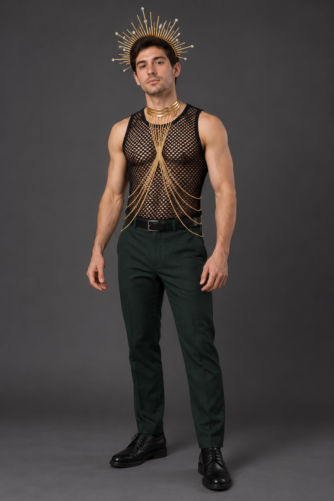
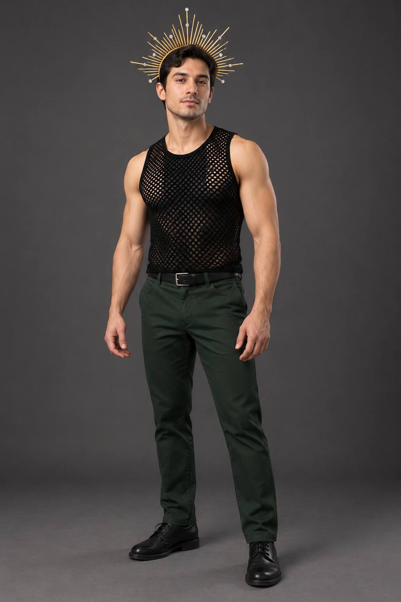
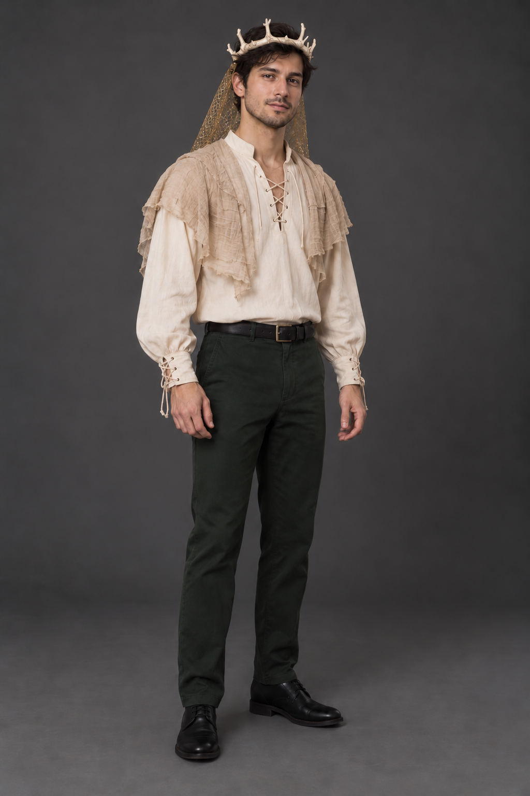

# Weekend outfit renders — October 21, 2026

AI-generated styling previews, requested by the host. **Not photographs of purchased outfits, exact virtual try-ons or proof of product fit/availability.** Generic male models, not the user's likeness. Trousers, belt and shoes are illustrative stand-ins; only dark-green trousers and shoes are confirmed owned.

Current user decisions, shopping status and revised subtotal live in the [weekend plan](05-weekend-costumes-2026-10-21.md#latest-direction).

## A — Original Eclipse shopping-list combination

Uses the actual retailer photographs as visual references for [Zoestar Gold halo](https://www.amazon.com/dp/B0GFCZ3KG2), [JOGAL Black fishnet tank](https://www.amazon.com/dp/B07D7S3RCF) and [Nicute Gold body chain](https://www.amazon.com/dp/B07S2Q4V4J). Keep the chain delicate: it is not armor or a male harness. No claim that this illustration establishes collar/waist sizing or comfort.

Styling assessment: the draped chain makes the outfit more ornate and body-jewelry-led, matching the user's concern about a feminine read. This is subjective styling feedback, not a rule about who can wear the pieces.

## B — Simplified Eclipse styling proposal

Same referenced halo and mesh tank, **body chain omitted**, with an optional plain opaque black tank beneath the mesh for a darker, straighter torso silhouette. The under-tank is an additional/owned-layer suggestion, **not a sourced item or confirmed inventory**. The render is approximate; actual opacity and neckline depend on that garment.

Styling assessment: cleaner and more athletic, but less elaborate. The halo remains the statement piece. This variation has not been selected by the host.

## C — Compact bone-crown Antler King concept

Illustrates the listed beige lace-up shirt, short folded beige gauze mantle, gold textile netting lifted behind the head, dark-green trousers and black shoes. Shirt/drape/mesh are **text-description approximations**, not photo-exact reproductions. The mesh is not chainmail; the mantle is a folded runner, not a finished cape.

**The small ivory bone-look circlet is a design concept, not an existing product found for sale.** Low blunt forked tines, close to the head, with an approximately 6–8 cm projection used only as a design prompt, not a measured product dimension. Specific product, material, fit, price and arrival must be sourced/verified. Prefer lightweight faux-bone finish rather than assuming actual bones. Keep eyes clear, veil removable and all cloth above the hips for dancing.

The host confirmed compact bone-crown direction for City of Gods. This does not cancel the unresolved larger Yellowjackets-inspired October 31 crown. The illustrated detailed crown, exact model proportions and cloth drape must not be used as buying guarantees.

## Generation record

Created with the built-in image-generation tool using the imagegen skill. Three independent first-pass assets; one targeted edit changed the King's crown from brown/twig-like to ivory bone-look without changing the outfit. Only the three selected outputs are copied here; the rejected brown-crown draft remains in the tool's original generated-images directory.

[Exact generation and correction prompts](renders/2026-10-21/prompts.md).

Retailer-photo credits: Zoestar, JOGAL and Nicute via the linked Amazon listings, viewed October 21 in Chrome. Halo/tank photo files were downloaded solely as image-generation inputs; chain design was referenced from a screenshot of its actual listing. No private user photo used. No new delivery/fit test, purchase, cart addition, reservation or seller contact performed.
