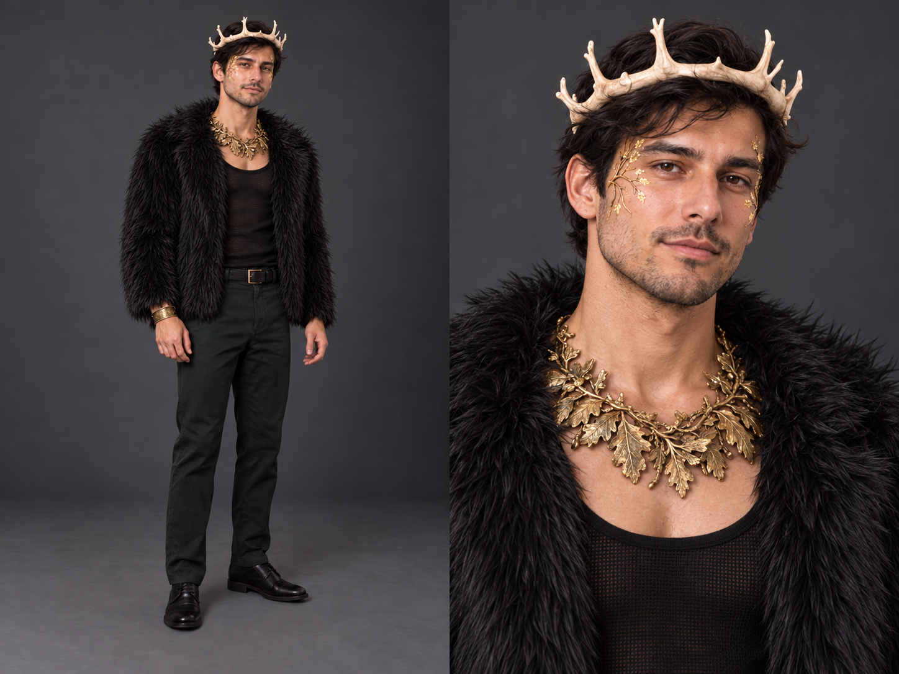
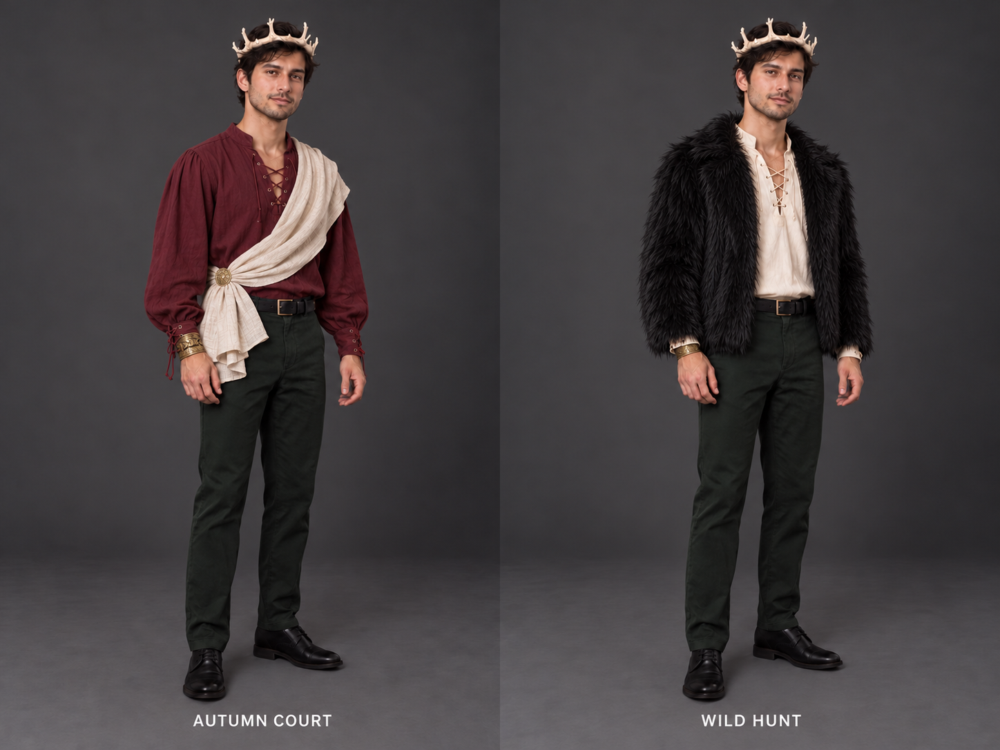
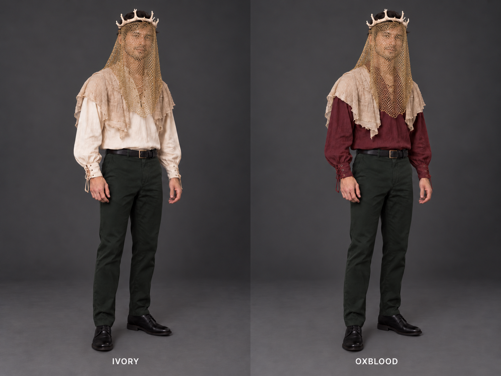
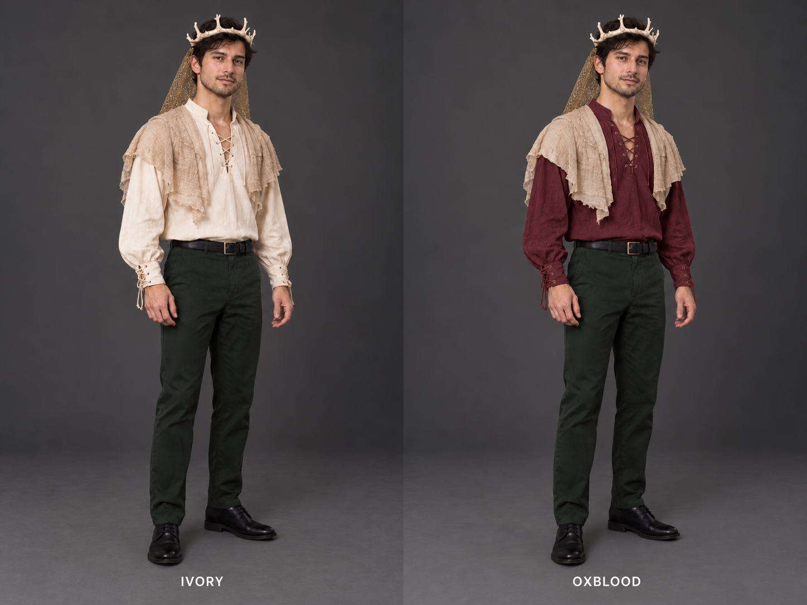
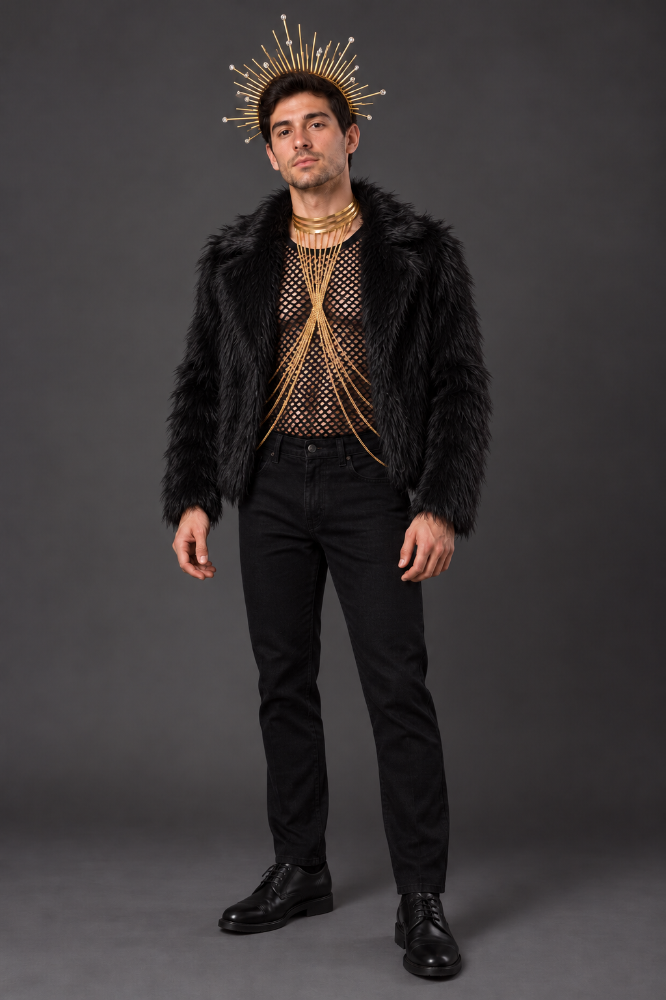

# Weekend outfit renders

AI-generated styling previews, requested by the host. **Not photographs of purchased outfits, exact virtual try-ons or proof of product fit/availability.** A–H use generic male models; **I–P use the host's requested likeness and stay Git-ignored locally**. Trousers, belt and shoes are illustrative stand-ins for owned pieces; exact appearance/fit is not established by these images.

Current user decisions, shopping status and revised subtotal live in the [current order and shopping list](09-final-weekend-shopping-2026-10-21.md). Original previews are dated October 21; the controlled King shirt-color comparison below was added October 22.

**Subsequent host instruction, October 22:** [source before making further renders](AGENTS.md#source-before-rendering--host-instruction-october-22). Existing previews below are history, not proof their essential pieces can be obtained by Saturday. In particular, H's collar and face branches require exact real-world sourcing and deadline verification before another preview; revise the design first if unavailable.

**Latest October 29: more eerie woodland texture and black-trouser direction sourced in [30](30-eerie-woodland-amazon-2026-10-29.md), no new render yet.** Host dislikes brocade's vampire-aristocrat read and clarifies actual trousers are olive/disfavored. Crown/torc/cuffs remain. P retains the completed earlier waistcoat/shirt/half-cape preview and illustrated deep-green trousers as history; [29](29-amazon-saturday-brocade-outfit-2026-10-29.md) owns its private final/prompt and dated sources. No new order/final outfit selected.

## P Black/gold brocade waistcoat and half-cape

Requested/completed October 29: actual VATPAVE Sv16-black waistcoat over JEMITOP Black-b short-sleeved shirt, FURPHI Black half-cape, compact crown, curled gold torc, gold cuff pair and green trousers, clean-shaven likeness. One successful built-in identity-preserve edit from O plus actual waistcoat/shirt/cape/cuff photographs. Full-body/detail, 1536 × 1024; visually checked requested pieces and absence of armor/strap/vials/mantle/sash/fur/mesh/face cover. Prior personalized final carries likeness because original upload is absent. [29](29-amazon-saturday-brocade-outfit-2026-10-29.md#requested-personalized-preview--october-29) owns private output/prompts, actual sources and approximation limits. No new order/physical fit/crown repair. Personal output/prompts ignored; no source-date refresh during generation.

## O Moon-phase armor and black half-cape

**Later October 29: shoulder armor dropped; half-cape retained. Current baseline/options in 27; this image is history.**

Requested/completed October 29: real Brown B pauldron with supplied three vials and diagonal strap, opposite-shoulder Black metallic-edged cape with supplied rope, black short-sleeved shirt, compact crown, torc/cuff pair, green trousers and clean-shaven likeness. Two built-in edits; the second removes only a cream fabric patch accidentally copied from a retailer model. Full-body/detail, 1536 × 1024. Prior personalized final carries likeness because original upload is absent; three actual garment photos supply objects. [27](27-haunted-court-statement-pieces-2026-10-29.md#personalized-pauldron-and-cape-preview) owns private final/prompts, exact source evidence and approximation limits. Source refresh hit verification; earlier successful exact checks only minutes before generation remain dated evidence. No new purchase, CAPTCHA click, physical fit or crown repair. Personal outputs/prompts remain ignored.

## N Short-sleeved cotton shirt and brown mantle

Requested/completed October 29 with crown, torc, actual cuffs, green trousers and clean-shaven likeness. Exact Black-b / Small shirt and Brown / Small mantle both refreshed for October 31 delivery before generation. Two built-in edits: insert actual short-sleeved shirt; correct invented mantle opening to the real closed front. Full outfit/detail, 1536 × 1024; shirt lacing mostly covered by mantle. Earlier personalized portrait carries likeness because original upload is absent. [26](26-brown-mantle-preview-and-crown-repair-2026-10-29.md#current-personalized-sleeved-preview) owns private final/prompts, source dates and limitations. Visually checked sleeves, closed mantle, accessories, green trousers and clean shave; texture/fit approximate. No new order or physical repair/test; personal outputs/prompts Git-ignored.

## M Brown leaf mantle with opaque black top

**Later October 29: sleeveless rejected; this preview is history.** See 26 for the sourced sleeved recommendation.

Requested/completed October 29 after the host rejects mesh. One built-in imagegen edit of L's clean-shaven final, using the actual Amazon Essentials Black / Small top photo. Exact variant stock and October 30 delivery verified before rendering; [26](26-brown-mantle-preview-and-crown-repair-2026-10-29.md#latest-revision-mesh-rejected-opaque-black-top) owns price/offer/provenance and private links. Same full-outfit/detail layout, brown mantle, compact crown, torc, cuffs, green trousers and clean-shaven likeness. Both torsos visually checked fully opaque, bare arms retained. No new order, physical repair or fit test. L's mesh is superseded; personal assets/prompts remain ignored.

## L Brown leaf mantle with reused pieces

**Later October 29: mesh rejected; see M for the opaque-top revision.**

Requested/completed October 29 after exact Brown / Small Amazon Friday delivery refresh. Two built-in imagegen edits: replace fur with the real matte brown leaf capelet and expose black mesh/bare arms, then remove remaining beard shadow only. Full outfit and matching detail, 1536 × 1024. Earlier personalized final supplied user likeness; actual mantle/crown/torc/cuff product photos supplied objects. Original uploaded photo no longer present. [26](26-brown-mantle-preview-and-crown-repair-2026-10-29.md) links the private final and exact prompts, all Git-ignored. No new purchase, extra accessory, makeup, veil, fur, feathers, large antlers or physical test. Crown shown intact as intended styling; user reports two small broken pieces and repair remains pending.

## K Jacket-free baseline and feather mantle upgrade

**Later October 27: feather upgrade rejected by host.** No order/final look inferred; see [24](24-party-reference-led-direction-2026-10-27.md) before new sourcing/renders.

Requested/completed October 27 after host rejects fur heat and plainness: first edit removes only the jacket and reconstructs actual Burgundy shirt sleeves; second adds the real A3-black feather/silver-chain mantle and Black woven hood, showing hood down/up in two full-body views. [23 owns exact sources, check date, private output links and limits](23-jacket-free-hollow-court-2026-10-27.md). Both retain compact crown, gold torc/cuffs, green trousers, clean-shaven likeness and clear face. No makeup, fur, veil or large antlers. Two successful built-in edits; product photos used as object references. New pieces sourced before upgraded render, not ordered. Physical fit/heat and exact fine details untested; private assets/prompts stay Git-ignored.

## J Hollow Court with Burgundy shirt

Requested/completed October 27: compact purchased bone crown, black fur, actual curled torc and tree-of-life cuff pair, green trousers and a newly sourced Burgundy cotton lace-up shirt. [22 owns the exact source, date/deadline, private output and generation record](22-hollow-court-reuse-redesign-2026-10-27.md#shirt-sourcing-and-personalized-preview--october-27). Host likeness inherited from I's private final because the original temporary upload is no longer on disk. One successful built-in edit; full outfit and matching close-up, clean-shaven, no makeup/veil/solar pieces. Image, exact prompt and references remain Git-ignored. New shirt not ordered, actual fit untested; color/scale/engraving approximate. No new purchases or physical tests.

## I Personalized Eclipse and Gilded Stag

Requested and completed October 23 after account delivery refresh and exact-product photo inspection. [Sanitized generation and source record](16-personalized-previews-2026-10-23.md) owns the details and private local image links. **Friday:** Gold Zivyes flat-ray halo, black fur/mesh/jeans and Nicute body chain; no Saturday cuffs. **Saturday:** thicker interlaced pale Sosation crown, black fur/mesh, NauticalMart curled torc, Karace Style B pair and green trousers. Clean-shaven styling, no makeup/veil. Fine engraving, material finish, jean/shoe appearance and garment fit remain approximate. No new purchases or physical tests.

Likeness outputs, source photos and exact prompts are under `renders/private/`, intentionally ignored and not embedded in tracked documents. Earlier A–H remain as dated design history.

## H Gilded Stag full outfit and detail

Requested October 22 following the [City of Gods styling reassessment](handoff-2026-10-22-city-of-gods-reassessment.md). The right-hand Wild Hunt model/outfit from G was the edit target. It retains the compact illustrated pale bone crown, open black fur jacket, dark-green trousers, belt/shoes and small gold cuff; the ivory lace-up shirt is replaced by a fitted black mesh tank. A broad antique-gold botanical collar sits inside the open lapels, with fine branching gold accents at the temples/upper cheeks. No veil, solar halo or full-body chain. Full-body framing left and matching close-up right make the collar/face work visible.

**Design preview, not a final outfit choice or exact product try-on.** The crown is not a photo-exact Sosation rendering; the new collar and cosmetic effect are not sourced or stock-verified. Fine raised-looking leaf/branch details are an illustrative target, not a claim that ordinary pigment will reproduce them. Base/mesh, cuff and jacket details remain approximate. No new purchase, delivery check, fit/warmth test or budget revision. [Exact prompt and input/output record](renders/2026-10-22/gilded-stag-prompt.md).

**Later October 22 sourcing:** [actual necklace alternatives and NYC makeup](14-gilded-stag-collar-makeup-2026-10-22.md) now have Saturday Amazon estimates / location-specific pickup stock. None reproduces the exact broad oak collar above; face accents would be flat painted branches, not raised filigree. No substitute selected or new render made. Refresh day-of delivery risk and pickup stock before depicting a chosen real version.

## G Autumn Court versus Wild Hunt without veils

**Subsequent host feedback:** these need a stronger City of Gods aesthetic. Wild Hunt might be adapted, not accepted unchanged; Autumn Court's thematic fit is questioned. [Official-mood-board assessment and proposed woodland-deity rework](handoff-2026-10-22-city-of-gods-reassessment.md). The previous assistant preference for Autumn Court is not a host selection or the current recommendation.

Requested October 22 to visualize the two proposed pivots. **Left — Autumn Court:** oxblood lace-up shirt, one broad asymmetric ivory shoulder drape and small gold clasp/cuff. **Right — Wild Hunt:** ivory lace-up shirt and open short black faux-fur jacket, with a gold cuff. Both retain the same illustrated compact bone crown, dark-green trousers and face-clear styling; no netting, sun halo or body chain. The right-hand look proposes reusing the ordered Eclipse fur, not buying another jacket.

The previous color diptych supplied model/crown/trouser continuity; D supplied the fur silhouette only. These are achievable styling ideas, **not exact product try-ons**: the crown is still illustrative rather than the ordered Sosation design, and the new broad drape/clasp/oxblood shirt are not sourced or deadline-cleared. No outfit selected, new purchase or budget revision. [Exact prompt and input/output record](renders/2026-10-22/autumn-court-wild-hunt-prompt.md).

## F Antler King with full face gold veil

Earlier full-face exploration, now under review after the host questioned its proportions with a small crown. G above shows alternatives; this is not a current instruction to buy netting.

Requested October 22 after E. The host's attached Yellowjackets still guided **front placement and gold-net texture only**; its tall antlers, large cloak and scene were not copied. The existing E diptych was edited so both veils cover forehead, eyes, nose, mouth, chin and neck to the upper chest. The compact illustrated bone crown, ivory-left/oxblood-right shirts, green trousers, pale shoulder mantle, belt/shoes, model, full-body framing and studio light remain visually matched. This records the earlier full-face request, not selection of that silhouette over G.

The mesh is an illustrative open gold textile, **not a photo-exact reproduction or proof of visibility through CABODYALS or another product**. Single-layer openness, thread thickness, folds, glare and room lighting all need actual trials. Use independently accessible clips on a padded band/support, not sharp crown tips; lift/remove for normal walking/dancing and whenever sightlines are poor. This compact front drape does not reproduce the reference's tall antler-supported canopy. Crown remains a concept rather than an exact rendering of the ordered Sosation piece. No shirt color, new product or spending change inferred. [Exact prompt and input record](renders/2026-10-22/prompts.md#full-face-veil-correction).

## E Antler King ivory versus oxblood

Earlier shirt-color comparison; F subsequently explored full-face placement, and G now explores a no-veil restyle.

Requested October 22. Left: warm ivory/parchment. Right: deep oxblood/wine. The existing compact King concept in C was the edit target; the same generic model, pose, dark-green trousers, pale bone-look crown, lifted-back gold net veil, pale gauze shoulder mantle, belt, shoes and gray studio lighting are visually matched. The mantle stays pale in both versions: this is a shirt-color comparison, not a whole-palette restyle. Minor generative detail variation is possible; not a pixel-identical photographic recolor.

The crown is still the **illustrated concept**, not a photo-exact rendering of the ordered Sosation product. No real user photograph or new retailer photo was used. The oxblood shirt is a styling idea, **not a newly sourced Small product or verified weekend delivery**. No color chosen, new order or budget change. [Exact prompt and input/output record](renders/2026-10-22/prompts.md).

## D — Eclipse with short black faux fur and black jeans

Requested October 21 after the [layer shortlist](08-layer-shopping-2026-10-21.md). Preserves the original gold sunray halo, black mesh tank and delicate gold body chain; adds an open, hip-length shaggy black jacket and replaces green tailored trousers with matte black slim-straight jeans. No cuffs added. Full-body studio styling preview on the same generic adult male model.

The jacket approximates the silhouette of the [Gihuo short faux-fur jacket](https://www.amazon.com/dp/B0F4X9GTPM) from its previously inspected product image and written description; **the retailer photo was not an input to this edit**, so pile, collar, proportions and construction are not photo-exact. Jeans/shoes are stand-ins, not a photo of owned items. The render is not evidence of warmth, jacket sizing, chain durability or delivery. Keep the chain supported by the base outfit so the jacket can come off independently; avoid snagging delicate chains in the fur.

## A — Original Eclipse shopping-list combination

Uses the actual retailer photographs as visual references for [Zoestar Gold halo](https://www.amazon.com/dp/B0GFCZ3KG2), [JOGAL Black fishnet tank](https://www.amazon.com/dp/B07D7S3RCF) and [Nicute Gold body chain](https://www.amazon.com/dp/B07S2Q4V4J). Keep the chain delicate: it is not armor or a male harness. No claim that this illustration establishes collar/waist sizing or comfort.

Styling assessment: the draped chain makes the outfit more ornate and body-jewelry-led, matching the user's concern about a feminine read. This is subjective styling feedback, not a rule about who can wear the pieces.

## B — Simplified Eclipse styling proposal

Same referenced halo and mesh tank, **body chain omitted**, with an optional plain opaque black tank beneath the mesh for a darker, straighter torso silhouette. The under-tank is an additional/owned-layer suggestion, **not a sourced item or confirmed inventory**. The render is approximate; actual opacity and neckline depend on that garment.

Styling assessment: cleaner and more athletic, but less elaborate. The halo remains the statement piece. This variation has not been selected by the host.

## C — Compact bone-crown Antler King concept

Illustrates the listed beige lace-up shirt, short folded beige gauze mantle, gold textile netting lifted behind the head, dark-green trousers and black shoes. Shirt/drape/mesh are **text-description approximations**, not photo-exact reproductions. The mesh is not chainmail; the mantle is a folded runner, not a finished cape.

**The small ivory bone-look circlet is a design concept, not an existing product found for sale.** Low blunt forked tines, close to the head, with an approximately 6–8 cm projection used only as a design prompt, not a measured product dimension. Specific product, material, fit, price and arrival must be sourced/verified. Prefer lightweight faux-bone finish rather than assuming actual bones. Keep eyes clear, veil removable and all cloth above the hips for dancing.

The host confirmed compact bone-crown direction for City of Gods. This does not cancel the unresolved larger Yellowjackets-inspired October 31 crown. The illustrated detailed crown, exact model proportions and cloth drape must not be used as buying guarantees.

## Generation record

Created with the built-in image-generation tool using the imagegen skill. Three independent first-pass assets; one targeted edit changed the King's crown from brown/twig-like to ivory bone-look without changing the outfit. A later successful edit of Original Eclipse adds the black fur jacket and black jeans. Four selected outputs are copied here; the rejected brown-crown draft remains in the tool's original generated-images directory. The new 1024 × 1536 PNG was visually inspected for full-body framing, open black fur, black jeans, retained halo/mesh/chain and absence of extra accessories.

October 22 adds one built-in edit output, the ivory/oxblood diptych. Visually inspected for correct left/right labels, full-body framing, shirt colors and matched green trousers/crown/gold veil/pale mantle. Source concept retained unchanged. The comparison asset and its exact prompt are saved in `renders/2026-10-22/`; it does not replace the four October 21 previews.

Later October 22 adds one further built-in edit using that diptych plus the user-attached reference still: full-face veil placement, saved as a separate sibling PNG. Visually checked for continuous face coverage, chest-length gold netting, compact crown retained, matching mesh between panels, unchanged clothes/palette and legible labels. The uploaded reference itself was not copied into Git. See the existing [Yellowjackets reference credits](references/README.md) for related source imagery.

A subsequent October 22 built-in edit creates G, the 1448 × 1086 no-veil diptych, from E plus D as a jacket-only reference. Visually checked for both clear faces, matched compact crown/green trousers, oxblood with broad ivory drape on left, ivory with black fur jacket on right, legible labels and no solar accessories or weapons. Previous outputs retained unchanged; no retailer/account checks or selection implied.

One further October 22 built-in edit creates H from the right-hand G figure. The 1448 × 1086 PNG was visually checked for all five requested design ingredients, black mesh replacing the poet shirt, matching outfit/detail views, unobstructed face and absence of veil/halo/body chain/weapons. Previous images retained unchanged; original output copied into the project without image processing.

[Exact generation and correction prompts](renders/2026-10-21/prompts.md).

Retailer-photo credits: Zoestar, JOGAL and Nicute via the linked Amazon listings, viewed October 21 in Chrome. Halo/tank photo files were downloaded solely as image-generation inputs; chain design was referenced from a screenshot of its actual listing. No private user photo used. No new delivery/fit test, purchase, cart addition, reservation or seller contact performed.
