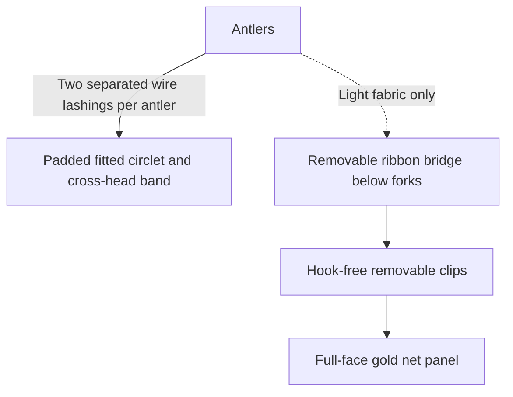

# Wearable antler frame and removable veil • two-hour proposal

Researched October 23, 2026, America/New_York / EDT (UTC−04:00). For the **October 31 Hollow Court headpiece**, not the October 24 compact Gilded Stag. This is the current construction proposal, superseding [20's display-plate/cap exploration](20-ready-bases-and-mounting-kits-2026-10-23.md). Antler offers and the single authorized seller enquiry remain in [19](19-jandmantlers-and-two-hour-build-2026-10-23.md).

## Recommendation and honest limits

**Do not buy the Shed Spreader plus bump cap as a finished kit. Remove that extra interface from the design.** Instead, adapt a documented, actually worn **padded wire-mesh circlet with a cross-head band**, mechanically lashing each antler at the reinforced band junction. It is a headpiece fabricated from materials, **not a newly discovered ready-made load-rated harness**. It avoids a skull plate, cap drilling, flattened antler butts, threaded inserts, paint, epoxy and overnight cure. Those are meaningful reductions in work, not proof that any natural pair is wearable.

The target is **80–90 minutes assembly plus 30 minutes fitting/testing, within 120 minutes total**. This is our planning estimate, **not the blogger's published time or a timed physical test**. It remains conditional on a manageable pair, successful clamped drilling, and a stable first fitting. No novice-proof or guaranteed two-hour result is established for the unknown-weight jandmantlers sheds. Do not characterize the whole basket as deadline-cleared: antler expedited arrival/mass are pending, and several tools/PPE have not received exact delivery checks.

Choose the narrower **2×2**, if seller measurements/shipping support it, rather than the thicker, wider 4×4 for this time-limited route. No used/pre-owned eBay, new outreach, purchases, reservations or accepted rush fees. All costume spending remains within the combined $500 ceiling.

## What actual builders did

| Primary firsthand source | Useful evidence and limits |
|---|---|
| [Erica: Antler Headpiece How-To](https://bellydancewitherica.com/2014/02/19/antler-headpiece-how-to/) | A photographed, worn real-shed build: doubled hardware-cloth ring, cross-head strip, felt, and wires through drilled antler holes and around the bases. The antlers attach where the crossband meets the ring. [Close-up of the actual connection](https://bellydancewitherica.com/wp-content/uploads/2014/02/hornheaddress_0011.jpg) inspected in Chrome. This is the most relevant mechanical precedent, **not a tested capacity for our pair**. Author's antler mass/gauge/build duration unpublished. |
| [Vix Venture: Yellowjackets Cosplay](https://www.vixventure.com/blog/feast-on-this-yellowjackets-cosplay) | Antler Queen uses fake antlers wired to a jersey-wrapped headband and mesh draped above the face. The separate Doomcoming build became too heavy for long wear. Supports the draping idea and cautions against treating all headbands/fake antlers as equivalent. |
| [Phoenix Fan Fusion cosplayer's own construction account](https://www.reddit.com/r/Yellowjackets/comments/1l6x9az/antler_queen_cosplay/) | Describes adding bicycle-helmet clips/straps and a scarf over the headband mounting. Useful retention/hiding precedent, but antler material/mass is unspecified; not proof for natural sheds. |
| [Diana Corpus: Antler Headdress](https://www.dianacorpus.com/blog/2018/1/24/antler-headdress) | Wearable leather-band construction exists, but this example required custom leatherwork, base sawing and E6000. Its reported hollow pieces must not be assumed to describe our natural sheds. Not the preferred two-hour method. |

The circlet adaptation below uses ready-width mesh, adhesive-backed padding and cloth tape instead of sewing a velvet cover. The ribbon bridge and hook-free removable veil clips are our proposed adaptation, **not a copied or physically tested part of Erica's build**.

## Complete headpiece bill of materials

### Exact selected Amazon offers verified in Chrome

Delivery destination **Brooklyn 11211**. Prices before tax; ordinary one-time new offers. Optional early delivery windows sometimes require a $25 qualifying order, but the separate free calendar-date delivery below was also visible. No cart, Buy, instant-add or subscription controls used.

| Buy one of each unless owned | Exact offer / quantity needed | Price observed | Arrival observed |
|---|---|---:|---|
| Frame mesh | [Ahua Walsong B0D8SH2T8F](https://www.amazon.com/dp/B0D8SH2T8F): **1/4-inch openings, 23 gauge, 4 inches × 10 feet**. Cut one circumference strip and one cross-head strip; substantial spare remains. Folded, padded and covered; never bare on the head. | $9.89 | **October 24**, in stock; Amazon / Ahua Walsong |
| Mechanical tying wire | [Hillman 123130 B000BPDBFU](https://www.amazon.com/dp/B000BPDBFU): **16-gauge galvanized steel, 25 feet, one pack**. About 8–10 feet allows seams, redundant antler lashings and retries. | $6.99 | **October 24**, in stock; Amazon.com |
| Inner comfort liner | [uxcell B0DSS84Y3D](https://www.amazon.com/dp/B0DSS84Y3D): **White, 2 × 51 × 0.2 inches**. Approximately circumference + fitted crossband length; measure first. | $9.39 | **October 25**, selected White offer showed 9 left |
| Wire-edge covering / exterior wrap | [Howies B0069NB73Q](https://www.amazon.com/dp/B0069NB73Q): **White cloth hockey tape, 1 inch × 24 yards, one roll**. Covers every mesh edge, joint and wire tail; finish with clean overlapping exterior wraps. Not structural antler glue. | $8.79 | **October 24**, in stock; Amazon / Howies Hockey Tape |
| Soft veil support / reinforcement | [LIUYAXI B0922N21M5](https://www.amazon.com/dp/B0922N21M5): **solid Gold grosgrain, 3/8 inch × 50 yards**. Only about 2 yards needed for anchor loops, bridge, clip reinforcement and spare. Not elastic. | $5.39 | **October 24**, in stock; Amazon / RDGHR |
| Removable veil clips | [JAM Paper B0CB1RTYFM](https://www.amazon.com/dp/B0CB1RTYFM): **Gold, 15 mm, 30-pack**. Use **four**, rest spare. Hook-free binder clips; ribbon passes through a handle, jaws grip reinforced folded mesh. | $8.49 | **October 24**, selected new one-time offer; Amazon / JAM Paper & Envelope |
| Ready-cut gold net • time-saving alternative, not exact show fabric | [II / XINZHIFA B0C4NRXTYX](https://www.amazon.com/dp/B0C4NRXTYX): **Gold (1 yard)**, actually **60 × 90 cm / 23.62 × 35.43 inches**. One front panel, not wraparound yardage. Actual photo inspected; 4.5/52 aggregate. | $13.99 | **October 24**, in stock; Amazon / XINZHIFA |
| **Core consumables with ready-cut net** | No antlers, tools, tax or rush shipping in this subtotal. | **$62.93** | Dates are observed estimates, not guarantees. |

The mesh page retained the old 12-inch product title/size-heading briefly after switching variants; **the selected 4-inch radio, changed ASIN B0D8SH2T8F and refreshed $9.89 buy box** are the quote used. Do not buy the 12-inch $15.89 roll inadvertently.

The new net is fine open gold cord with visible rhinestones: **more sparkling/beaded and less aged/chunky than the Yellowjackets crochet**. It is a practical, currently obtainable front-veil alternative, not an exact replica or an already accepted aesthetic substitution. Hold the uncut panel over the completed support first; its stated dimensions do not prove upper-chest coverage for every antler arrangement. Avoid permanent alteration if it is too short, too transparent, irritating or visually wrong. A tall canopy consumes length: measure from the bridge to the desired chest edge, not from the forehead.

**Better-textured local alternative:** [B&J Metallic Mesh Gold 9254956](https://bandjfabrics.com/fabric/metallic-mesh-gold), **$50/yard, 45 inches wide**, price/specs refreshed on the primary page October 23. One yard gives a 45 × 36-inch trial piece. **NYC floor stock/pickup still unconfirmed**; the web Add to Cart button is not a pickup promise. At 525 Seventh Avenue / 38th, second floor, published weekdays 8:45–17:45, weekends closed. Must obtain by October 29–30, not attempt a Saturday store run. No contact authorized or made. Replacing the $13.99 net with one $50 yard makes core consumables **$98.94**, conditional on stock/coverage. Don't buy both by default.

### Antlers • still conditional, not purchased

[jandmantlers new 2×2 set 8614, item 960073128854](https://www.ebay.com/itm/960073128854): previously checked **$38.99 + $14.99 standard shipping = $53.98** before tax. **Standard October 27–November 2 does not clear the party**. This turn did not recheck seller replies, shipping quote or inventory; [19](19-jandmantlers-and-two-hour-build-2026-10-23.md) is the dated evidence. The sent enquiry already asks pair mass, overall height, base dimensions and delivery October 29 / October 30 latest. Do not send again. The 8.5-inch figure is longest tine, not whole-antler height. Unknown mass cannot be converted into a safe headwear limit from the wire's static hanging rating.

### Tools / work setup • buy only missing items, not assumed owned

| Required for this approach | Sourcing / check status |
|---|---|
| Small drill and a sharp **5/64-inch / approximately 2 mm HSS bit**, plus spare | Drill owned. Bit fits the approximately 1.3 mm tying wire, subject to actual measured wire diameter. Bit purchase/delivery **not verified**. Do not confuse a wire-through hole with the earlier large blind screw/insert hole. |
| Straight aviation snips, one pair | [HURRICANE B07GDDF5JB](https://www.amazon.com/dp/B07GDDF5JB), selected **10 Inch Regular: Straight Cut**, **$13.39, in stock, October 24** verified. Not household/fabric scissors. |
| Combination pliers with steel-wire cutter, one pair | [DOWELL B07475DQJF](https://www.amazon.com/dp/B07475DQJF), selected **8-inch Lineman's**, **$9.99, in stock, October 24** verified. Inspect actual cutting capacity before use; no made-up capacity derived from product name. |
| **Two clamps or a suitable bench vise**, plus a stable work surface and sacrificial wood/blocking that immobilizes the curved antler | A WORKPRO 6-inch/50-lb two-pack search offer showed $9.48; **detail navigation hit an Amazon human checkbox**, so exact offer/date/ASIN not cleared. User asked non-blockingly to handle it; no challenge completed/bypassed. [Husky 2-inch C-clamp product](https://www.homedepot.com/p/207119522) is a standard alternate specification, **not a verified NYC-stock recommendation**. No hand-held drilling. |
| Cut-resistant work gloves for mesh handling; eye protection; suitable particulate mask for antler drilling; a damp wipe for cleanup | Required work-setup inventory, **ownership and exact pickup/delivery not checked**. Gloves off/loose fabric restrained around rotating drill. Do not treat small drilling volume as zero dust. |
| Tape measure, marker, metal ruler/straightedge, fabric scissors, paper / removable tape for a fit template | Ownership unconfirmed. No sewing machine, heat gun, larger drill, saw, E6000, epoxy, threaded inserts, hard hat or replica skull plate specified. |

Core consumables + the two verified tools total **$86.31**. Adding the earlier standard antler subtotal gives **$140.29 before tax**, **not a full delivered total**: clamping/PPE/bit, expedited shipping, and any missing body costume remain additional. With tools already owned, core + standard antlers is **$116.91 before tax**. These figures are comparisons, not an approved order or a price for a finished headpiece.

Budget source remains [09](09-final-weekend-shopping-2026-10-21.md#budget-after-the-order): $196.59 weekend orders, $347.47 optional-inclusive envelope including $110 unpurchased jeans and $20 supplies. Do not add the whole envelope and a new supply basket without replacing that overlapping $20 allowance. This proposal is more comfortable within the $500 ceiling **if optional jeans are omitted**; rush, tools, body garment, tax and travel still need a delivered total. No operations budget/cart mutation while the route remains unselected.

## Connection and veil support, plainly

### Antlers to a wearable base • no plate-to-cap joint

The load path is **each antler → two separated mechanical lashings → reinforced ring/cross-head junction → padded fitted circlet → head**. The cross-head band is essential; it stops this being just a thin decorative hairband. No cap hides underneath and no wall-mount plate sits above it.

Diagram shows the proposed connections, not certified loads or a physically tested rig.

1. Make a fitted, doubled mesh ring approximately **2 inches tall**. The ready 4-inch strip needs a length cut and a lengthwise fold, not a long freehand rip cut. Overlap the back about 1 inch and wire it at multiple separated points. Fit **over the liner thickness**, not tightly to bare-head circumference; use a padded paper fit template. Author's 22-inch circumference is not the user's measurement.
2. Make a crown-crossing band from the same roll, folded into an approximately 1-inch-wide strip. Size its arc over the head with spare overlap at each end; wire both ends to the ring at the intended antler seats. Do not copy the blogger's fixed 10-inch crossband length.
3. Seat each antler **against the outside of that reinforced junction**, burr down and fork upright. This avoids needing its butt sawn flat to lie on top of a plate. Dry-position before modifying. Unknown antler curvature may still prevent the desired close-in orientation.
4. Off the body, **immobilize the antler on blocking with clamps/vise**. Drill two separated transverse wire holes through sound, sufficiently thick lower beam above the burr. Exact positions depend on the real piece: no hole at a crack, thin tine or edge, and no universal millimeter positions inferred from listing pictures. If it cannot be immobilized or comfortably drilled, stop rather than improvise while holding it.
5. Each hole gets its **own wire lashing** to separated frame points at the junction; add external wraps that capture the lower beam. Tighten using pliers without distorting the mesh. Two separated attachments resist twist better than one central screw/friction loop. Trim, fold outward and completely tape over every wire tail. The cloth/felt cover is not the structural attachment.
6. Cover every raw mesh edge/joint with cloth tape, line all head contact with felt, and mechanically retain the felt with wrap-over tape where needed; its adhesive is only a positioning aid. Do not leave wire accessible through the mesh or place clip bodies against the skin. Fit snug, not headache-tight. This lift-off ring has no tight neck tie; if it needs one to compensate for tipping, this pair/frame has failed the fit gate.

This is a DIY adaptation with no load certification or physical test; increasing wire thickness/tightening a neck strap is not an established fix for an overly heavy pair. Do not use it for vigorous dancing or crowded movement with rigid antlers.

### Tall face veil • soft bridge, not a separate cage

- Tie a short padded ribbon loop around each substantial upper beam **below a fork**, away from sharp tips. Connect those loops with a removable grosgrain bridge across the upper front. Set its height by the actual desired canopy; leave fork tips visible. It supports only the light fabric, **not the antlers**, and must not pull the antlers inward.
- Tie two binder-clip handles to the bridge using short ribbon loops; fold a little ribbon inside the mesh's top edge and grip the folded sandwich with the clips. Two more accessible clips can control the outer corners if necessary, without stretching the net across the nose/eyes. No hot glue or holes required in the net for this first trial.
- The panel hangs **from above the face down to the upper chest**, not from the brow or behind the neck. Actual support geometry and face clearance require the fitted antlers; a soft bridge does not create a guaranteed rigid stand-off. If a rigid cage becomes necessary to keep the effect, that is a different build, not hidden work inside this estimate.
- Lift the lower front over the bridge for a clear face, or open the accessible clip jaws and remove the panel without disturbing the structural wire lashings. Verify it can be done by the wearer, not only a helper. Do not permanently wire mesh around antler forks.
- Keep it down only for photos/a brief ceremony. **Face clear for walking, serving, stairs, hugging and dancing**. No candles/flames near cloth; if it snags, impairs vision, sheds stones or irritates skin, take it off.

## The 120-minute clock • includes fitting and cleanup

All parts must be in hand; shopping/travel/delivery are separate, not disguised construction time. Parts sorting, measurements, drilling, wrapping and the wear test are included below. No prior antler preparation, paint drying or overnight curing assumed.

| Elapsed | Work / concrete checkpoint |
|---|---|
| **0–10 min** | Unpack/inspect, set tools and clamping block, measure padded circumference and cross-head arc, dry-position antlers, measure bridge-to-chest cloth length. Stop immediately if the cloth/pair cannot make the intended silhouette. |
| **10–30 min** | Cut/fold mesh; join ring and crossband; cover raw edges and temporary head-contact points. No custom decorative metalwork. |
| **30–50 min** | Clamp and drill the four small antler holes; attach the two independent lashings per antler at reinforced junctions. |
| **50–65 min** | Finish liner/tape over all contacts and wire ends; fit upright and turn gently. **Hard gate: if either antler twists, frame buckles, or ring tips/pinches, stop this natural-shed route.** Do not spend the remaining hour concealing an unstable mount. |
| **65–80 min** | Add soft ribbon bridge, four clips and net panel; adjust height/drape; verify one-person lifting/removal. Skip pearls, hair bundles, moss and extra embellishments. |
| **80–110 min** | Thirty-minute room-light comfort test, including talking, sitting, gentle turns and checking door clearance. Lift veil for movement; no dancing in an untested rigid rack. Failure means no finished wearable sign-off. |
| **110–120 min** | One small pad/clip adjustment, retest it and clean up dust/cut wire. No structural rebuild squeezed into the last ten minutes. |

**Cure time: none relied upon.** The schedule is plausible only if the simple structure fits and the antlers are manageable on the first pass. The natural pair's mass, shape and drilling behavior may invalidate it. This is not a promise that an untested raw-shed project will meet a strict two-hour deadline. The ready compact purchased crown remains an explicit lower-effect fallback, not a silent substitute for the requested tall look.

## Readiness / next actions

1. Wait for the **already-sent** jandmantlers reply, without duplicate outreach: require arrival October 29 preferred / October 30 latest, actual pair mass and overall dimensions before selecting. No standard ETA covering November qualifies.
2. Confirm tools/bit/PPE already owned, or finish exact purchase/delivery checks after the user clears Amazon's checkbox. No assumption that a small drill includes a suitable bit or clamp. **Later this turn:** user handled the first challenge; Chrome visibly returned to Amazon's homepage, so it cleared. A new challenge immediately appeared during drill-bit navigation. Browser focus recovery/product reads then repeatedly timed out; no additional selected tool/PPE offer was verified. Do not describe the first challenge as still uncleared or invent tool delivery. User requests that any future challenge tab be brought to the foreground immediately. Use supported Chrome window-focus plus native tab selection if needed; browser-management `tabs.update({active:true})` is unsupported in this environment. No challenge solved by the agent.
3. Choose the fine rhinestone net versus the better-textured but local-stock-unconfirmed B&J material. Both are proposals, neither purchased. Measure actual bridge height and panel coverage before cutting.
4. Build/test before party day. A fit failure is a real stop, not authorization for a longer build or a commission. No new beauty render until the essential antlers, veil and feasible fitted route clear the source gate.
5. **This is the complete headpiece spec, not a complete robe shopping list.** The warm-ivory body/hood for the screen-close October 31 look is still unsourced; the ordered weekend black fur/mesh does not silently satisfy that separate brief.
