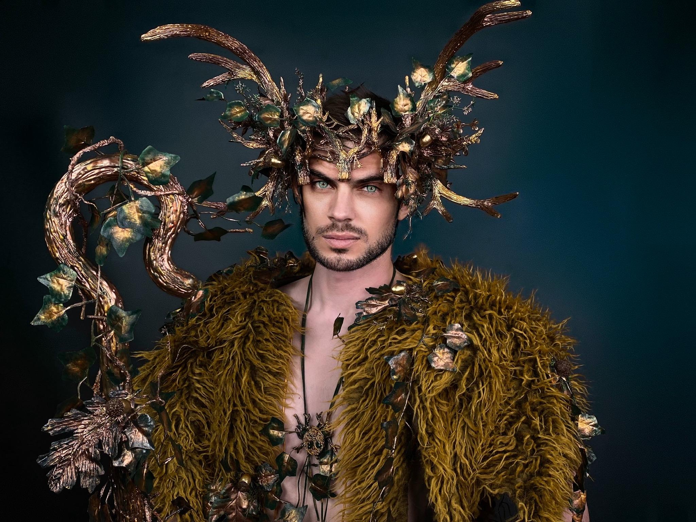
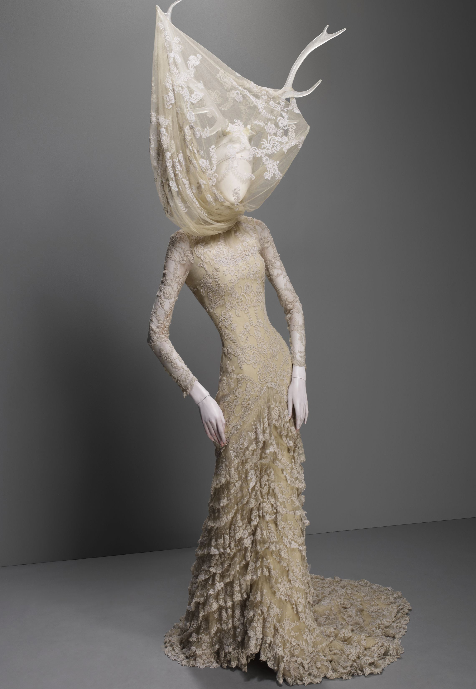

# Host costume • the party's own visual language

October 27, 2026, America/New_York / EDT (UTC−04:00). Event Saturday October 31. **Current design study; new defining pieces are not sourced or selected.** Supersedes the feather proposal in [23](23-jacket-free-hollow-court-2026-10-27.md).

## Confirmed correction

Host: **“no on the feathers”**; take inspiration from the party's lookbooks, pictures, themes and guardians. Fur remains too hot; the plain shirt lacks the earlier Antler King's mystery/impact. Retain compact headwear, clear face, no large antlers/full-face veil/self-applied makeup. No new garment/accessory purchase, contact or physical fit reported. The feather mantle is rejected, not an outstanding order; hood alone was not independently accepted or rejected.

## Sources actually reviewed

Read the [ritual lookbook](../guests/pack/COSTUME-RITUAL-BOARD.md), [art lookbook](../guests/pack/COSTUME-ART-BOARD.md), [guest guide](../guests/pack/COSTUME-GUIDE.md), [creative direction](../decor/creative-direction.md), [decor picture board](../decor/inspiration/BOARD.md), [material/room concepts](../decor/inspiration/2026-10-21/README.md), current [Rootkeeper](../decor/bedroom/woodland-guardian.md), [guardian characters](../interactive-game/design/narrative-arc.md), [app art](../interactive-game/app/src/client/Art.tsx) and [Gilded Root brief](../interactive-game/app/gilded-root-character.md). Visually inspected ritual boards 03/04, art contact sheet, material board, Forest King/dryad references, invitation cover V2 and portal artwork. References are not owned/sourceable costume pieces. Decor's October 27 notes say nothing bought; do not appropriate moss/ivy as owned costume supplies.

| Party reference | Specific visual lesson | Host-costume translation |
|---|---|---|
| **Gilded Root**, DEC-02 | Actual gold branch lamp: continuous narrow trunk, irregular forks, honey-gold ridges / bronze recesses / parchment. | One asymmetric **antique-gold root-patterned shoulder/chest panel**, branching inward across a dark base. Existing torc/cuffs retain substantial metal accents. No lamp-shade hat or delicate replacement necklace. |
| **Rootkeeper / Keeper of the Pulse**, DEC-03, and **Green Knight**, ritual board 04 | Dark body, carved bark ridges, branching silhouette and negative space. | Concentrate bark/root texture at one shoulder and upper chest. Arms and most torso remain free; no literal creature mask, glowing eyes or bark suit. |
| **McQueen / Yellowjackets**, ritual board 03, and **Open Door**, MAKE-05 | Pale bone contrasted with fragile open cloth and an uneven silhouette. | Airy ivory open-weave cloth over one shoulder and diagonally across torso, with short uneven ends and face entirely clear. Crown independent of cloth; no attempt at a tall canopy from small crown tips. |
| **Unfinished Guest**, DEC-05 | Pale skeletal remnants among branches, a visitor lingering beyond its season. | Existing bone crown supplies the relic; weathered cloth can echo it. No pile of skull jewelry or face-covering mask. |
| **Rackham / Proserpine / invitation / portal** | Asymmetric flowing shapes, green/wine/parchment/muted gold, growth intruding on formal structure. | Keep green trousers; wine can remain an accent. Give the torso one deliberate diagonal feature instead of relying on head/wrist jewelry alone. |
| **Magic Circle / Knotkeeper** | Tied waist, simple cord relationships and worn material. | A later restrained wrap/sash could finish the silhouette; not an approved new belt or confirmed owned supply. |

## Preferred direction • gilded woodland regalia

**Small pale bone crown + dark base + one organic asymmetric rootwork shoulder/chest piece + gold torc/cuffs + green trousers.** The host should read as a human figure belonging to the Court's wood, with something organic growing through otherwise ceremonial clothing. The missing impact is a changed torso silhouette and tactile surface, rather than more isolated jewelry.

- **Hero piece to source:** ready-made bronze/aged-gold branching cutwork, corded open mesh or substantial botanical appliqué over one shoulder/upper chest; dense at the shoulder, sparse branches toward sternum. Root/bark shapes, dark recesses and uneven edges; not a neat floral bib or conventional Tudor brocade. Source a finished soft piece/prepared appliqués with simple garment attachment. No sculpted armor, wire framework or curing workflow promised inside two hours.
- **Base to test first:** already ordered black JOGAL mesh, cooler and more integrated with branching surface detail. Delivery refreshed in [09](09-final-weekend-shopping-2026-10-21.md). The sourced Small/Burgundy shirt in [22](22-hollow-court-reuse-redesign-2026-10-27.md) remains a more covered alternative, **not a required purchase or confirmed owned item**.
- **Reuse:** actual Sosation compact crown, NauticalMart torc, Karace Style B tree-of-life cuffs, green trousers/shoes. No default body chain/solar halo. A little clean attached moss/leaf texture is possible only if a wearable piece is sourced; no loose scenic moss or all-over ivy.

Credit: **SETAdesignStudio**, [Forest King costume listing](https://www.etsy.com/listing/1856331145/mardi-gras-costume-forest-king-costume), already saved in the party's private reference library. Borrow bronze branching/leaf surface and green contrast. Pictured fur, large crown and staff are not proposed purchases. Image is not evidence of a timely available costume; no current maker quote/contact.

## Strong alternative • pale woodland apparition

**Small bone crown + airy ivory open-weave diagonal shoulder drape + wine/dark base + green trousers + torc/cuffs.** This takes the eerie bone/cloth contrast directly from McQueen/Yellowjackets and the Open Door. Uneven ends stop around hip/thigh; both hands usable, no floor train or face cover. More ghostly than the preferred embodied woodland figure. Neither is host-selected, and no new character/game rename is proposed.

Credit: **Alexander McQueen, Widows of Culloden, autumn/winter 2006–07**; photograph **Sølve Sundsbø / Art + Commerce**, as credited by [The Met](https://blog.metmuseum.org/alexandermcqueen/dress-widows-of-culloden/). Existing saved reference; source/rights record in ritual board. This is a texture/silhouette reference, not a gown or headgear shopping recommendation.

## Source check and remaining work

[UJUROU Black-gold half-shoulder cape B0GS1XKJRW](https://www.amazon.com/dp/B0GS1XKJRW), exact Black-gold / one size: **$19.29**, In Stock, free **Thursday October 29** delivery to Brooklyn 11211 in signed-in Chrome October 27; ships Amazon / sold Xueping12. Photo inspected: roughly 28-inch floral-damask half-cape, gold braid/long ties; polyester, only two listing reviews. **Excluded aesthetically:** timely but too orderly/conventional to supply the organic texture in the actual references. No order/cart/hold. This is not a source-cleared replacement rootwork piece.

Next: source the **one organic hero piece**, or exact airy ivory drape, with Saturday delivery/location-specific NYC pickup, real photo/attachment and realistic short assembly. Then render with actual purchased references. Do not depict an invented superior root sculpture, leaf armor or couture garment as obtainable. Reference review is complete; source readiness is not. Keep clear face/compact crown, then actual mobility/snag/temperature test. No new likeness render, physical test, purchase, seller message, return, game/decor edit or shared-budget charge. $500 ceiling / $196.59 order basis unchanged; shirt/feather/hood quotes remain unpaid proposals, not refunds or settled spending.
