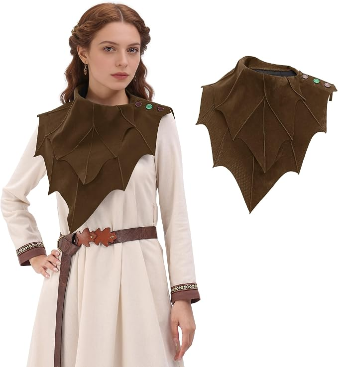
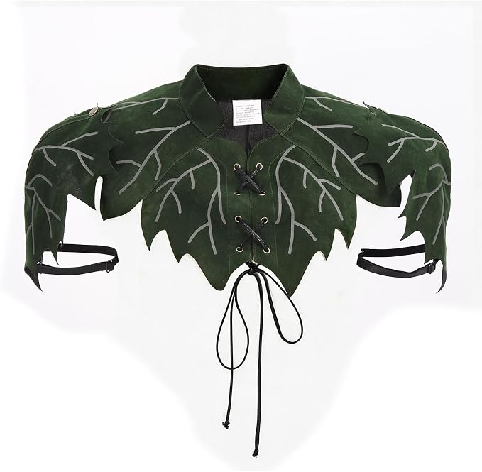

# Hollow Court costume • realistic reuse and Amazon stock

October 29, 2026, America/New_York / EDT (UTC−04:00). Party Saturday October 31. **Research and buying recommendation, not a host-selected outfit or new order.** [24](24-party-reference-led-direction-2026-10-27.md) retains the party/lookbook/guardian reference study. Host says Gilded Root and Rootkeeper both make sense and asks what can realistically be reused versus bought.

**Later October 29:** host requests this exact brown-mantle combination as a personalized preview and reports two small pieces broken from the crown. [26 — completed private preview and PLA repair guidance](26-brown-mantle-preview-and-crown-repair-2026-10-29.md) owns that follow-up. Brown / Small $13.16 / Friday offer refreshed before rendering; mantle/glue still not reported bought. Physical crown repair/fit pending.

## Reuse first

| Piece | Evidence / use |
|---|---|
| Sosation compact pale branching crown | Bought; host confirms in hand October 29 with **two small broken pieces**. Keep it for requested preview; actual repair/fit pending. [26](26-brown-mantle-preview-and-crown-repair-2026-10-29.md) owns PLA/gel-CA guidance. |
| NauticalMart curled brass-finish iron torc | Bought; marked delivered October 24. Existing substantial antique-gold neck accent. Do not buy another necklace. |
| Karace Style B two-cuff set | Bought; marked delivered October 24. Tree-of-life roundels already connect to the woodland theme. |
| JOGAL Small / Black mesh tank | Bought; marked delivered October 23. Preferred cool indoor base. |
| Dark-green trousers and shoes | Host-confirmed owned. Keep green; it ties the pale crown / brown texture / old gold into the woodland palette. |
| Functional warm layer | Owned; for travel if needed, not an additional indoor costume purchase. |

[09](09-final-weekend-shopping-2026-10-21.md) owns the nine-item order record and **$196.59** combined order basis. These are purchased/previously retailer-marked delivered states, not a new receipt/fit audit. Burgundy shirt has not been reported bought. Fur, solar halos and body chain remain purchases but are not required in the proposed indoor look. No refunds assumed.

## Strongest practical new piece checked

**[C-ZOFEK leaf shoulder mantle — Brown / Small, B0GVMLRMSP](https://www.amazon.com/dp/B0GVMLRMSP), $13.16, In Stock, free Friday October 30 delivery to Brooklyn 11211**, selected live in signed-in Chrome October 29, approximately 3:30 p.m. EDT. Ships Amazon / sold Heshund-US. Exact Small buy box and variant resolved after the initial Large-to-Small page transition; the old Large buy box was not used as Small evidence.

Actual photo: short brown leaf-shaped shoulder/collar piece, raised vein seams, scalloped pointed edges and three shoulder fasteners; arms free and one longer diagonal tip. Listed Small cowl length **13.4 inches**, neck circumference **19.7 inches**. This is polyester with a suede-like finish; the marketing bullet says “suede,” but it is not verified leather. Listing has **4.4/5 from only five reviews** across the listing. Actual feel, neck opening and torc compatibility need an unaltered try-on. Large was separately $14.99 / Saturday, not the recommended size or delivery buffer.

Retailer photograph saved from the Amazon C-ZOFEK listing October 29; photographer not identified. Private product/design reference, not a claim of redistribution permission. The model's shirt, belt, jewelry and skirt are not included or recommended purchases.

**Practical recommendation:** use this finished mantle over the owned black mesh with crown / torc / cuffs / green trousers. It gives Rootkeeper its organic torso silhouette; existing metal accents supply the Gilded Root palette. This is a wearable leaf interpretation, not the film's sculpted bark armor. No painting, wire sculpture, new headpiece, glue curing or sewing is necessary for this baseline.

## Other Amazon pieces actually inspected

| Exact candidate | Live October 29 offer | Assessment |
|---|---|---|
| [GORGECRAFT gold floral/leaf appliqué pair, B0CX156BGN](https://www.amazon.com/dp/B0CX156BGN), Gold, 2 pieces, nominal 16.77 × 9.25 in | **$6.99**, In Stock, free **Friday October 30** to 11211; ships Amazon / GORGECRAFT US | Actual large soft embroidered floral sprays on sheer tulle with sequins. A readily obtainable textile detail, **not sculpted roots or metal armor**. More floral/bridal than the intended rough rootwork; not the main recommendation. Requires garment attachment and needle/thread supplies, which have not been cleared as a complete kit. |
| [wtbv.n beaded shoulder pair, B0FCX691HC](https://www.amazon.com/dp/B0FCX691HC), Champagne, 9.8 × 10.2 in | **$29.90**, In Stock, free **Friday October 30** to 11211; ships Amazon / Coco jos | Photo shows ornate flower/rhinestone clusters and long looping bead chains. Listing explicitly flags **Frequently returned item**; 4.4/63. More jeweled than root-like and needs secure sewn attachment; not the main recommendation. |
| [C-ZOFEK green leaf shoulder cape, B0GX69G7VP](https://www.amazon.com/dp/B0GX69G7VP), Small | **$31.29**, In Stock, free **Saturday October 31** to 11211; ships Amazon / Htyuan-US; checked about **3:54 p.m. EDT**, after host cleared verification | Real product photo shows green leaf-shaped chest/shoulders, pale embroidered veins, front lacing and adjustable upper-arm straps. Only **4.3/5 from three ratings**. One displayed Vine reviewer reports thin velvet-like fabric, deep packing creases and shoulder snap adjustment that does not sit flat. More structured-looking but not demonstrated sturdier construction or a quality upgrade; brown mantle retains the recommendation and Friday buffer. |

Green cape retailer photograph saved from the C-ZOFEK Amazon listing October 29, photographer unidentified; private product reference. Small's resolved ASIN/offer above supersedes the original Medium B0GX62PR3J / $31.99 search lead. Host cleared the verification; no agent CAPTCHA click, purchase or other account mutation. Extra cape check is now complete; no unresolved verification task remains from that prompt.

Search-result screening also found gold leaf patches with Friday estimates and several leaf capes, but those are not exact-variant product-page clearances. No ready-made, reference-quality sculpted gold-root/bark shoulder armor has been verified for Saturday.

## Realistic time and cost

The finished brown mantle baseline needs **one new purchase / $13.16 merchandise**, before any checkout tax/fees. Existing order basis plus this proposed item would be **$209.75 before new checkout adjustments**; confirmed purchased spending remains $196.59. No optional jeans, Burgundy shirt, craft basket or separate new necklace is necessary for this baseline. The $500 costume ceiling is unchanged.

Plan roughly **10–15 minutes dressing and positioning**, then **20–30 minutes wearing it while sitting/reaching/moving**, including crown stability, mantle neck opening and whether torc sits comfortably and visibly at the neckline. These are estimates, not a completed physical test. Use the supplied fastening; do not force-bend the torc or alter the crown. This stays well inside the two-hour active-build ceiling because the defining piece is finished. Gilded appliqué embellishment is a separate optional project, not required or yet a verified complete kit.

Delivery is the selected live offer, not a reservation or physical receipt guarantee. Friday gives a fitting buffer; recheck the exact Brown / Small offer at checkout. No new order, cart change, contact, reservation, return, cancellation, render or physical test performed.
