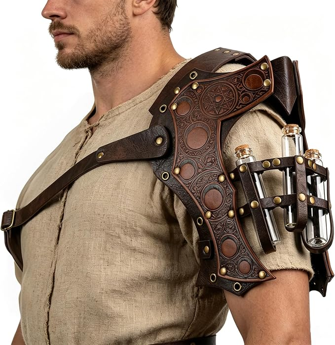
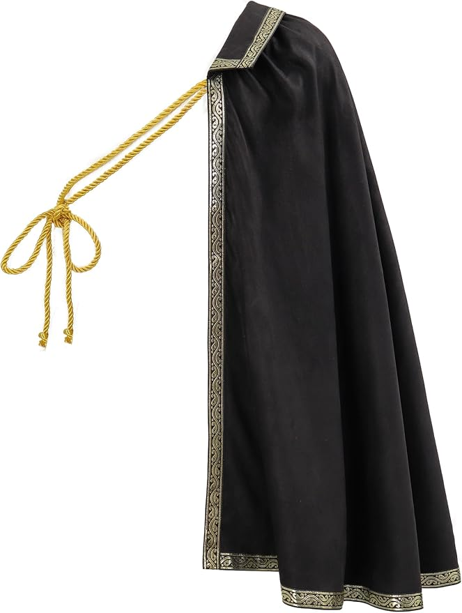

# Hollow Court • stronger shoulder and cape proposal

October 29, 2026, America/New_York / EDT (UTC−04:00). Event Saturday October 31. **Latest fixed core: bone crown, gold torc and cuffs; everything else open.** [28](28-fixed-core-clothing-references-2026-10-29.md) owns the current real-image references. Below retains inventory and earlier half-cape/armor history. No new outfit render, purchase, physical fit or crown repair reported.

**Later core clarification:** definitely keep the bone crown, gold torc and cuffs; everything else open. [28](28-fixed-core-clothing-references-2026-10-29.md) owns the new real-image board. Half-cape is liked, but shirt/trousers/cape styling can change. Prior body-chain-for-torc swap is superseded; the torc must remain. No new garment selected.

## Current inventory and finishing options • armor dropped

Host likes the cape direction, explicitly drops the armor, and asks what else we have. Remove the pauldron, its diagonal chest strap, vials and holder from the next proposal/render; do not keep the strap as an independently owned harness. Half-cape remains selected, not confirmed purchased. Earlier armor research/render below is history.

| Useful piece | Evidence / current use |
|---|---|
| Sosation pale bone-look crown | Bought; host confirms in hand with two small broken pieces. Keep; repair/cure/fit pending in [26](26-brown-mantle-preview-and-crown-repair-2026-10-29.md#crown-material-and-glue). |
| NauticalMart curled gold torc and Karace Style B cuff pair | Bought, retailer-marked delivered in the October 27 refresh. Retain in the current look; physical fit remains untested by the agent. |
| **Nicute gold body chain B07S2Q4V4J** | **Already bought**, $19.62 included in the existing order basis, retailer-marked delivered October 22 as last checked October 27. Useful reuse option from Eclipse; do not buy another or count its cost again. Its own neckbands led to an earlier torc-swap suggestion, now superseded by the fixed-torc instruction. No body-chain substitution selected; actual fit over the sleeved shirt untested. |
| Green trousers, shoes and functional warm layer | Host-owned. Keep trousers/shoes; warm layer for travel as needed. |
| Black JEMITOP Small shirt and FURPHI Black half-cape | Sourced proposals, **purchase not reported**. Latest successful exact garment offers remain dated in 26/this file; no fresh order audit this turn. |

[09](09-final-weekend-shopping-2026-10-21.md) remains the purchase/delivery evidence. Other bought pieces include three solar halos, mesh and fur; mesh/sleeveless/fur remain excluded from this indoor direction and the bone crown remains current. Gold mesh veil/ivory cloth, Burgundy shirt, extra belt/brooch/rings have no confirmed purchase. Do not treat earlier proposals or research images as inventory.

**Earlier chain option, now superseded:** the proposed body-chain-for-torc comparison is no longer current because the torc must stay. [Earlier private Eclipse preview](renders/private/2026-10-23/eclipse-zivyes-personal.png) was inspected to review its fine draped chains and built-in neckbands; that generated image is styling history, not a new exact-product or physical-fit check. No new render made and no chain/torc swap selected by the host.

**If keeping the torc:** a broad plain black wrap belt or a deep oxblood waist sash could add structure/color at the waist. These are **unselected styling ideas, not source-cleared Saturday recommendations or owned pieces**. The inspected [Renaissance belt set B0GVSS5FJX](https://www.amazon.com/dp/B0GVSS5FJX), exact Black-a, was $29.99 / In Stock / free October 31 in signed-in Chrome October 29, but its explicit fit bullet starts at **35.4 inches** and extends to 49.2 inches. It does not suit the host's 28–30 waist; exclude it. Subsequent wrap-belt search hit human verification; window foregrounded, no CAPTCHA click or exact wrap-belt offer verified. Do not buy that oversized set or depict an imagined fitted version.

**Earlier shirt/cape price example, not a fixed new basket:** armor is removed from shopping; if retained, half-cape $18.59 + previously sourced shirt $15.99 = **$34.58 before new tax/fees**, at their last checked prices. Existing $196.59 bought basis unchanged; hypothetical merchandise sum $231.17 before new checkout adjustments. Chain reuse adds $0. No armor order/refund/cancellation reported; earlier $74.48 armor/shirt/cape proposal is superseded, not added. $500 ceiling unchanged. [Current handoff](handoff-2026-10-29-half-cape-inventory.md).

## Latest feedback and proposed change

**History: armor-and-cape exploration, superseded by the armor-drop decision above.**

Host says the [sleeved brown-mantle preview](26-brown-mantle-preview-and-crown-repair-2026-10-29.md#current-personalized-sleeved-preview) still looks basic and he does not love the brown leaf piece. He then requests the moon-phase armor and black cape with the same black shirt, crown, torc, cuffs and green trousers, using his likeness and clean-shaven styling. The replacement is selected for the completed preview below; no purchase, cancellation, return or final-fit approval inferred.

**Proposed outfit:** compact pale bone crown + sourced black short-sleeved cotton shirt + one embossed moon-phase shoulder pauldron + black half-cape with warm metallic edging + existing substantial gold torc/cuffs + owned green trousers/shoes. Keep the face clear, clean-shaven styling, sleeves and indoor practicality; fur, feathers, mesh/tank, large antlers, full-face veil and self-applied makeup remain excluded.

The pauldron supplies a raised, layered shoulder shape and diagonal chest strap. The half-cape supplies movement and a longer asymmetric outline. Moon phases, a star/sigil motif and brass-colored hardware connect with the party's lunar/pagan references and the existing gold pieces. [24](24-party-reference-led-direction-2026-10-27.md) and the [ritual board's Green Knight/Arthur imagery](../guests/pack/COSTUME-RITUAL-BOARD.md) support this ceremonial direction. This is a human Court figure; it is not a source-cleared carved-bark/Gilded Root armor replica or a change to game/guardian names.

## Exact Amazon offers checked

Signed-in Chrome to Brooklyn 11211, approximately **5:17–5:20 p.m. EDT October 29**. Both selected product buy boxes say **In Stock / free Saturday October 31 delivery**. No timed window, hold, order or physical fit verified.

A refresh for the next preview encountered Amazon's human-verification checkbox. Its window was brought forward per host preference; no CAPTCHA click performed and no new ETA verified. The successful exact-product checks immediately before this request, only minutes before generation, remain the dated sourcing evidence above. Do not relabel those offers as a newer check or a guaranteed delivery.

| Piece | Exact variant / offer | Actual appearance and limitations |
|---|---|---|
| [HiiFeuer alchemy single pauldron B0GT8CCQFF](https://www.amazon.com/dp/B0GT8CCQFF) | **Brown B / Style B, $39.90**, ships Amazon / sold HiiFeuer | Fabric field explicitly **PU**. Dark brown embossed moon phases, circular/star motifs, layered shoulder, brass-colored rivets, diagonal adjustable strap, three small glass vials in a side holder. More sculptural than the leaf textile. Listing says potion bottles and decorative charms are detachable; this does **not** establish that the entire bottle holder can be removed. Actual Small-body fit, weight, material feel and durability untested. No exact body measurement verified. |
| [FURPHI Tudor half-shoulder cape B0F1T1NJW2](https://www.amazon.com/dp/B0F1T1NJW2) | **Black, $18.59**, ships Amazon / sold Fuxyang | **Polyester**, plain black body, narrow warm metallic scroll border and long gold-colored rope tie. One-shoulder drape, rather than an all-around coat. Listing observed 4.0/5 from 27 ratings; costume-grade fabric/trim quality not independently tested. Neck/torc/strap interaction and actual drape need fitting. |

| Actual pauldron photograph | Actual cape photograph |
|---|---|
|  |  |

Retail photographs downloaded from the selected live listings and visually inspected October 29. Credit HiiFeuer / Amazon and FURPHI / Amazon respectively; copyright remains with the rights holders. Models supply products only; no user likeness or generated design shown here. The pauldron model's cream shirt is not part of the proposed outfit.

## How to wear it and what to retain

Keep the short-sleeved black shirt tucked into the green trousers. Fit the pauldron's supplied strap over the shirt and try the cape over the opposite shoulder, draped behind that arm so the shoulder piece remains visible. Use the cape's supplied tie, keeping the torc and throat comfortable. The combination is illustrated below but has not been physically tested; neither closure's compatibility with the torc is proved. No new cloak pin, structural frame, glue or armor fabrication is proposed.

For hosting, leaving the detachable glass vials off is the proposed cleaner configuration; **expect their leather-look loops/holder to remain visible** unless arrival confirms otherwise. Do not render an invented smooth panel with the entire holster magically removed. The existing torc and cuff pair provide the gold accents; no extra necklace needed. Crown repair still follows [26's PLA/gel-CA guidance](26-brown-mantle-preview-and-crown-repair-2026-10-29.md#crown-material-and-glue), with full cure and a real fit trial. No repair or fit was performed.

Both pieces use supplied straps/ties. Plan approximately 15–20 minutes positioning plus a movement trial; this is a planning estimate, not a timed build. Check reaching/serving/sitting and whether cape, shoulder strap and torc interfere. Temperature, stability and comfort are unknown until worn together. The cape can be omitted if the pauldron alone provides enough impact; the proposed full combination is not mandatory shopping.

## Personalized pauldron and cape preview

Final [private moon-phase armor/cape preview](renders/private/2026-10-29/moon-court-pauldron-cape-v2.png), **1536 × 1024**, full body left and matching head/torso detail right. [Exact private prompt set/provenance](renders/private/2026-10-29/moon-court-pauldron-cape-prompts.md). Two built-in imagegen edits: first removes the leaf mantle and inserts the real armor/cape over the black sleeved shirt; second changes only a small accidentally copied beige retailer-model shirt patch under the armor to black. Draft v1 preserved privately. No CLI/manual image processing.

Inputs: previous clean-shaven sleeved personalized final as identity/composition/crown/jewelry/green-trouser base, plus actual armor, cape and shirt photographs above. The original user rooftop upload is absent locally; likeness is inherited through the earlier user-authorized portrait, as disclosed before editing. Retail models supplied objects only. Personal outputs and exact prompts remain **Git-ignored** under renders/private/2026-10-29.

Visual QA: recognizable clean-shaven likeness, compact pale crown, short black sleeves/standing collar/lace-up front, no leaf mantle, one Brown B pauldron with diagonal strap and **all three supplied corked vials**, black metallic-edged half-cape/rope on opposite shoulder, curled torc, both cuffs, green trousers/belt/boots and matching full-body/detail framing. Vials are included to reflect the actual product; their omission for hosting remains optional, not a completed product modification. No fur/feathers/veil/makeup/extra weapon/accessory. Material richness, precise scale, cape length/drape, engraving and fastening/torc fit remain approximate; this is not a physical fit or proof of crown repair.

## Other screened options and buying status

[HiiFeuer Black / Style A B0FSKLJDZQ](https://www.amazon.com/dp/B0FSKLJDZQ) was also exact-page checked at **$39.90 / In Stock / Saturday October 31** before switching to Style B. It has silver rivets, arrow-shaped charms and vials on a plainer black embossed surface. It is an available darker alternative; Brown B's moon imagery and brass-colored hardware are the preferred match for this proposal. Style B selection automatically changed Black to **Brown B**; no black Style B was verified.

The previously inspected UJUROU damask cape remains a separate, more formal floral product; this recommendation uses the plainer FURPHI scroll-edged version. Feather/fur shoulder products were excluded by the standing user constraints. Higher-rated Willyacos cape search estimate was November 5–10, so it did not clear the deadline; no seller outreach or rushed bespoke work.

**Historical armor-inclusive proposal: $58.49 for armor/cape, $74.48 with shirt before tax; superseded by the current half-cape-only subtotal above.** No purchase, refund or shared-budget charge. [Earlier render handoff](handoff-2026-10-29-pauldron-cape-render.md); [earlier source handoff](handoff-2026-10-29-statement-pieces.md).
