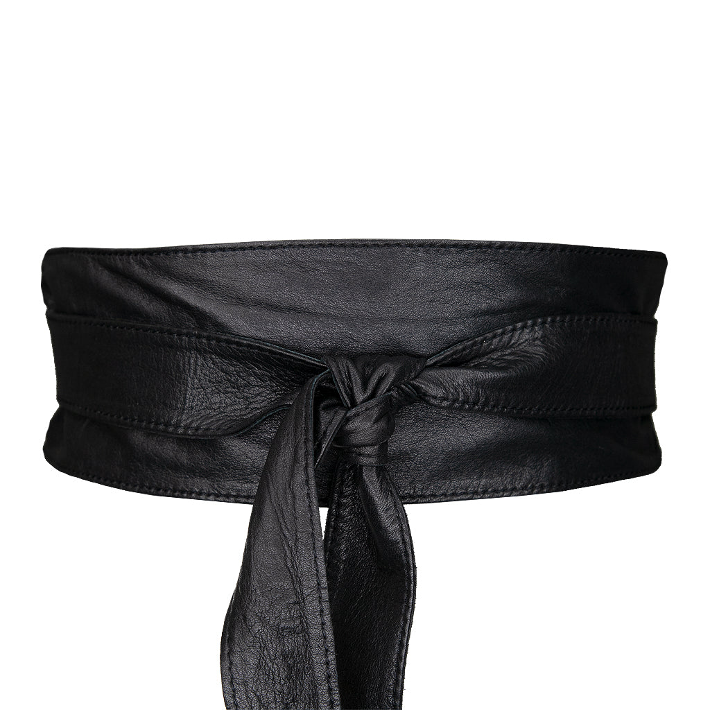
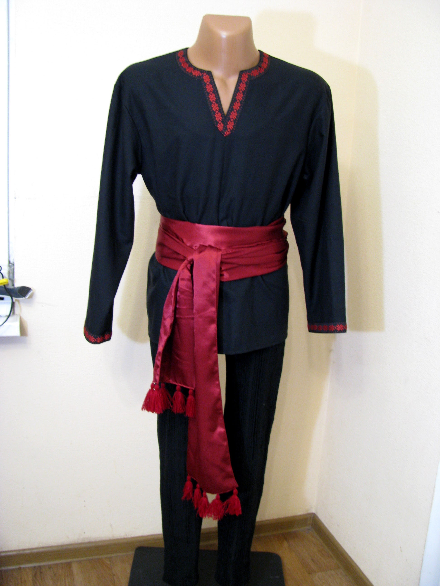
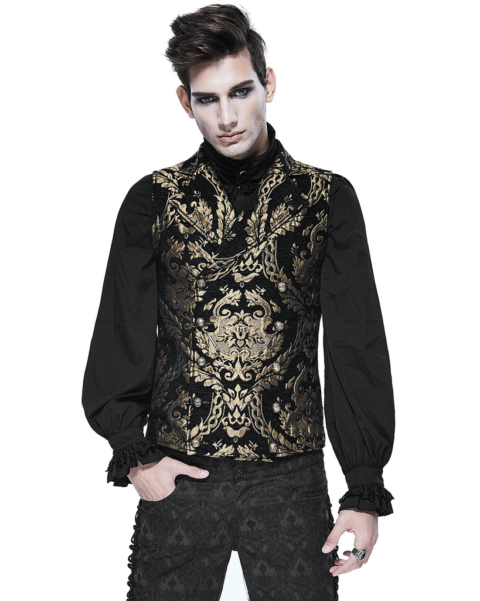

# Clothing references • fixed bone crown, gold torc and cuffs

October 29, 2026, America/New_York / EDT (UTC−04:00). **Host confirms the bone crown, gold torc and cuffs must remain; everything else is open to change.** These are real reference photographs for clothing and waist details, not new outfit renders, selected purchases or Saturday-cleared shopping links. No fit/stock/delivery checked for these exact examples.

The half-cape was liked before this clarification and remains a useful option. Black shirt/green trousers/cape styling can change; do not treat them as fixed requirements. The existing body chain is no longer proposed as a replacement for the fixed torc. No new accessory, garment, makeup, armor or game-character change selected.

| Black wrap belt | Burgundy waist sash | Black-and-gold waistcoat |
|---|---|---|
|  |  |  |
| [Streets Ahead — Kelby](https://www.streetsaheadinc.com/products/kelby-obi-belt) | [EthnicandMedieval / Etsy — burgundy/cherry-red sash](https://www.etsy.com/listing/1149092675/cherry-red-pirate-sash-with-tassels) | [Violent Delights — Devil Fashion Cavalier](https://violentdelights.co.uk/products/devil-fashion-cavalier-mens-waistcoat-vest-black-gold) |

## What to borrow

1. **Black wrap belt:** wide, plain dark band and a compact knot. This gives waist definition while leaving the crown/torc/cuffs as focal accents. The image is a product detail; it does not prove how that exact size will fit the host. No metal shoulder/chest armor.
2. **Burgundy sash:** broad softly folded fabric and a side knot, worn over a dark shirt. This is the color/ceremonial direction; aim toward deep wine/oxblood and keep tails practical for hosting if later sourced. The pictured long tasselled tails, embroidered tunic and other clothes are not added to shopping. A separate Lost Island image looked pink on visual inspection and was excluded from this board.
3. **Black-and-gold waistcoat:** ornate woven-looking torso texture and a shaped front over a simple black shirt. This is the strongest visual upgrade of the three in the assistant's judgment. The torc stays at the neckline, crown/cuffs remain, and the liked half-cape could layer over a compatible real vest. Collar/neckpiece interaction and indoor heat need a real fit check. The model's makeup, other jewelry and trousers are not proposed; this reference is for the waistcoat.

These options need not all be combined. Before a new personalized render, source a chosen real Small garment/belt/sash with the host's 28–30 waist and a verified October 31 delivery or NYC pickup route. Do not depict the imported/catalog example as a timely available purchase or invent a matching superior substitute. No source-before-rendering waiver inferred from asking for reference images.

## Image provenance and verification

All three photographs were found through web image search, their retailer/listing pages opened, then downloaded and visually inspected October 29. No image generation or image editing. Copyright remains with the respective rights holders; images are retained locally for design reference with credits, not a claim of redistribution permission.

- **Belt:** Streets Ahead Inc, Kelby Obi Belt product photograph. [Original image](https://www.streetsaheadinc.com/cdn/shop/products/22086.jpg?v=1623997857), 1024 × 1024. Plain leather wrap, knot and draped ends observed.
- **Sash:** EthnicandMedieval / Etsy listing 1149092675, seller photograph of burgundy/cherry-red sash on a black tunic; individual photographer unidentified. [Original image](https://i.etsystatic.com/28416538/r/il/a96ad3/3618274666/il_fullxfull.3618274666_8ooz.jpg), 1944 × 2592. Burgundy tone inspected directly; no color edit. This is a reference, not an urgent overseas shipping recommendation.
- **Waistcoat:** Devil Fashion / Violent Delights retailer photograph, individual photographer unidentified. [Original image](https://violentdelights.co.uk/cdn/shop/products/fulft5frapg_1024x1024.jpg?v=1742564222), 819 × 1024. Gold damask pattern, double-breasted front and notched lapels observed. UK retailer page was read for appearance only, no deadline proof.

Purchase basis remains **$196.59** and ceiling **$500**; no new cost selected or charged, no order/cart/hold/message/cancellation/return. [27](27-haunted-court-statement-pieces-2026-10-29.md) retains purchased inventory, prior source checks and historical renders; [26](26-brown-mantle-preview-and-crown-repair-2026-10-29.md) retains the broken-crown repair guidance. [Current handoff](handoff-2026-10-29-fixed-core-references.md).
