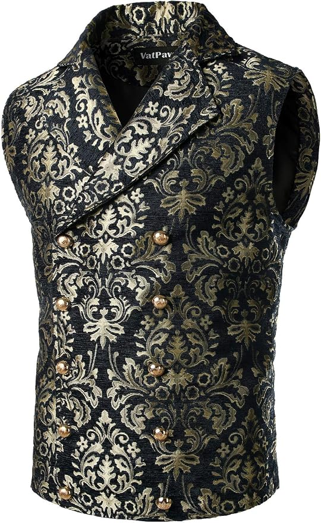

# Hollow Court • Amazon Saturday clothing shortlist

Checked October 29, 2026, approximately **6:26–6:29 p.m. America/New_York / EDT (UTC−04:00)**, signed-in Chrome, delivery destination Brooklyn 11211. Event Saturday October 31. **Host subsequently requested/completed the exact waistcoat/shirt/cape preview below; no purchase or final outfit selection inferred.**

## Latest host constraints

- Keep the purchased compact bone crown, gold torc and gold cuff pair. Everything else is open to change.
- **Anything newly suggested must be on Amazon with delivery by Saturday October 31.** Do not substitute a generic Prime badge/search-card date for the exact selected product's buy box.
- **Belt/sash is disfavored.** Stop that direction. [28's imported/reference examples](28-fixed-core-clothing-references-2026-10-29.md) are history, not a shopping list.
- Sleeves required; fur too hot, brown leaf mantle disliked, shoulder armor dropped. No feathers, large antlers, full-face cover or DIY face makeup. No torc-to-body-chain swap.

## Strongest new clothing option

**VATPAVE Sv16-black / Small double-breasted brocade waistcoat, [B07XDWH4XZ](https://www.amazon.com/dp/B07XDWH4XZ?th=1&psc=1), $39.99.** Exact Small selected; current child URL, selected color/size and buy box inspected. **In Stock / FREE delivery Saturday October 31**, ships Amazon, sold SOWTEE. Buy box showed about 5 hours 32 minutes left to order when checked. No delivery time window or hold established; the final checkout date must still be Saturday before the host buys.

Actual product photo: black ground with dense muted gold/olive damask scrollwork, broad overlapping shawl lapels, two columns of gold-tone buttons and a shaped torso. This is the real Amazon garment, not an imagined upgrade or the imported Devil Fashion reference. **Wear over a sleeved black shirt**; the sleeveless waistcoat does not replace the required sleeves.

Styling judgment: the pattern and double-breasted shape add enough detail across the torso to carry the costume after removing the armor, leaf mantle and waist sash. Bone crown + gold torc/cuffs + green trousers keeps a woodland Court connection; this is an ornate human Court look, not a carved-bark or screen-accurate Antler King costume. An optional half-cape adds asymmetry and movement without becoming the only interesting clothing piece. These are proposals for the host to assess, not accepted character/game changes.

**Quality and fit limits:** listed 100% polyester. Aggregate 4.4/5 from 1,206 ratings across variants, not 1,206 Small/black reviews. Several actual written reviews praise substantial tapestry-like fabric; other reviews mention cheap or weakly attached buttons, snug fit, warmer/thicker fabric and shinier gold than the photo. Treat this as a $40 costume garment, not premium tailoring. A Small is available, but no reliable exact chest/waist chart was obtained from the unresponsive Size guide; usual Small and trouser waist alone do not establish fit. Torc/collar clearance, sleeve layering and indoor heat need a real try-on. Cape should be removable if warm.

## Complete sourceable clothing proposal

All three **exact selected buy boxes** were successfully checked in this pass, rather than inferred from search results. The shirt/cape dates below refresh earlier records in 26–27.

| Proposed piece | Exact variant and Amazon link | Price before new tax | Live deadline/stock evidence |
|---|---|---:|---|
| **Main upgrade: ornate waistcoat** | VATPAVE **Sv16-black / Small**, [B07XDWH4XZ](https://www.amazon.com/dp/B07XDWH4XZ?th=1&psc=1) | **$39.99** | In Stock; free **Saturday Oct 31**; Amazon / SOWTEE; about 6:26–6:27 p.m. EDT |
| Sleeved base shirt | JEMITOP **Black-b / Small**, [B0CR38X65T](https://www.amazon.com/dp/B0CR38X65T) | **$15.99** | In Stock; free **Saturday Oct 31**; Amazon / JEMITOP; about 6:28–6:29 p.m. EDT |
| Optional liked half-cape | FURPHI **Black**, [B0F1T1NJW2](https://www.amazon.com/dp/B0F1T1NJW2) | **$18.59** | In Stock; free **Saturday Oct 31**; Amazon / Fuxyang; about 6:29 p.m. EDT |

The JEMITOP shirt is opaque textured cotton with **short sleeves**, standing collar and cord-laced V; [actual photo](references/2026-10-29/jemitop-black-b-short-sleeve.jpg). The FURPHI cape is a polyester one-shoulder black drape with narrow gold scroll edging and braided gold tie; [actual photo](references/2026-10-29/furphi-black-gold-half-cape.jpg). Neither has a confirmed order or measured fit. The cape's neck tie and the torc need a comfortable combined try-on; keep the chest/neck jewelry visible without tightening the tie around the throat.

**Proposed assembled look:** repaired compact pale crown, gold torc and cuff pair + black sleeved shirt + black/gold waistcoat + owned green trousers and shoes. Half-cape optional for the more dramatic outline; no extra waist accessory. Green trousers are a reuse recommendation, not a new fixed host decision. No new pants recommendation is needed for this proposal.

New merchandise subtotal **$55.98 shirt + vest**, or **$74.57 including the optional cape**, before new tax. Existing bought basis remains **$196.59 including estimated tax** in [09](09-final-weekend-shopping-2026-10-21.md). If all three were later bought, arithmetic basis would be $271.16 **plus new tax**, not an actual spent total; unchanged $500 combined ceiling. Do not double-count earlier armor/mantle/shirt proposals, assume refunds or add the already purchased jewelry again. No shared budget mutation warranted for this unselected shortlist.

## Requested personalized preview • October 29

Host requests the VATPAVE waistcoat, black shirt and half-cape while retaining the bone crown, gold torc/cuffs and green trousers. One successful built-in **imagegen / identity-preserve** edit, with full-body left and matching close view right, **1536 × 1024**. Clean-shaven likeness continuity supplied by the previous personalized preview because the original temporary uploaded photograph is absent. Actual waistcoat/shirt/cape/cuff product photographs supplied object references; the earlier preview supplied crown/torc/trouser continuity. No unrelated retailer model used as the host.

- **Private local final:** [brocade-waistcoat-half-cape.png](renders/private/2026-10-29/brocade-waistcoat-half-cape.png).
- **Private exact prompt, five input roles and output record:** [brocade-waistcoat-half-cape-prompts.md](renders/private/2026-10-29/brocade-waistcoat-half-cape-prompts.md).

Output copied into this task and visually inspected: compact ivory crown; curled gold torc and two substantial cuffs; double-breasted black/gold brocade over opaque black short sleeves; one-shoulder black cape with narrow gold edging and rope tie; green trousers/black shoes; same clean-shaven likeness across both views. Armor, chest strap, vials, leaf mantle, sash, fur, mesh, face cover and makeup absent. Crown shown intact as intended after repair; **actual repair remains pending**. Pattern scale/shine, engraving and real garment fit remain approximate. No manual image editing or correction pass.

The exact Saturday sources above were verified immediately before this render request, not rechecked during image generation. No new item added, order, physical fit or comfort test. Generation does not establish final selection or guarantee arrival. Prior public references/renders retained as history; personal output and exact prompt remain **Git-ignored**, with this sanitized record tracked.

## Image provenance and browser limits

- VATPAVE / Amazon listing product photograph; individual photographer not identified. [Observed original image URL](https://m.media-amazon.com/images/I/81BkczAHMLL._AC_SY879_.jpg), 540 × 879. Downloaded from the selected product's landing image and visually inspected October 29. Copyright remains with the rights holder; retained for private project reference with attribution. No image generation/editing.
- Search discovery included Victorian/tapestry waistcoats and a Tudor doublet. A doublet search result quoted November 12–20 and was not promoted; other unselected search cards did not become verified offers. The inspected Small black/gold VATPAVE was the strongest directly verified candidate; no claim of an exhaustive Amazon quality comparison.
- The shirt refresh briefly displayed “I am human.” Window was brought forward and a private temporary screenshot saved. Host authorized that specific checkbox; by the attempted check, the checkbox was no longer present and the product page had cleared. Exact Small/color/buy-box evidence was then obtained. Do not claim a successful checkbox click or reuse that consent on a future challenge.
- No orders, cart edits, messages, return/cancellation or reservations. Requested preview completed above; no physical test. The **broken PLA crown still needs repair/cure and a fit trial** in [26](26-brown-mantle-preview-and-crown-repair-2026-10-29.md#crown-material-and-glue). Glue exact delivery has not been verified; it is not added to this Saturday-cleared basket.

[Purchased inventory/history](27-haunted-court-statement-pieces-2026-10-29.md) · [Source-check handoff](handoff-2026-10-29-amazon-saturday-clothing.md) · [Current preview handoff](handoff-2026-10-29-brocade-preview.md)
