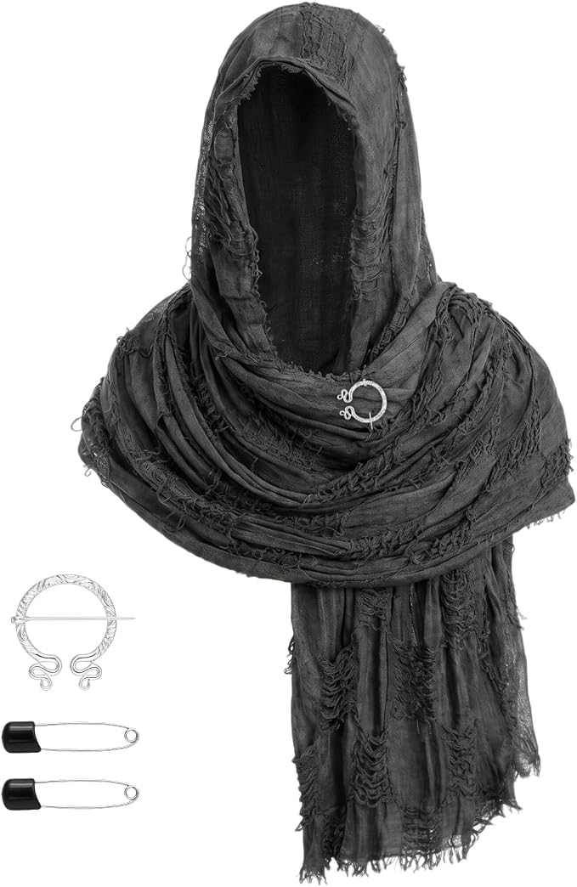
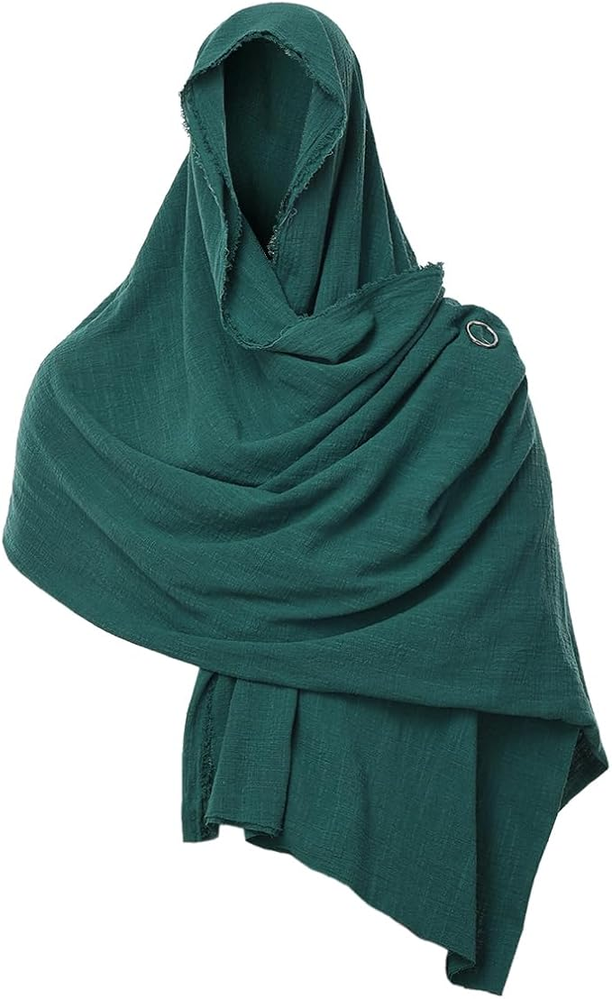
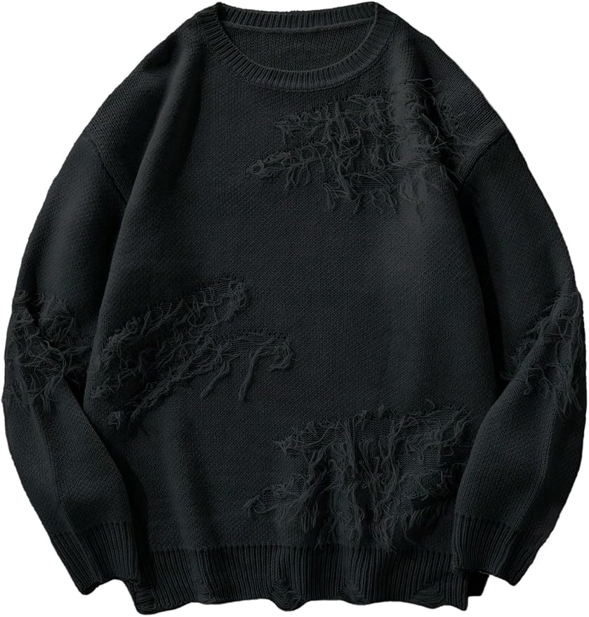

# Hollow Court • eerie woodland texture, Amazon deadline

October 29, 2026, America/New_York / EDT (UTC−04:00). Event Saturday October 31. **Latest host confirmation: order placed for the wrap/shirt; Levi's already owned; superglue pickup planned for Friday October 30.** This records the host's report, not a new retailer order audit or proof of delivery/fit. The chosen look is charcoal wrap + opaque black sleeved shirt + owned black Levi's + compact bone crown/torc/cuffs/shoes.

## What to order for this render • latest October 29

**No further clothing order needed.** The host's “placed an order, I already have the levis” is recorded in context as the two remaining garments ordered. Exact checkout selections, charges/tax and new order ETA have not been independently rechecked; below are the intended selections and last checked quotes, not actual charges.

| Piece | Intended selection / last quote | Current status |
|---|---|---|
| [Dhthdrh charcoal distressed wrap](https://www.amazon.com/dp/B0H4SZNTVL?th=1) | Black, one-size set; $22.99 | Ordered, host report October 29; pins/brooch included in listing |
| [JEMITOP opaque sleeved shirt](https://www.amazon.com/dp/B0CR38X65T) | Black-b / Small, short sleeves; $15.99 | Ordered, host report October 29 |
| Black Levi's | Host already has them; exact owned model/wash/size not restated | Owned, no new $52.46 jeans charge inferred |
| Superglue | Gel CA for the small snug decorative crown breaks | Host plans local pickup Friday October 30; not acquired yet |

The wrap/shirt last-quoted merchandise sum is **$38.98 before tax**, replacing the earlier three-piece $91.44 proposal. Actual new order total unknown. [09](09-final-weekend-shopping-2026-10-21.md#current-order-and-planning-reconciliation--october-29) owns accounting. At the earlier 11:08–11:10 p.m. buy-box check all three sourced offers showed Saturday October 31; that source evidence is not an independently verified ETA for the new order. The sourced 578 remains a visual reference, not proof of the owned pair's model.

**Reuse:** compact Sosation bone crown, NauticalMart gold torc, Karace Style B cuff pair, owned Levi's and shoes. No extra garment/accessory purchase required for the depicted look. Wrap quality (no visible reviews), drape and actual fit remain untested.

**Existing Saturday glue order:** [Loctite Ultra Gel Control / 1 pack B00ELV2D0Y](https://www.amazon.com/dp/B00ELV2D0Y), independently checked earlier October 29, arriving Saturday October 31, **$4.89 total including estimated tax**. Friday local pickup is now the host's earlier-glue plan; no cancellation, refund or replacement of that Amazon order performed or assumed. Local pickup product, store and cost unknown; no local stock promise. Do not buy another online glue listing on the old Saturday timetable.

**Repair plan:** pick up gel superglue Friday and repair the crown Friday early enough to allow **24 hours before wearing Saturday night**, following [26](26-brown-mantle-preview-and-crown-repair-2026-10-29.md#crown-material-and-glue). Pickup and completed repair/cure remain pending. This addresses the timing plan without treating the work as done.

No agent cart/order/message/delivery change/cancellation/return. Earlier source and preview history follows.

## Confirmed host correction

- Make the look **more eerie and woodland, less vampire aristocrat**, using actual surface texture rather than conventional gold damask.
- **Keep the compact purchased bone crown, gold torc and cuff pair.** Other clothing can change; source on Amazon with exact Saturday delivery first.
- Host does not love the green trousers, and clarifies the owned pair is **more olive** than the render's forest green. Do not depict those owned trousers as deep forest green or keep them by default. Black Levi's are now confirmed already owned for this look; exact model/fit not restated.
- Earlier constraints remain: sleeves, face clear, no large antlers/veil, DIY makeup, feathers, hot fur, rejected brown leaf mantle or dropped moon armor. Belt/sash disfavored. Do not substitute body chain for torc.

## Recommended silhouette and exact new offers

**Proposed primary look:** compact pale bone crown + existing gold torc/cuff pair + opaque black sleeved shirt + an irregular **charcoal shredded shoulder wrap** + black loose-leg jeans and owned shoes. The wrap replaces the brocade and gold-trimmed half-cape. Wear it as a low asymmetric shoulder/chest drape, with the hood down behind the crown and the torc clear above the fabric. No waist sash, armor or full-face cover. Supplied brooch/safety pins make this a simple draping/fastening task, not a sewing/painting build; actual fit must determine the folds and secure closed pins through garment fabric, off the neck/skin.

Styling interpretation: matte dark clothes, uneven raised fraying and a pale branching crown suggest an old woodland presence in worn ceremonial clothing. Existing gold remains the relic/authority accent; no invented new guardian name, plot or game-mechanic change. The texture is **frayed fabric, not sculpted bark or actual moss**. This proposal is more convincing for the brief than conventional brocade, but the strongest visual match has the weakest review evidence.

Exact selected product buy boxes checked in signed-in Chrome to Brooklyn 11211 **initially 8:15–8:20 p.m. EDT October 29**, then **8:35 p.m. before generation**. The latest **11:08–11:10 p.m. garment refresh/order list is above**; unchanged prices/Saturday, wrap still only 2. GRACEART green retains its earlier dated quote. No arrival time window, hold or checkout guarantee. No new garment purchase confirmed.

| Piece / role | Exact Amazon option | Price | Stock / seller / deadline evidence |
|---|---|---:|---|
| **Strongest visual texture; lower quality confidence** | Dhthdrh tattered cowl set, **Black**, [B0H4SZNTVL](https://www.amazon.com/dp/B0H4SZNTVL?th=1) | **$22.99** | **Only 2 left**, free **Sat Oct 31**; ships Amazon / sold ChengHuiQiang. Exact Black refreshed about **8:35 p.m. EDT** (previously 3 at 8:17). |
| **Better-reviewed, subtler woodland alternative** | GRACEART woven cowl, **11-green**, [B0C8NK1STK](https://www.amazon.com/dp/B0C8NK1STK?th=1) | **$19.99** | **In Stock**, free **Sat Oct 31**; Amazon / GRACEART Online-Store; about 8:16 p.m. EDT. |
| Opaque sleeved base, if not already bought | JEMITOP **Black-b / Small**, [B0CR38X65T](https://www.amazon.com/dp/B0CR38X65T) | **$15.99** | **In Stock**, free **Sat Oct 31**; Amazon / JEMITOP; exact Small/color refreshed about **8:35 p.m. EDT**. |
| **Black trouser replacement** | Levi's **578 Baggy / Black / 30W × 30L**, [B0GVVYXFYW](https://www.amazon.com/dp/B0GVVYXFYW?th=1&psc=1) | **$52.46** | **In Stock**, free **Sat Oct 31**; sold/shipped **Amazon.com**; exact child/color/size refreshed about **8:35 p.m. EDT**. |

| Charcoal shredded wrap — strongest visual match | GRACEART green woven cowl — stronger review evidence |
|---|---|
|  |  |

**Charcoal-wrap assessment:** called Black but the photograph reads washed charcoal. Uneven open/fraying bands, hanging strands and raw edges give the requested root/lichen-like surface. Set includes **one 190 × 84 cm / 74.8 × 33 in scarf, one silver-tone round brooch and two safety pins**. Top fabric specification says **75% polyester**, remaining blend unspecified; no measured breathability/heat test. **No visible customer rating/review count** on the inspected page, so do not present its quality as established or equivalent to an artisan garment. This is an inexpensive visual-match candidate with actual stock, not an unconditional quality recommendation. Brown variant B0H4SXMT6X was separately $22.59 / only 1 / Saturday, but its photograph is light tan rather than dark bark; not the primary color proposal. No need to display the supplied silver brooch centrally if it competes with the gold torc; use the included fastening options on a side/underlayer.

**GRACEART assessment:** rough woven cotton, frayed edges and natural folds; **230 × 130 cm** rectangular wrap with a brooch, styled rather than sewn into a fixed hood. Green is a deep teal/green in the actual image, not olive; do not recolor it to black/forest green in a render. More subdued surface texture than the shredded wrap, but **4.4/5 from 1,794 aggregate ratings** provides more review history, not a guarantee for this exact color. Wear across a black base with hood dropped/face clear; this puts woodland color around the shoulders instead of relying on olive trousers. Other useful colors miss the deadline: **01-black Sunday Nov 1, 02-brown Tuesday Nov 3, 05-urban dark grey Wednesday Nov 4**, so none is a Saturday substitute.

**Jeans assessment:** 578 is a genuinely baggy, **wide-leg**, 100% cotton option; actual product photograph is dark black, not the grey faded wash. [Actual photograph](references/2026-10-29/levis-578-black-baggy.jpg). Listing 4.6/5 from 879 aggregate ratings; listed 19-inch leg opening refers to a **size-32 sample**, not a measured 30W garment. 30W × 30L is inside the host's stated 28–30 / 30–32 range, but actual waist/length/comfort not tested. Search results for earlier requested 568 mainly showed Monday November 2; not promoted as Saturday-ready. **Variant trap caught:** selecting 29W × 30L auto-switched the page to Small Grey Step B0GVW835FQ with November 6–8 delivery. That offer is excluded. Reopened Black listing, selected 30W × 30L, then confirmed **Black + child B0GVVYXFYW + Saturday** together after hydration. Initial 34W × 32L date was not used as host-size evidence.

**Historical source-pass cost example, before discovery of the glue order:** charcoal wrap + shirt + new jeans = **$91.44 before new tax**; GRACEART alternative + shirt + jeans = **$88.44**. If reusing owned faded black jeans, these become $38.98 / $35.98. The two wraps are alternatives, not an additive basket. The then-known $196.59 order basis + $91.44 would have been $288.03 plus new tax. **Current order basis/accounting is in 09 and the latest order-list section above**, not this older example. No final clothing order had been reported at that historical source pass; the latest host confirmation is above.

## Requested charcoal-wrap personalized preview • October 29

Host requests charcoal wrap, black shirt and black Levi's with the existing compact bone crown, gold torc and cuffs, using the host's photo again and clean-shaven styling. **Original temporary upload checked and absent**; the previous personalized preview supplies likeness continuity, transparently stated before generation. No unrelated retailer face/model used as the host. Request selects this combination for visualization, not a final purchase/outfit decision.

One successful built-in **imagegen / identity-preserve** edit, **1536 × 1024**, full-body left/detail right. Inputs: earlier personalized brocade preview as edit target; actual charcoal wrap, black short-sleeved shirt, Black Levi's 578 and actual Karace cuff photographs. Crown/torc inherited from prior personalized reference. Exact source refresh above succeeded on all three garment pages without CAPTCHA before generation.

- **Private local final:** [charcoal-wrap-black-levis.png](renders/private/2026-10-29/charcoal-wrap-black-levis.png).
- **Private exact prompt, five input roles and output record:** [charcoal-wrap-black-levis-prompts.md](renders/private/2026-10-29/charcoal-wrap-black-levis-prompts.md).

Visually inspected both views for the same clean-shaven likeness; compact pale branching crown, curled gold torc and gold cuff pair; actual frayed charcoal shoulder wrap with hood down and one hanging end; opaque black short sleeves and wide black jeans; retained black shoes. Brocade, gold-edged cape/rope, green/olive trousers, armor, sash, fur, mesh, makeup and face cover absent. Cloth folds, jeans wash/fit, cuff engraving and crown detail remain approximate; not exact virtual try-on or measured comfort. Crown shown intact as intended after repair; physical repair remains pending. No correction pass or manual image editing. Personal output/exact prompt **Git-ignored**, sanitized record tracked; older renders retained unchanged.

## Exact cleared fallback, not the primary recommendation

[WDIRARA distressed knit pullover, **Black / Small, B0FPFB9WMH**](https://www.amazon.com/dp/B0FPFB9WMH?th=1&psc=1): **$33.99**, **In Stock / free Saturday October 31**, ships Amazon / sold WDIRARA, exact selected color/Small/child URL and buy box checked in signed-in Chrome to Brooklyn 11211 October 29 around 8:09–8:11 p.m. EDT. Initial X-Large result's “only 2” stock was not applied to Small; Small resolved to **In Stock**. No hold or delivery time window.

Actual photo: opaque black knitted crew neck with long sleeves and several diagonal patches of long, irregular fraying across chest/body/arms. The loose strands can suggest small roots/lichen; this is **distressed knit, not sculpted bark or sewn real foliage**. 100% acrylic; 4.2/5 from 45 aggregate ratings across variants. A verified Small/Black written review specifically calls it cozy/warm, so indoor heat is a material limitation. Exact garment measurements not established. It is a fallback with some surface depth, not yet a complete eerie woodland costume recommendation.

Photo credited WDIRARA / Amazon listing, individual photographer unidentified; [observed source image](https://m.media-amazon.com/images/I/71cpFqQsvkL._AC_SY879_.jpg), downloaded and visually inspected October 29. Copyright remains with rights holder. No manual image edit or generation.

## Search exclusions and verification boundaries

- Standard hooded ponchos were screened but mostly smooth fabric or warm blanket knit; search-card Saturday dates did not become exact-variant clearance. Distressed sweater results included late-arriving variants and duplicate product photographs across brands; no premium-quality claim inferred.
- **Ginsco 3D leafy hunting poncho B09B1V4RMC**, $21.99, offered free Saturday from Amazon / GinscoDirect and 4.6/663; actual photo inspected. **Aesthetically excluded:** photorealistic hunting-camouflage print dominates the small raised leaves, oversized full poncho covers the jewelry, and the result would need more alteration to escape hunting gear. Not a recommendation/order. Other leaf/cape search results arriving Sunday/Monday were not promoted; no wearable couture bark/root piece was found with the deadline.
- **DigiTizerArt cotton cowl B0FDK5SCWP**, Brown, $19.99 / 4.1 from 91, was Sunday Nov 1; other displayed color dates were Sunday or later. Better-reviewed than the new charcoal listing but not deadline-cleared, so excluded. GRACEART green is the actually cleared review-history alternative.
- Woodland search reached an “I am human” checkbox. Window immediately focused, private screenshot saved under `/private/tmp`; host **authorized that specific check**. At the attempted check the checkbox was no longer present and the search had cleared. The trousers page later also released without an agent CAPTCHA click; no consent reused. Optional final review-comparison search encountered another challenge, not acted on or needed for the four cleared rows above. No unresolved CAPTCHA is necessary to view this shortlist; research tabs closed after extracting evidence.

## Additional image provenance

Retailer photos downloaded from the live selected landing images and visually inspected October 29; no manual edits/generation. Copyright remains with respective rights holders, retained for project reference with credit:

- **Dhthdrh / Amazon**, photographer unidentified: [Black cowl source image](https://m.media-amazon.com/images/I/71JRzx6IDnL._AC_SX679_.jpg).
- **GRACEART / Amazon**, photographer unidentified: [11-green source image](https://m.media-amazon.com/images/I/61IGB5CbRAL._AC_SX679_.jpg).
- **Levi's / Amazon**, photographer unidentified: [Black 578 source image](https://m.media-amazon.com/images/I/51IenOKV-9L._AC_SX679_.jpg). Model's white shirt/jewelry not proposed.

No agent order/cart/message/hold/return/cancellation. Latest confirmed order basis is **$201.48 including estimated tax** after the separately discovered $4.89 Loctite order; [09](09-final-weekend-shopping-2026-10-21.md) owns the reconciliation. The earlier $196.59 figures above describe the source-pass basis before that discovery. Same **$500 ceiling**; wrap/shirt now user-reported ordered at an unknown actual total, last quote $38.98; Levi's owned, no new jeans cost. No assumed refunds. Crown repair/full cure and actual fit pending in [26](26-brown-mantle-preview-and-crown-repair-2026-10-29.md#crown-material-and-glue).

[Source-pass handoff](handoff-2026-10-29-eerie-woodland-sourcing.md) · [Preview handoff](handoff-2026-10-29-charcoal-wrap-preview.md) · [Order-list handoff](handoff-2026-10-29-charcoal-order-list.md) · [Current purchase-confirmation handoff](handoff-2026-10-29-clothing-ordered.md).
