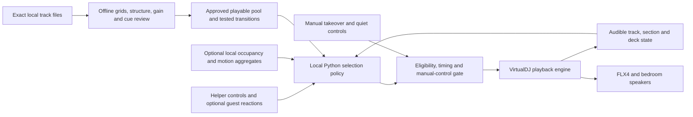

# Adaptive Auto DJ · deferred research

**Superseded later October 19:** the host chose a [premixed bedroom set](premixed-set-plan-2026-10-19.md). There will be no human feedback during the event; a possible phone camera does not justify making playback depend on crowd inference. The proposal below is preserved for future work, not the current implementation queue.

Researched October 19, 2026. **Research complete; proposed prototype, not an installed or tested crowd-responsive DJ.** The host is willing to change software and use local track files, and wants code to choose next tracks and shorten weak moments in response to the floor. This changes the primary software criterion from “reuse installed rekordbox” to “good mixing with a verified control interface.” It supersedes the default-engine recommendation in the [earlier source/routing comparison](auto-dj-research-2026-10-19.md); that document retains the source, hardware and rehearsal background.

## Best fit now

**VirtualDJ Pro is the first choice to pilot for this adaptive system.** A local Python supervisor can use its official Network Control HTTP extension and VDJScript to observe playback and request actions. That is a concrete documented integration path. It still needs a Mac/ARM smoke test and deterministic track-selection proof before we select it as the party engine. Pro is currently $19/month before taxes; nothing was bought. [Vendor HTTP interface](https://virtualdj.com/wiki/NetworkControlPlugin) · [Action reference](https://virtualdj.com/manuals/virtualdj/appendix/vdjscriptverbs.html) · [Current price](https://virtualdj.com/buy/)

| Goal | First candidate | Why / practical limit |
|---|---|---|
| Custom live selection and early exits | **VirtualDJ Pro + local Python controller** | Real command/query interface, native Automix and editable pair transitions; Mac extension, exact queue selection and takeover behavior need proof |
| Strong automatic playback with little custom code | **djay Pro** | Automatic/manual mix ranges, tempo blend, Neural Mix and early Mix Now; no suitable supported external director API established |
| Polished, fully auditioned fixed mixes or fallback chapters | **DJ.Studio** | Harmonic ordering, editable timeline and rendered output; a rendered future cannot react to the floor |
| Open-source control platform | **Mixxx** | Free, source and numeric controller controls available; less sophisticated stock Automix and more adapter/selection work |
| Already installed fixed-queue baseline | **rekordbox** | FLX4 unlock and existing Automix; a suitable live external library/queue API was not established |

This is a feature/integration recommendation, **not a measured sound-quality winner**. Run VirtualDJ and djay on the same difficult crate before choosing on transition quality. DJ.Studio's ordering uses BPM/key; “AI” in these products does not establish that they understand an audience. [djay Mac Automix](https://help.algoriddim.com/user-manual/djay-pro-mac/mixing-basics/using-automix) · [DJ.Studio Harmonize](https://dj.studio/automix) · [Detailed current product evidence](research/auto-dj-products-2026-10-19.md)

The broader survey found research prototypes and new crowd-AI claims, but no examined shipping product established reliable passive crowd enjoyment inference plus a tested Mac/FLX4 workflow. This is a bounded evidence finding, not proof that no such product exists. Do not buy an early-access claim as a substitute for testing the required loop.

## Yes, code can direct the set

Build two layers. The mature DJ engine owns decoding, time stretching, EQ/crossfade and the FLX4 output. Our controller owns selection policy and planned exits. A language model need not run on the beat clock; transparent rules and a scored shortlist are a better first implementation.

The required decisions are richer than “highest energy next”:

- Rank compatible **approved exact files**, considering the current genre chapter, host taste, recent recordings/artists/aliases, hooks/texture, energy direction, key/tempo limits and the next tested join. Guest requests cannot override a host Cut or put an unavailable track on a deck.
- Keep a short look-ahead shortlist, then commit the next track in time to load/prepare it. Late votes or a noisy sensor cannot keep replacing a deck that is about to become audible.
- Let a successful track run through its intended payoff. If sustained evidence says the direction is failing, prefer a compatible change of texture or a planned early exit; do not blindly increase BPM or volume. Keep DnB in intentional chapters with rehearsed entries/exits.
- Use actual-file phrase/section maps to identify likely exits. A documented “mix now” command is not proof of phrase-quantized execution. Prove the engine's scheduling/cues and audible result; Python HTTP polling is not a beat-accurate crossfader.

### The important interface boundary

VirtualDJ documents exact-path deck loading and early transition actions. Its queue-editing verbs often act on the selected browser item; the research did **not** establish an atomic `set_next('/path')` operation. We must prove exact identity and queue position by readback. The HTTP extension is vendor-documented, but has not been enabled or tested on this Mac. [Detailed API/source findings and test matrix](research/adaptive-dj-control-interfaces-2026-10-19.md)

There are two possible runtime modes; choose one authority:

1. **Native Automix owns playback.** Our controller observes a prepared queue and, after proof, changes the next exact item or requests one early transition. Losing the controller should leave the native queue playing. This is the preferred initial architecture if its selection gate passes.
2. **Our supervisor directs the silent deck.** Native Automix is off; load an exact path, confirm identity/readiness, prepare cues and request a native deck transition. This supports arbitrary selection but requires a stronger crash/handover solution. A Python crash is not automatically rescued by an inactive native queue. Never race these two loaders.

Use a header-based bearer secret and verify local-only listener binding. Keep this command endpoint off the public music hostname. Any guest-facing input sends an allowlisted intent/track ID to the director, never raw VDJScript or a filesystem path. This is a narrow requirement arising from the command interface, not a new Cloudflare access change.

## What “responding to the floor” can mean

| Signal | What it gives us | What it cannot establish |
|---|---|---|
| Helper: hold course, more bounce, ease slightly, exit soon | High-context direction with little interaction | Continuous automatic observation when nobody is watching |
| Optional guest reactions/requests | Explicit contextual preferences from participating guests | A representative vote from everyone in the apartment |
| Optional camera: local floor occupancy, relative movement and quality | A trend that can prompt or inform a direction change | Why someone left, whether stillness means dislike, or what a face “feels” |
| Track position/arrangement | Whether a lull is a known build/breakdown and when a safe exit is approaching | The crowd's response by itself |

An actual adaptive system is feasible; reliable crowd inference is the uncertain part. Historical research demonstrates feedback-driven selection and dance/activity sensing, but does not validate automatic song-liking inference for a small dark floor with costumes and guests moving between rooms. [Primary studies, product claims and proposed policy](research/crowd-responsive-dj-2026-10-19.md)

Start with helper/explicit feedback to calibrate the policy. If sensing is chosen, process only coarse occupancy/motion locally, keep a quality flag, and test under the real lighting. Camera activation and guest participation have not been selected or enabled. Face recognition, emotion scoring, biometrics and microphone recording are unnecessary for this design.

Example proposed behavior: a techno track has finished its first main section; reliable activity trends decline for more than one observation window and a helper/explicit reaction supports changing direction. The controller picks a more hook-driven approved track in the same chapter, prepares its reviewed entry, and requests an exit at a suitable outgoing phrase. A scheduled breakdown, a few people fetching drinks, uncertain sensing or missing next-track readiness should result in **hold/no action**, not an automatic accusation that the song failed.

These are proposed decision rules, not observed outcomes or proven thresholds. The [sensor research](research/crowd-responsive-dj-2026-10-19.md) recommends helper confirmation for sensor-driven early exits at this event. Greater autonomous authority is a later option if a pilot supports it; it is not an assumption or a promise that cameras can replace DJ judgment. Automatic next-track selection within a verified eligible pool is easier to prove than arbitrary crowd-triggered cuts.

### Non-negotiable operating behavior

Manual pause/stop/lowering wins and suspends automatic writes until re-armed. No reaction-based volume increases. Unknown/stale signals are not negative votes. Never learn a permanent host dislike from an empty floor. Enforce recent-artist/recording limits and the closing schedule independently of crowd enthusiasm. Losing sensors should remove their influence; losing the director must enter the rehearsed fallback for the chosen playback mode. Do not claim fallback continuity until it is tested.

## Local files materially improve the project

Use exact owned/purchased/artist-downloadable files. They enable file-level beats/downbeats, key and loudness, structural sections, vocal/drum activity and candidate cue regions, all tied to file hashes. ReccoBeats remains useful selection metadata; it cannot reveal where to exit a particular local file.

Bandcamp offers ordinary downloadable formats such as FLAC, WAV, AIFF and MP3 320. Spotify DJ playback is online-only and is not a general audio-folder export for our analyzers. No playlist audio was downloaded or bought in this research pass; a source list/budget is not yet established. [Bandcamp formats](https://get.bandcamp.help/en/articles/15263234-in-which-formats-can-i-download-my-purchases) · [Spotify DJ support](https://support.spotify.com/us/article/dj-integration/)

Start with 10–12 exact files for the software/control test instead of buying every unapproved candidate. Analyze offline with the DJ application, then optionally Essentia and All-In-One structure analysis. Verify actual grids/cues by ear, especially half/double-time DnB and long club arrangements. Keep measured file features separate from Spotify-style proprietary scores; no model measures “sexy” or proves audience enjoyment. [Sources and file-analysis workflow](research/local-track-analysis-2026-10-19.md)

## Concrete next work

1. **Mac interface gate:** trial the chosen VirtualDJ build with FLX4, verify the Pro-only Network Control extension and auth/binding/restart behavior, and query actual deck identity/position. Compare djay on the same files for audible joins. Price/plan choice follows the actual pilot needs; no license is already purchased.
2. **Deterministic control gate:** load exact silent-deck files, request one early transition, prove next-item identity/queue mutation and manual takeover, and test timeouts without blind repeated skips. Choose native-Automix or full-supervisor authority from that result.
3. **Offline/advisory prototype:** rank only the prepared pool; replay synthetic feedback for drinks breaks, breakdowns, a four-person floor losing two people, conflicting votes, stale telemetry, missing files and the repeated hour. Evaluate proposed decisions without a sensor or audible control first.
4. **Supervised automatic pilot:** test next-track selection and helper-requested exits on reviewed boundaries. Add optional crowd trends only if they improve suggestions over the fixed queue. Keep sensor-triggered exits confirmed until the evidence justifies greater authority.
5. **Party gate:** finish approved nine-hour music after real cuts/transitions, and run the real Mac/FLX4/speakers alongside the living-room Google Homes and muted Jellyfin. Freeze the proven engine/settings and retain prepared fallback chapters.

The current deliverable is this research, recommendation and testable architecture. No adaptive service, camera pipeline, app control, new audio source or device rehearsal has been deployed. The playlists and hosted review system were unchanged in this pass.
